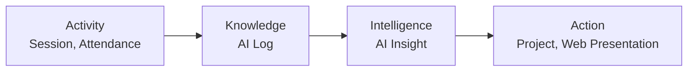
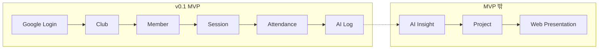
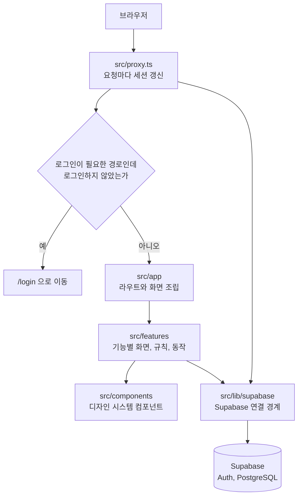
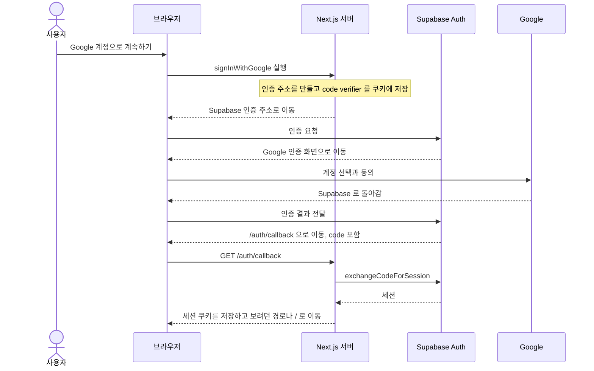
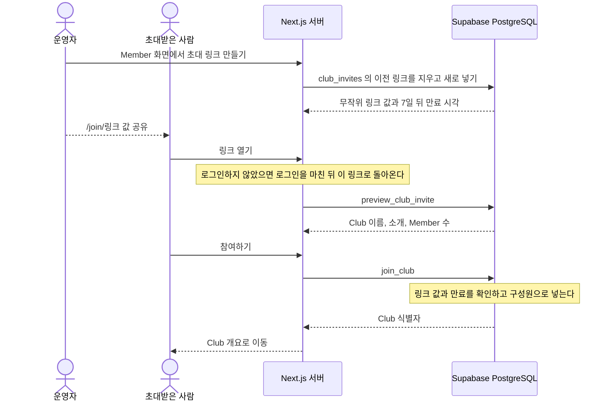

# Architecture

## 목표

AI Club OS는 활동 기록이 지식이 되고, 지식이 이해와 행동으로 이어지는 흐름을 지원합니다.

```text
Activity -> Knowledge -> Intelligence -> Action
```



## 핵심 영역

- Club: 활동이 이루어지는 작업 공간
- Member: Club에 참여하는 구성원과 역할
- Session: 학습과 실험이 일어나는 회차
- Attendance: Session 참여 기록
- AI Log: 구성원이 남긴 인공지능 활용 기록
- AI Insight: AI Log를 바탕으로 만든 이해와 제안
- Project: 여러 활동과 기록이 모이는 결과물
- Web Presentation: 결과를 외부에 보여 주는 발표 화면
- 회고: Project, Session, 한 달을 사람이 직접 돌아보는 글
- 알림: 다른 영역의 기록에서 내가 챙길 것과 새 소식을 읽어 내 모아 보여 주는 화면. 자기 데이터는 마지막으로 확인한 시각뿐이다
- 계정: 내 정보를 보고 계정을 지우는 화면. 자기 테이블이 없고, 지우는 일은 데이터베이스의 함수 하나가 한 묶음으로 한다
- Docs: 앱을 쓰는 법을 안내하는 문서. 모든 Club 에 같고, 데이터베이스가 아닌 저장소의 MDX 파일을 빌드할 때 화면으로 바꾼다

댓글, 도움이 됐어요 표시, 붙인 이미지는 AI Log 에 딸린 것이라 `ai-log` 안에 둡니다. Session 과 Project 를 잇는 것은 `project` 안에 둡니다.

AI Log는 나머지 확장 기능이 지식을 얻는 핵심 Entity입니다.

## MVP 경계

v0.1은 인증과 Club 운영의 기본 흐름만 포함합니다.

```text
Google Login
  -> Club
  -> Member
  -> Session
  -> Attendance
  -> AI Log
```



AI Insight, Project, Web Presentation은 MVP 밖에 둡니다. AI Insight 는 v0.2 로 2026-10-10 에, Project 는 v0.3 으로, Web Presentation 은 v0.4 로 2026-10-11 에 첫 단계를 만들었습니다.

## 목표 디렉터리 구조

실제 코드를 작성할 때 다음 기능 경계를 기준으로 확장합니다.

```text
src/
├── app/
├── components/
├── features/
│   ├── auth/
│   ├── club/
│   ├── member/
│   ├── session/
│   ├── attendance/
│   ├── ai-log/
│   ├── ai-insight/
│   ├── project/
│   ├── presentation/
│   ├── notification/
│   ├── retrospective/
│   ├── account/
│   └── docs/
├── content/
│   └── docs/
├── lib/
│   └── supabase/
├── mdx-components.tsx
└── proxy.ts
```

`content/docs/` 에는 Docs 의 MDX 파일과 순서를 적은 `list.ts` 가 있습니다. 문서마다의 제목, 소개, 날짜, 태그는 그 MDX 맨 앞의 frontmatter 에 있습니다. `features/docs/` 는 목록에서 문서를 찾고, 문서를 불러오고, 본문을 그립니다. 서버의 `features/docs/load.ts` 가 목록의 slug 로 빌드한 모듈을 불러 frontmatter 와 본문을 건넵니다. 목록에 있는 slug 로만 MDX 를 불러오므로 주소로 다른 파일을 열 수 없습니다. `mdx-components.tsx` 는 `@next/mdx` 가 모든 MDX 에 넘기는 부품이고, 지금은 Docs 의 부품을 돌려줍니다. 빌드할 때 목차를 만드는 플러그인 `features/docs/rehype-toc.mjs`, "마크다운으로 복사" 에 쓸 Markdown 을 만드는 플러그인 `features/docs/remark-markdown.mjs`, frontmatter 를 읽고 본문 맨 앞의 `#` 제목을 빼는 플러그인 `features/docs/remark-front-matter.mjs`(값의 규칙은 `front-matter.mjs`)는 `next.config.ts` 가 불러옵니다. Session 은 Docs 의 문서를 slug 로 가리켜 참고 자료로 이어 두고(`session_docs`), 제목과 소개는 `load.ts` 의 `listDocs` 로 frontmatter 에서 찾습니다.

`components/` 는 디자인 시스템 컴포넌트와 여러 기능이 함께 쓰는 부품입니다. 예를 들어 `components/link-controls.tsx` 는 Session 과 Project 를 잇는 화면과 Session 에 참고 자료를 가져오는 화면이 함께 씁니다. `lib/supabase/` 는 Supabase 연결 경계입니다. `lib/supabase/` 에는 서버에서 쓰는 연결과, 브라우저가 파일을 올릴 때만 쓰는 로그인 정보 없는 연결이 있습니다. `lib/theme.ts` 는 화면 모드를 고르고 기억하는 규칙이고, 고르는 메뉴는 `components/theme-menu.tsx` 입니다. 이 메뉴와 내 프로필 메뉴(`features/auth/components/user-menu.tsx`)는 모든 화면의 상단 막대 오른쪽에 둡니다. `proxy.ts` 는 요청마다 세션을 갱신하고 로그인 여부에 따라 경로를 나눕니다.

각 기능은 자신의 화면, 규칙, 데이터 접근 경계를 소유합니다. 여러 기능이 함께 쓰는 요소는 실제 중복이 확인된 뒤에만 공용 영역으로 이동합니다.

## 요청 처리 흐름

모든 요청은 `proxy.ts` 를 먼저 거칩니다. `/login` 과 `/auth/`, 그리고 발표를 여는 `/p/` 는 로그인 없이 통과하고, 나머지 경로는 로그인하지 않았으면 로그인 화면으로 이동합니다. 이때 보려던 경로를 `next` 값으로 넘겨서 로그인한 뒤 그곳으로 돌아옵니다. 지금 구현된 기능은 `auth`, `club`, `member`, `session`, `attendance`, `ai-log`, `ai-insight`, `project`, `presentation`, `notification`, `retrospective` 입니다.

`notification` 은 다른 기능의 기록을 읽기만 합니다. 참여 요청, 할 일, 참여, 공개된 AI Insight 를 직접 조회해 알림으로 다듬고, 그 기능들이 알림을 알 필요는 없습니다. Club 안쪽 화면의 틀(`src/app/clubs/[clubId]/layout.tsx`)이 메뉴에 보일 알림 수를 읽어 넘깁니다.

`retrospective` 는 자기 테이블 하나를 갖고, Project 화면과 Session 의 탭, 개요의 내 기록에 자기 영역을 올립니다. 그 화면들은 회고를 모르고 자리만 내줍니다. 한 달 회고에서 보여 주는 내 AI Log 와 출석은 `ai_logs` 와 `attendance` 를 읽기만 합니다.



`proxy.ts` 는 화면 이동만 막습니다. Server Action 과 데이터 접근은 각자 사용자를 다시 확인합니다.

## 로그인 흐름

Google Login 은 PKCE 흐름을 씁니다. 결정 배경은 `docs/adr/0002-auth-session-with-supabase-ssr.md` 에 있습니다.



인증에 실패하거나 code 가 없으면 `/login?error=auth_failed` 로 이동해 오류를 알립니다.

로그인 전에 보려던 경로는 Google 인증을 다녀오는 동안 10분짜리 쿠키에 담아 둡니다. 이 앱 안의 경로만 허용하고, 다른 사이트로 보내려는 값은 `src/features/auth/return-path.ts` 가 버립니다.

## 초대 흐름

운영자가 만든 초대 링크로 Club 에 참여합니다. 결정 배경은 `docs/adr/0007-club-invite-link.md` 에 있습니다.



링크가 틀렸거나 만료됐으면 참여 화면이 그 사실을 알리고 새 링크를 받으라고 안내합니다. 이미 Member 인 사람이 링크를 열면 바로 Club 으로 들어갑니다.

## 이미지를 올리고 지우는 흐름

파일은 Storage 에, 무엇이 어디에 붙었는지는 데이터베이스에 있습니다. 둘이 어긋나지 않게 순서를 정해 둡니다.

```text
올릴 때
  서버: 목록(ai_log_attachments)에 줄을 적는다. 작성자인지와 장수는 데이터베이스가 확인한다
  서버: 그 자리에만 쓰는 한 번짜리 표를 Storage 에서 받는다
  브라우저: 표로 Storage 에 바로 올린다. 실패하면 서버가 줄을 거둔다

지울 때 (이미지 한 장, AI Log, Club, 계정 모두)
  서버: Storage 에서 파일을 먼저 지운다
  서버: 줄을 지운다. 파일이 남아 있으면 데이터베이스가 막고 전체가 되돌려진다
```

AI Log 의 이미지를 다루는 Storage 코드는 `src/features/ai-log/image-store.ts` 한 곳에 있습니다. Club 과 계정을 지우는 쪽도 이 파일의 함수를 씁니다.

## Club 목록과 로고

처음 화면은 내가 속한 Club 과 다른 Club 을 함께 보여 줍니다. Member 가 아닌 Club 은 `list_clubs` 함수가 돌려주는 이름, 소개, 로고, Member 수만 보이고, 카드를 누르면 들어갈 권한이 없다는 안내 창이 열립니다. `clubs` 와 `members` 의 접근 규칙은 그대로라 Club 안은 여전히 Member 만 봅니다. 결정 배경은 `docs/adr/0032-club-directory-and-logos.md` 에 있습니다.

```text
올릴 때
  브라우저: 가운데를 정사각형으로 잘라 256px 로 줄인다
  서버: 운영자인지 확인하고 새 이름으로 club-logos 에 올린다
  서버: clubs.logo_path 가 새 파일을 가리키게 한다. 실패하면 올린 파일을 지운다
  서버: 앞의 로고 파일을 지운다

보여 줄 때
  화면: /clubs/<Club>/logo/<파일 이름> 을 불러온다
  서버: 로그인을 확인하고 Storage 에서 읽어 보낸다. 파일 이름이 바뀌지 않으므로 브라우저가 기억한다

지울 때 (Club, 계정)
  서버: AI Log 의 이미지 다음에 그 Club 의 자리에 있는 로고 파일을 모두 지운다
  서버: Club 을 지운다. 로고 파일이 남아 있으면 데이터베이스가 막는다
```

로고 주소는 이미지 확장자로 끝나서 `proxy.ts` 를 거치지 않습니다. 그래서 라우트가 로그인을 직접 확인합니다. Club 로고를 다루는 Storage 코드는 `src/features/club/logo-store.ts` 한 곳에 있습니다.

## 데이터 흐름 원칙

1. 사용자가 Club과 Session 안에서 활동합니다.
2. Attendance와 AI Log가 활동을 기록합니다.
3. AI Insight가 기록을 이해 가능한 정보로 바꿉니다. 운영자가 만들고 확인한 뒤 공개합니다.
4. Project와 Web Presentation이 기록과 이해를 결과물과 공유 행동으로 연결합니다. Project 는 작성자가 자기 AI Log 를 묶고, 참여자가 할 일과 결과물 링크를 관리합니다. Web Presentation 은 공개한 Project 와 Club 의 활동을 링크로 Club 밖에 보여 줍니다.

## 외부 경계

- 인증과 기본 데이터는 Supabase를 사용합니다.
- 데이터베이스 구조와 접근 규칙은 `supabase/migrations/` 의 SQL 파일로 관리합니다.
- 파일이 필요한 기능만 Supabase Storage를 사용합니다. 지금은 AI Log 의 이미지와 Club 로고이고, 둘 다 공개하지 않는 저장 공간에 둡니다. AI Log 의 이미지는 잠깐 쓰는 주소로, Club 로고는 로그인을 확인하는 앱의 주소로 보여 줍니다.
- AI Provider는 교체 가능한 연결부 뒤에 둡니다. 연결부는 `src/features/ai-insight/provider/` 이고 Gemini 와 Claude 가운데 서버의 환경 변수로 고른 쪽을 부릅니다. 2026-10-20 부터 Gemini 의 무료 등급을 씁니다. 서버에서만 부르며 키는 브라우저로 나가지 않습니다.
- 배포는 Vercel을 기본으로 합니다.

## 오류와 권한 원칙

- 모든 Club 데이터는 소속과 역할을 기준으로 접근을 제한합니다. Club 목록의 이름, 소개, 로고, Member 수만은 로그인한 사용자 모두가 `list_clubs` 로 봅니다.
- 인증되지 않은 요청과 권한이 없는 요청을 구분합니다.
- 로그인하지 않은 요청에는 테이블을 열지 않습니다. 발표만 `get_presentation` 함수 하나로 읽고, 이 함수가 내보내는 것이 밖으로 나가는 전부입니다. 로그인 없이 열리는 화면은 로그인, 발표, 개인 정보 안내뿐이고, 개인 정보 안내는 데이터를 읽지 않습니다.
- 올린 사람이 없어진 파일을 남기지 않습니다. 파일이 남아 있는 목록의 줄과, 로고 파일이 남아 있는 Club 은 데이터베이스가 지우지 못하게 막습니다.
- 외부 서비스 오류가 사용자의 원본 기록을 손상시키지 않게 합니다.
- AI 기능 실패와 기본 기록 기능 실패를 분리합니다.

## 검증 방향

- 도메인 규칙은 작은 단위 테스트로 검증합니다.
- 인증과 권한 경계는 통합 테스트로 검증합니다.
- 가입부터 AI Log 작성까지의 핵심 흐름은 사용자 흐름 테스트로 검증합니다.
- 구체적인 도구는 첫 구현 마일스톤에서 확정합니다.

