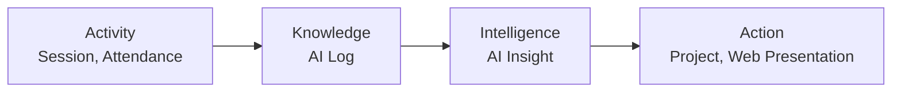
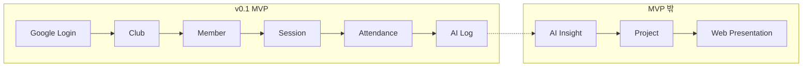
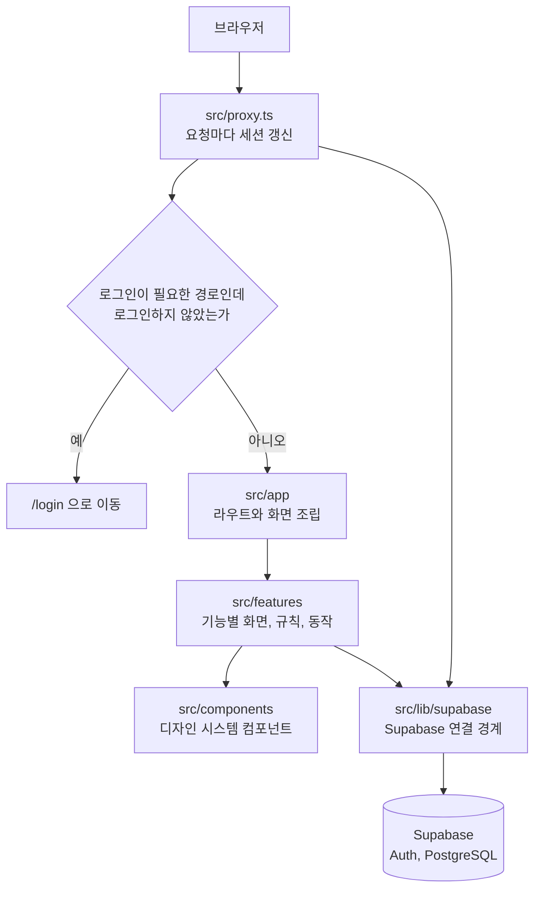
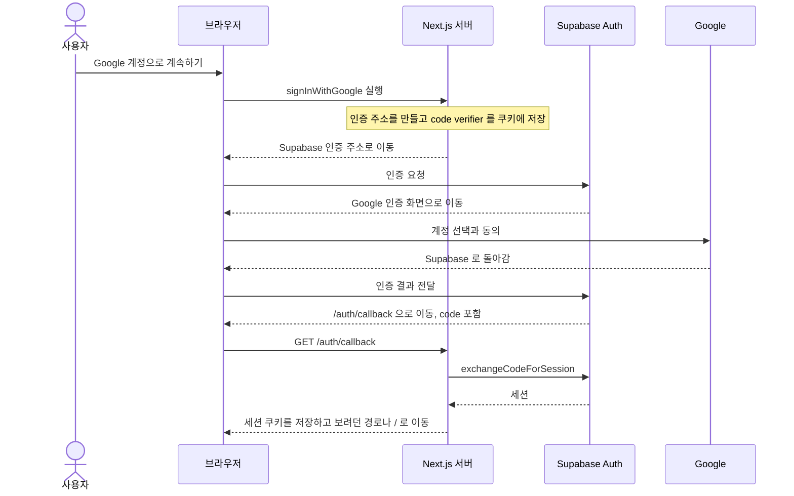
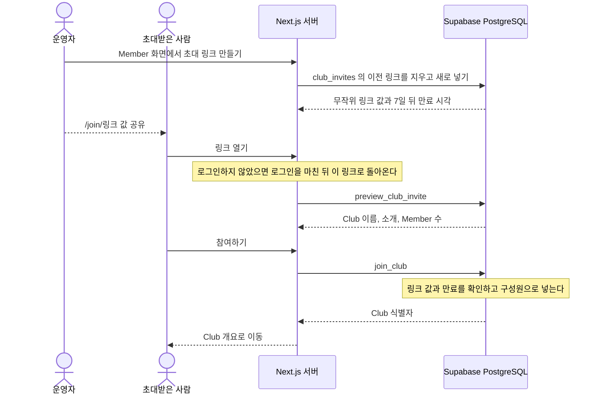

# Architecture

## 목표

AI Club OS는 활동 기록이 지식이 되고, 지식이 이해와 행동으로 이어지는 흐름을 지원합니다.

```text
Activity -> Knowledge -> Intelligence -> Action
```



## 핵심 영역

- Club: 활동이 이루어지는 작업 공간
- Member: Club에 참여하는 구성원과 역할
- Session: 학습과 실험이 일어나는 회차
- Attendance: Session 참여 기록
- AI Log: 구성원이 남긴 인공지능 활용 기록
- AI Insight: AI Log를 바탕으로 만든 이해와 제안
- Project: 여러 활동과 기록이 모이는 결과물
- Web Presentation: 결과를 외부에 보여 주는 발표 화면

AI Log는 나머지 확장 기능이 지식을 얻는 핵심 Entity입니다.

## MVP 경계

v0.1은 인증과 Club 운영의 기본 흐름만 포함합니다.

```text
Google Login
  -> Club
  -> Member
  -> Session
  -> Attendance
  -> AI Log
```



AI Insight, Project, Web Presentation은 MVP 밖에 둡니다. AI Insight 는 v0.2 로 2026-10-10 에 첫 단계를 만들었습니다.

## 목표 디렉터리 구조

실제 코드를 작성할 때 다음 기능 경계를 기준으로 확장합니다.

```text
src/
├── app/
├── components/
├── features/
│   ├── auth/
│   ├── club/
│   ├── member/
│   ├── session/
│   ├── attendance/
│   ├── ai-log/
│   └── ai-insight/
├── lib/
│   └── supabase/
└── proxy.ts
```

`components/` 는 디자인 시스템 컴포넌트, `lib/supabase/` 는 Supabase 연결 경계입니다. `proxy.ts` 는 요청마다 세션을 갱신하고 로그인 여부에 따라 경로를 나눕니다.

각 기능은 자신의 화면, 규칙, 데이터 접근 경계를 소유합니다. 여러 기능이 함께 쓰는 요소는 실제 중복이 확인된 뒤에만 공용 영역으로 이동합니다.

## 요청 처리 흐름

모든 요청은 `proxy.ts` 를 먼저 거칩니다. `/login` 과 `/auth/` 는 로그인 없이 통과하고, 나머지 경로는 로그인하지 않았으면 로그인 화면으로 이동합니다. 이때 보려던 경로를 `next` 값으로 넘겨서 로그인한 뒤 그곳으로 돌아옵니다. 지금 구현된 기능은 `auth`, `club`, `member`, `session`, `attendance`, `ai-log`, `ai-insight` 입니다.



`proxy.ts` 는 화면 이동만 막습니다. Server Action 과 데이터 접근은 각자 사용자를 다시 확인합니다.

## 로그인 흐름

Google Login 은 PKCE 흐름을 씁니다. 결정 배경은 `docs/adr/0002-auth-session-with-supabase-ssr.md` 에 있습니다.



인증에 실패하거나 code 가 없으면 `/login?error=auth_failed` 로 이동해 오류를 알립니다.

로그인 전에 보려던 경로는 Google 인증을 다녀오는 동안 10분짜리 쿠키에 담아 둡니다. 이 앱 안의 경로만 허용하고, 다른 사이트로 보내려는 값은 `src/features/auth/return-path.ts` 가 버립니다.

## 초대 흐름

운영자가 만든 초대 링크로 Club 에 참여합니다. 결정 배경은 `docs/adr/0007-club-invite-link.md` 에 있습니다.



링크가 틀렸거나 만료됐으면 참여 화면이 그 사실을 알리고 새 링크를 받으라고 안내합니다. 이미 Member 인 사람이 링크를 열면 바로 Club 으로 들어갑니다.

## 데이터 흐름 원칙

1. 사용자가 Club과 Session 안에서 활동합니다.
2. Attendance와 AI Log가 활동을 기록합니다.
3. AI Insight가 기록을 이해 가능한 정보로 바꿉니다. 운영자가 만들고 확인한 뒤 공개합니다.
4. Project와 Web Presentation이 기록과 이해를 결과물과 공유 행동으로 연결합니다.

## 외부 경계

- 인증과 기본 데이터는 Supabase를 사용합니다.
- 데이터베이스 구조와 접근 규칙은 `supabase/migrations/` 의 SQL 파일로 관리합니다.
- 파일이 필요한 기능만 Supabase Storage를 사용합니다.
- AI Provider는 교체 가능한 연결부 뒤에 둡니다. 연결부는 `src/features/ai-insight/provider/` 이고 지금은 Claude 를 부릅니다. 서버에서만 부르며 키는 브라우저로 나가지 않습니다.
- 배포는 Vercel을 기본으로 합니다.

## 오류와 권한 원칙

- 모든 Club 데이터는 소속과 역할을 기준으로 접근을 제한합니다.
- 인증되지 않은 요청과 권한이 없는 요청을 구분합니다.
- 외부 서비스 오류가 사용자의 원본 기록을 손상시키지 않게 합니다.
- AI 기능 실패와 기본 기록 기능 실패를 분리합니다.

## 검증 방향

- 도메인 규칙은 작은 단위 테스트로 검증합니다.
- 인증과 권한 경계는 통합 테스트로 검증합니다.
- 가입부터 AI Log 작성까지의 핵심 흐름은 사용자 흐름 테스트로 검증합니다.
- 구체적인 도구는 첫 구현 마일스톤에서 확정합니다.

