# Database

## 목적

이 문서는 AI Club OS의 데이터 경계와 관계를 관리합니다. 스키마 변경은 `supabase/migrations/` 의 SQL 파일로 관리합니다.

## 핵심 Entity

- Club
- Member
- Session
- Attendance
- AI Log
- Project
- AI Insight
- Web Presentation

## MVP 관계 초안

```text
User
  -> Member
  -> Club
       -> Session
            -> Attendance
            -> AI Log
```

## 데이터 원칙

- 모든 Club 소속 데이터는 Club 식별자를 통해 경계를 확인할 수 있어야 한다.
- Member는 사용자와 Club 사이의 소속과 역할을 나타낸다.
- Attendance는 Member와 Session의 관계를 기록한다.
- AI Log는 작성자와 Club에 속하며 필요할 때 Session, Project 와 연결한다.
- Project 는 Club 에 속하고 참여자, 할 일, 결과물 링크, AI Log 를 묶는다. AI Log 하나는 Project 하나에만 속한다.
- 사용자가 작성한 원본 AI Log와 이후 생성된 AI Insight를 구분한다.
- 지운 것은 바로 없어지고 되살리지 않는다. 숨겨 두는 열이나 보관 기간은 두지 않는다. 2026-10-10 결정.
- 누가 무엇을 지웠는지는 종류와 제목만 따로 남긴다. 지운 내용은 남기지 않는다. 2026-10-11 결정.
- Club 밖으로 나가는 것은 공개한 발표뿐이다. 2026-10-11 결정. Project 발표에는 그 Project 에 묶인 AI Log 가 작성자의 허락 없이 모두 들어간다. 2026-10-22 결정.

## 구현된 구조

지금 있는 테이블은 `clubs`, `members`, `sessions`, `attendance`, `ai_logs`, `club_invites`, `ai_insights`, `projects`, `project_members`, `project_links`, `project_tasks`, `club_bans`, `deletion_logs`, `ai_insight_runs`, `project_join_requests`, `presentations`, `notification_reads`, `ai_log_revisions`, `retrospectives`, `ai_log_comments`, `ai_log_reactions`, `session_projects`, `ai_log_attachments`, `session_docs` 입니다. 정의는 `supabase/migrations/` 의 SQL 파일에 있습니다. 파일은 Storage 의 `ai-log-images` 와 `club-logos` 에 둡니다.

| 테이블 | 마이그레이션 | 결정 배경 |
|---|---|---|
| `clubs`, `members` | `20261009165228_create_clubs_and_members.sql` | `docs/adr/0003-club-membership-and-rls.md` |
| `sessions` | `20261009172039_create_sessions.sql` | `docs/adr/0004-session-time-in-korea-standard-time.md` |
| `attendance`, `members` 의 이름과 이메일 열 | `20261009175244_create_attendance.sql` | `docs/adr/0005-attendance-and-member-display-name.md` |
| `ai_logs` | `20261009181137_create_ai_logs.sql` | `docs/adr/0006-ai-log-structure-and-authorship.md` |
| `club_invites`, 참여 함수 | `20261010064838_create_club_invites.sql` | `docs/adr/0007-club-invite-link.md` |
| `members` 의 사진 주소 열, 사진 맞추기 함수 | `20261010070509_add_member_avatar.sql` | `docs/adr/0008-member-avatar-from-google.md` |
| 역할 바꾸기, 내보내기와 나가기, Club 정보 수정 규칙 | `20261010071641_manage_members_and_club.sql` | `docs/adr/0009-member-management-and-last-admin.md` |
| AI Log 검색과 도구 목록 함수 | `20261010075452_add_ai_log_search.sql` | `docs/adr/0011-ai-log-search-functions.md` |
| 검색과 도구 이름을 느슨하게 맞추도록 두 함수 교체 | `20261010080736_loosen_ai_log_search.sql` | `docs/adr/0012-loose-matching-for-search-and-tools.md` |
| 검색이 한 도구의 여러 표기를 함께 찾도록 함수 교체 | `20261010082852_search_tool_spellings.sql` | `docs/adr/0013-known-tool-catalog.md` |
| AI Log, Session, Club 을 지우는 규칙 | `20261010091458_add_delete_rules.sql` | `docs/adr/0015-delete-rules.md` |
| `ai_insights` | `20261010141008_create_ai_insights.sql` | `docs/adr/0017-ai-insight-draft-and-publish.md` |
| `projects`, `project_members`, `project_links`, `project_tasks` | `20261010145830_create_projects.sql` | `docs/adr/0019-project-structure-and-participants.md` |
| `ai_logs` 의 Project 열과 참여자 확인 | `20261010153246_link_ai_logs_to_projects.sql` | `docs/adr/0019-project-structure-and-participants.md` |
| `club_bans`, `deletion_logs`, `ai_insight_runs` | `20261010160037_create_operation_records.sql` | `docs/adr/0020-operation-rules.md` |
| 막힌 사람을 받지 않도록 참여 함수 교체 | `20261010160040_block_banned_users_from_joining.sql` | `docs/adr/0020-operation-rules.md` |
| `ai_logs` 의 선택 열 두 개와 지운 기록 trigger. 선택 열은 2026-10-22 에 지웠다 | `20261010160042_add_ai_log_options.sql` | `docs/adr/0020-operation-rules.md` |
| `sessions`, `ai_insights`, `projects` 의 지운 기록 trigger | `20261010160044_log_session_deletions.sql` 부터 세 파일 | `docs/adr/0020-operation-rules.md` |
| `project_join_requests` | `20261010161229_create_project_join_requests.sql` | `docs/adr/0021-project-requests-and-task-details.md` |
| `project_tasks` 의 담당자와 기한 열 | `20261010161232_add_project_task_details.sql` | `docs/adr/0021-project-requests-and-task-details.md` |
| `presentations`, 링크로 발표를 읽는 함수 | `20261010161921_create_presentations.sql` | `docs/adr/0022-web-presentation-by-link.md` |
| `notification_reads`, `ai_log_revisions`, 이름 고치기와 도구 표기 합치기 함수 | `20261010173236_create_notification_reads_and_revisions.sql` | `docs/adr/0023-notifications-names-and-revisions.md` |
| `ai_logs` 의 수정 기록 trigger | `20261010173239_keep_ai_log_revisions.sql` | `docs/adr/0023-notifications-names-and-revisions.md` |
| `project_tasks` 의 맡은 시각 열 | `20261010173242_add_project_task_assigned_at.sql` | `docs/adr/0023-notifications-names-and-revisions.md` |
| `sessions` 의 시간표 열 | `20261010173244_add_session_agenda.sql` | `docs/adr/0023-notifications-names-and-revisions.md` |
| `presentations` 의 소개 글 열, 발표를 읽는 함수 교체 | `20261010173246_add_presentation_intro.sql` | `docs/adr/0022-web-presentation-by-link.md` |
| `retrospectives` | `20261011073600_create_retrospectives.sql` | `docs/adr/0024-retrospectives.md` |
| `deletion_logs` 의 보관 기간과 회고 종류 | `20261011073604_log_and_expire_deletions.sql` | `docs/adr/0025-retention-and-ownerless-rules.md` |
| `ai_log_revisions` 의 보관 기간 | `20261011073607_expire_ai_log_revisions.sql` | `docs/adr/0025-retention-and-ownerless-rules.md` |
| `members` 의 역할이 바뀐 시각 열, 운영자 이어받기 | `20261011073611_promote_member_when_admin_is_gone.sql` | `docs/adr/0025-retention-and-ownerless-rules.md` |
| `ai_log_comments`, `ai_log_reactions` | `20261011145437_create_ai_log_comments_and_reactions.sql` | `docs/adr/0026-comments-and-helpful-marks.md` |
| 지운 댓글을 지운 기록에 남기기, 계정을 지울 때는 남기지 않기 | `20261011145440_log_comment_deletions.sql` | `docs/adr/0026-comments-and-helpful-marks.md`, `docs/adr/0027-account-deletion-and-privacy.md` |
| `retrospectives` 의 두 가지 쓰임 열, 발표에 회고 싣기 | `20261011145444_add_retrospective_options.sql` | `docs/adr/0024-retrospectives.md` |
| `session_projects` | `20261011145448_create_session_projects.sql` | `docs/adr/0026-comments-and-helpful-marks.md` |
| `ai_log_attachments`, 장수 제한, 파일이 남은 줄을 지키는 규칙 | `20261011145452_create_ai_log_attachments.sql` | `docs/adr/0028-ai-log-images-in-storage.md` |
| Storage 의 `ai-log-images` 와 접근 규칙 | `20261011145455_create_ai_log_images_bucket.sql` | `docs/adr/0028-ai-log-images-in-storage.md` |
| 계정을 지우는 함수, Member 가 없는 Club 지우기 | `20261011145459_add_account_deletion.sql` | `docs/adr/0027-account-deletion-and-privacy.md` |
| `clubs` 의 로고 열, 로고 파일이 남은 Club 을 지키는 규칙 | `20261021052123_add_club_logo.sql` | `docs/adr/0032-club-directory-and-logos.md` |
| Storage 의 `club-logos` 와 접근 규칙 | `20261021052125_create_club_logos_bucket.sql` | `docs/adr/0032-club-directory-and-logos.md` |
| 로그인한 사용자 모두가 보는 Club 목록 함수 | `20261021052127_add_list_clubs.sql` | `docs/adr/0032-club-directory-and-logos.md` |
| `session_docs` | `20261021055751_create_session_docs.sql` | `docs/adr/0033-session-reference-docs.md` |
| 발표에 Project 의 AI Log 를 모두 싣도록 함수 교체 | `20261022030222_use_all_ai_logs_in_presentation.sql` | `docs/adr/0036-ai-logs-always-in-insight-and-presentation.md` |
| `ai_logs` 의 선택 열 두 개 지우기 | `20261022030225_drop_ai_log_options.sql` | `docs/adr/0036-ai-logs-always-in-insight-and-presentation.md` |
| `sessions` 의 시각을 비울 수 있게 하기(날짜 미정) | `20261022030702_session_date_undecided.sql` | `docs/adr/0037-session-date-undecided-and-time-picker.md` |

```mermaid
erDiagram
  auth_users ||--o{ members : "소속"
  clubs ||--o{ members : "구성"
  auth_users ||--o{ clubs : "생성"
  clubs ||--o{ sessions : "회차"
  auth_users ||--o{ sessions : "생성"
  sessions ||--o{ attendance : "기록"
  members ||--o{ attendance : "참여"
  auth_users ||--o{ attendance : "기록자"
  clubs ||--o{ ai_logs : "기록"
  sessions |o--o{ ai_logs : "회차"
  members |o--o{ ai_logs : "작성"
  clubs ||--o| club_invites : "초대"
  auth_users ||--o{ club_invites : "생성"
  clubs ||--o{ ai_insights : "정리"
  sessions |o--o| ai_insights : "회차"
  auth_users ||--o{ ai_insights : "생성"
  clubs ||--o{ projects : "결과물"
  auth_users ||--o{ projects : "생성"
  projects ||--o{ project_members : "참여"
  members ||--o{ project_members : "참여"
  projects ||--o{ project_links : "링크"
  projects ||--o{ project_tasks : "할 일"
  projects |o--o{ ai_logs : "묶음"
  clubs ||--o{ club_bans : "막음"
  auth_users ||--o{ club_bans : "막힌 사람"
  clubs ||--o{ deletion_logs : "지운 기록"
  clubs ||--o{ ai_insight_runs : "횟수"
  projects ||--o{ project_join_requests : "요청"
  members ||--o{ project_join_requests : "요청"
  members |o--o{ project_tasks : "담당"
  clubs ||--o{ presentations : "발표"
  projects |o--o| presentations : "발표"
  clubs ||--o{ notification_reads : "알림 확인"
  auth_users ||--o{ notification_reads : "본 사람"
  ai_logs ||--o{ ai_log_revisions : "수정 기록"
  clubs ||--o{ retrospectives : "회고"
  members |o--o{ retrospectives : "작성"
  sessions |o--o{ retrospectives : "돌아봄"
  projects |o--o{ retrospectives : "돌아봄"

  clubs {
    uuid id PK
    text name
    text description
    text logo_path
    uuid created_by FK
    timestamptz created_at
  }

  members {
    uuid id PK
    uuid club_id FK
    uuid user_id FK
    text role
    text display_name
    text email
    text avatar_url
    timestamptz role_changed_at
    timestamptz created_at
  }

  sessions {
    uuid id PK
    uuid club_id FK
    text title
    text description
    text location
    timestamptz starts_at
    timestamptz ends_at
    text agenda
    uuid created_by FK
    timestamptz created_at
    timestamptz updated_at
  }

  attendance {
    uuid id PK
    uuid club_id FK
    uuid session_id FK
    uuid member_id FK
    text status
    uuid recorded_by FK
    timestamptz created_at
    timestamptz updated_at
  }

  ai_logs {
    uuid id PK
    uuid club_id FK
    uuid session_id FK
    uuid project_id FK
    uuid author_id FK
    text title
    text[] tools
    text attempt
    text result
    text learned
    text next_action
    timestamptz created_at
    timestamptz updated_at
  }

  club_invites {
    uuid club_id PK
    text token UK
    uuid created_by FK
    timestamptz created_at
    timestamptz expires_at
  }

  ai_insights {
    uuid id PK
    uuid club_id FK
    text scope
    uuid session_id FK
    timestamptz period_start
    timestamptz period_end
    text status
    jsonb content
    uuid[] source_log_ids
    text provider
    text model
    uuid created_by FK
    timestamptz created_at
    timestamptz updated_at
    timestamptz published_at
  }

  projects {
    uuid id PK
    uuid club_id FK
    text name
    text goal
    text status
    uuid created_by FK
    timestamptz created_at
    timestamptz updated_at
  }

  project_members {
    uuid project_id PK
    uuid member_id PK
    uuid club_id FK
    timestamptz created_at
  }

  project_links {
    uuid id PK
    uuid project_id FK
    uuid club_id FK
    text label
    text url
    uuid created_by FK
    timestamptz created_at
  }

  project_tasks {
    uuid id PK
    uuid project_id FK
    uuid club_id FK
    text title
    boolean done
    timestamptz done_at
    uuid assignee_member_id FK
    timestamptz assigned_at
    date due_on
    uuid created_by FK
    timestamptz created_at
  }

  club_bans {
    uuid club_id PK
    uuid user_id PK
    text display_name
    uuid banned_by FK
    timestamptz created_at
  }

  deletion_logs {
    uuid id PK
    uuid club_id FK
    text entity
    text title
    text owner_name
    uuid deleted_by FK
    text deleted_by_name
    timestamptz created_at
  }

  ai_insight_runs {
    uuid id PK
    uuid club_id FK
    uuid created_by FK
    timestamptz created_at
  }

  project_join_requests {
    uuid project_id PK
    uuid member_id PK
    uuid club_id FK
    timestamptz created_at
  }

  presentations {
    uuid id PK
    uuid club_id FK
    text scope
    uuid project_id FK
    text token UK
    boolean show_names
    text intro
    uuid created_by FK
    timestamptz created_at
    timestamptz updated_at
  }

  notification_reads {
    uuid club_id PK
    uuid user_id PK
    timestamptz seen_at
  }

  ai_log_revisions {
    uuid id PK
    uuid club_id FK
    uuid log_id FK
    text title
    text_array tools
    text attempt
    text result
    text learned
    text next_action
    timestamptz replaced_at
    uuid replaced_by FK
  }

  retrospectives {
    uuid id PK
    uuid club_id FK
    text scope
    uuid session_id FK
    uuid project_id FK
    date period_start
    uuid author_id FK
    text went_well
    text to_improve
    text to_try
    timestamptz created_at
    timestamptz updated_at
  }
```



`auth_users` 는 Supabase Auth 가 관리하는 `auth.users` 입니다.

### clubs

| 열 | 형식 | 설명 |
|---|---|---|
| `id` | uuid | 기본 키 |
| `name` | text | 앞뒤 공백을 뺀 길이가 1자 이상 50자 이하 |
| `description` | text | 200자 이하. 기본값은 빈 문자열 |
| `logo_path` | text | 로고 파일의 Storage 경로. Club 과 파일 이름의 두 마디이고, 첫 마디는 이 Club 이어야 한다. 파일 이름은 앱이 만든 식별자와 `png`, `jpg`, `webp` 가운데 하나의 확장자다. 로고가 없으면 null |
| `created_by` | uuid | 만든 사용자. 사용자가 삭제되면 비운다 |
| `created_at` | timestamptz | 만든 시각 |

로고 파일이 Storage 에 남아 있는 Club 은 지울 수 없습니다. `clubs_keep_until_logo_is_gone` trigger 가 그 Club 의 자리에 남은 파일을 모두 보고, 하나라도 있으면 오류(`23503`)를 냅니다. `logo_path` 를 비워도 파일이 남아 있으면 같습니다. 계정이 지워지면서 Club 이 함께 지워질 때도 같아서, 앱은 Club 을 지우기 전에 그 Club 의 로고 파일을 먼저 지웁니다.

### 모든 Club 을 읽는 함수

`public.list_clubs()` 가 등록된 Club 을 모두 돌려줍니다. 로그인한 사용자만 부를 수 있습니다. Member 가 아닌 사람도 `clubs` 와 `members` 를 읽어야 해서 만든 사람의 권한으로 실행합니다.

- 돌려주는 열은 `id`, `name`, `description`, `logo_path`, `member_count`, `my_role`, `created_at` 입니다. `my_role` 은 내 역할이고 Member 가 아니면 null 입니다.
- Member 의 이름, 이메일, Club 안의 기록은 돌려주지 않습니다.
- `clubs` 와 `members` 의 접근 규칙은 바꾸지 않았습니다. Member 가 아닌 사람이 두 테이블을 직접 읽으면 여전히 아무것도 보이지 않습니다.

### members

| 열 | 형식 | 설명 |
|---|---|---|
| `id` | uuid | 기본 키 |
| `club_id` | uuid | 소속 Club. Club 이 삭제되면 함께 삭제된다 |
| `user_id` | uuid | 사용자. 사용자가 삭제되면 함께 삭제된다 |
| `role` | text | `admin` 은 운영자, `member` 는 구성원 |
| `display_name` | text | Club 안에서 보이는 이름. 참여할 때 Google 계정의 이름을 옮겨 적는다. 이름이 없으면 이메일을 쓴다 |
| `email` | text | 참여할 때의 이메일. 같은 Club 의 Member 에게만 보인다 |
| `avatar_url` | text | Google 계정의 프로필 사진 주소. Google 의 사진 주소만 들어갈 수 있고, 없으면 비어 있다. 로그인할 때 지금 값으로 맞춘다 |
| `role_changed_at` | timestamptz | 역할이 마지막으로 바뀐 시각. 데이터베이스가 정한다. Club 을 만들거나 참여하면서 정해진 역할에는 비어 있다. 알림에서 새로 운영자가 된 것을 알리는 데 쓴다 |
| `created_at` | timestamptz | 소속된 시각 |

한 사용자는 한 Club 에 한 번만 소속됩니다. 이름과 이메일은 참여한 시점의 값이며 Google 계정에서 바꿔도 따라 바뀌지 않습니다. 이름은 본인이 `public.set_my_display_name(target_club_id, new_name)` 으로 고칩니다. 이 함수는 부른 사용자의 그 Club 행에서 이름만 바꾸고, 이어진 공백을 하나로 줄인 뒤 1자 이상 40자 이하이고 `@` 가 없는 이름만 받습니다. 아니면 오류(`22023`)를 냅니다. 운영자도 남의 이름은 고치지 못합니다. 사진 주소만 로그인할 때 `public.sync_my_avatar()` 가 지금 값으로 맞춥니다. 이 함수는 부른 사용자의 행에서 사진 주소만 바꾸고, 로그인한 사용자만 부를 수 있습니다.

### sessions

| 열 | 형식 | 설명 |
|---|---|---|
| `id` | uuid | 기본 키 |
| `club_id` | uuid | 소속 Club. Club 이 삭제되면 함께 삭제된다. 만든 뒤에는 바꿀 수 없다 |
| `title` | text | 앞뒤 공백을 뺀 길이가 1자 이상 80자 이하 |
| `description` | text | 목표와 소개. 2000자 이하 |
| `location` | text | 장소. 80자 이하 |
| `starts_at` | timestamptz | 시작 시각. 날짜를 정하지 않은 회차는 비어 있다 |
| `ends_at` | timestamptz | 종료 시각. 시작 시각보다 뒤여야 한다. 시작 시각과 함께 비어 있거나 함께 있다 |
| `agenda` | text | 시간표. 한 줄에 하나씩 적은 글이고 2000자 이하. 기본값은 빈 문자열 |
| `created_by` | uuid | 만든 사용자. 사용자가 삭제되면 비운다 |
| `created_at` | timestamptz | 만든 시각 |
| `updated_at` | timestamptz | 마지막으로 고친 시각. 고칠 때 자동으로 바뀐다 |

시간표는 줄마다 따로 저장하지 않고 글 하나로 둡니다. 줄 앞의 시각(`19:00`)을 가려 보여 주는 일은 앱의 `src/features/session/agenda.ts` 가 합니다.

날짜를 정하지 않은 회차는 `starts_at` 과 `ends_at` 을 함께 비웁니다. 한쪽만 비운 행은 `sessions_time_both_or_neither` 가 막습니다(`23514`). 비어 있는 회차는 시작하지 않은 것으로 봐서 회고를 쓸 수 없고 Club 발표에 나가지 않습니다. 앱은 시작 시각 순서로 읽고 비어 있는 회차를 맨 뒤에 만든 순서로 둡니다.

### attendance

| 열 | 형식 | 설명 |
|---|---|---|
| `id` | uuid | 기본 키 |
| `club_id` | uuid | 소속 Club. Session 과 Member 가 모두 이 Club 에 속해야 한다 |
| `session_id` | uuid | 회차. Session 이 삭제되면 함께 삭제된다 |
| `member_id` | uuid | 대상 Member. Member 가 삭제되면 함께 삭제된다 |
| `status` | text | `present` 출석, `late` 지각, `absent` 결석, `excused` 공결 |
| `recorded_by` | uuid | 마지막으로 기록한 사용자. 사용자가 삭제되면 비운다 |
| `created_at` | timestamptz | 처음 기록한 시각 |
| `updated_at` | timestamptz | 마지막으로 고친 시각. 고칠 때 자동으로 바뀐다 |

한 Session 의 한 Member 에게 행은 하나뿐입니다. 행이 없으면 미기록이고, 미기록으로 되돌릴 때는 행을 지웁니다. 만든 뒤에는 `status` 만 고칠 수 있습니다.

### ai_logs

| 열 | 형식 | 설명 |
|---|---|---|
| `id` | uuid | 기본 키 |
| `club_id` | uuid | 소속 Club. Club 이 삭제되면 함께 삭제된다. 만든 뒤에는 바꿀 수 없다 |
| `session_id` | uuid | 기록이 속한 회차. 비어 있으면 Club 의 기록이다. 같은 Club 의 Session 만 넣을 수 있고, Session 이 삭제되면 비운다 |
| `project_id` | uuid | 기록이 속한 Project. 비어 있으면 어느 Project 에도 속하지 않는다. 같은 Club 의 Project 만 넣을 수 있고, Project 가 삭제되면 비운다 |
| `author_id` | uuid | 작성자의 사용자 식별자. 만들 때 로그인한 사용자로 정해진다. Member 가 Club 에서 빠지면 비운다 |
| `title` | text | 제목. 앞뒤 공백을 뺀 길이가 1자 이상 100자 이하 |
| `tools` | text[] | 사용한 도구 이름. 10개 이하이고 이름마다 1자 이상 30자 이하 |
| `attempt` | text | 시도한 내용. 앞뒤 공백을 뺀 길이가 1자 이상 5000자 이하 |
| `result` | text | 결과. 5000자 이하. 기본값은 빈 문자열 |
| `learned` | text | 배운 점. 5000자 이하. 기본값은 빈 문자열 |
| `next_action` | text | 다음 행동. 5000자 이하. 기본값은 빈 문자열 |
| `created_at` | timestamptz | 작성한 시각 |
| `updated_at` | timestamptz | 작성자가 마지막으로 고친 시각. Session 연결, Project 연결, 내용이 실제로 바뀌었을 때만 바뀐다. 운영자가 도구 표기를 합치거나, Session 이나 Project 가 지워져 연결이 비워질 때는 바뀌지 않는다 |

사용자가 쓴 원본 기록입니다. AI Insight 는 이 테이블에 덮어쓰지 않고 `ai_insights` 에 따로 둡니다. 작성자가 기록마다 쓰임을 고르는 열은 없습니다. 모든 기록을 AI Insight 에 쓰고, Project 에 묶인 기록은 그 Project 의 발표에 넣습니다.

`project_id` 는 작성자가 참여하는 Project 만 넣을 수 있습니다. `ai_logs_check_project` trigger 가 넣거나 다른 Project 로 바꿀 때 확인하고, 참여자가 아니면 오류(`42501`)를 냅니다. 이미 묶어 둔 기록은 참여를 그만둔 뒤에도 다른 내용을 고칠 수 있고, 연결을 비우는 것은 언제나 됩니다.

### AI Log 를 찾는 함수

두 함수 모두 부른 사람의 권한으로 실행하므로 `ai_logs` 의 접근 규칙이 그대로 적용됩니다. 로그인한 사용자만 부를 수 있습니다.

| 함수 | 하는 일 |
|---|---|
| `public.search_ai_logs(target_club_id, search, tool_name)` | 찾는 글자의 낱말이 제목, 내용, 도구 이름에 모두 들어 있는 기록을 `ai_logs` 와 같은 모양으로 돌려준다. `tool_name` 을 주면 그 도구를 쓴 기록만 돌려준다 |
| `public.club_tool_counts(target_club_id)` | 그 Club 의 기록에 쓰인 도구 이름과 쓴 횟수를 많이 쓰인 순서로 돌려준다. 표기만 다른 이름은 하나로 합친다 |

`search` 의 낱말과 `tool_name` 은 `|` 로 여러 표기를 이을 수 있고, 그 가운데 하나만 맞아도 됩니다. 앱은 널리 쓰는 도구의 다른 표기를 이렇게 이어 넘깁니다(`클로드|claude`). 어느 도구가 어떤 표기를 갖는지는 앱의 `src/features/ai-log/tool-catalog.ts` 에 있고 데이터베이스에는 없습니다.

글자를 비교할 때는 `private.search_key` 가 만든 값을 씁니다. 대소문자를 없애고 공백을 모두 뺀 값이라서 "청크 크기" 와 "청크크기", "ChatGPT" 와 "chatgpt" 가 같은 것으로 잡힙니다.

### ai_log_revisions

| 열 | 형식 | 설명 |
|---|---|---|
| `id` | uuid | 기본 키 |
| `club_id` | uuid | 소속 Club. Club 이 삭제되면 함께 삭제된다 |
| `log_id` | uuid | 고친 AI Log. 기록이 삭제되면 함께 삭제된다 |
| `title`, `tools`, `attempt`, `result`, `learned`, `next_action` | `ai_logs` 와 같음 | 고치기 전의 내용 |
| `replaced_at` | timestamptz | 이 내용이 고쳐져 지난 것이 된 시각 |
| `replaced_by` | uuid | 고친 사용자. 사용자가 삭제되면 비운다 |

AI Log 의 내용이 바뀔 때마다 `ai_logs_keep_revision` trigger 가 고치기 전의 내용을 한 줄로 남깁니다. Session 이나 Project 연결만 바꿀 때는 남기지 않습니다. 한 기록에 최근 20줄까지만 두고 넘으면 오래된 것부터 지웁니다. 수는 `private.ai_log_revision_limit()` 에 있습니다. 앱이 넣거나 고치거나 지울 수 없습니다.

90일 동안만 둡니다. 날수는 `private.ai_log_revision_days()` 에 있습니다. 기간이 지난 줄은 접근 규칙이 보여 주지 않고, 그 Club 에서 누군가 AI Log 를 다시 고칠 때 trigger 가 지웁니다. 따로 도는 청소 작업이 없어서, 아무도 고치지 않는 Club 에는 기간이 지난 줄이 보이지 않는 채로 남아 있을 수 있습니다.

### 도구 표기를 합치는 함수

| 함수 | 하는 일 |
|---|---|
| `public.club_tool_spellings(target_club_id)` | 그 Club 의 기록에 쓰인 도구 이름을 적힌 그대로, 쓴 횟수와 함께 돌려준다. `club_tool_counts` 와 달리 표기를 합치지 않는다. 부른 사람의 권한으로 실행한다 |
| `public.rename_club_tool(target_club_id, from_name, to_name)` | 그 Club 의 모든 기록에서 도구 이름 하나를 다른 표기로 바꾸고 바뀐 기록 수를 돌려준다. 운영자만 부를 수 있고 아니면 오류(`42501`)를 낸다. 바꾼 결과 같은 도구가 두 번 들어가면 하나만 남긴다 |

`rename_club_tool` 은 작성자가 내용을 고친 것이 아니므로 `updated_at` 을 바꾸지 않고 수정 기록도 남기지 않습니다. 함수가 그 요청 안에서만 `app.bulk_tool_rename` 을 켜고, `ai_logs` 의 두 trigger 가 그 값을 보고 물러납니다. 어떤 표기를 하나로 묶어 권할지는 앱의 `src/features/ai-log/tool-merge.ts` 가 정합니다.

### club_invites

| 열 | 형식 | 설명 |
|---|---|---|
| `club_id` | uuid | 기본 키. Club 마다 초대는 하나뿐이다. Club 이 삭제되면 함께 삭제된다 |
| `token` | text | 링크에 들어가는 값. 데이터베이스가 무작위로 만드는 32자 |
| `created_by` | uuid | 만든 운영자. 사용자가 삭제되면 비운다 |
| `created_at` | timestamptz | 만든 시각 |
| `expires_at` | timestamptz | 만료 시각. 만든 때부터 7일 뒤 |

새 링크는 이전 행을 지우고 다시 넣어 만듭니다. 링크 값과 만료 시각은 앱이 정하거나 고칠 수 없습니다.

### 초대 링크로 참여하는 함수

아직 Member 가 아닌 사람은 `clubs` 와 `members` 를 읽거나 쓸 수 없어서, 아래 두 함수만 만든 사람의 권한으로 실행합니다. 둘 다 로그인한 사용자만 부를 수 있고 안에서 링크 값과 만료를 확인합니다.

| 함수 | 하는 일 |
|---|---|
| `public.preview_club_invite(invite_token)` | 링크가 가리키는 Club 의 이름, 소개, Member 수, 이미 Member 인지, 운영자가 다시 들어오지 못하게 막았는지를 돌려준다. 링크가 틀렸거나 만료됐으면 아무 행도 돌려주지 않는다 |
| `public.join_club(invite_token)` | 부른 사용자를 그 Club 의 구성원으로 넣고 Club 식별자를 돌려준다. 이미 Member 이면 그대로 둔다. 링크가 틀렸거나 만료됐거나, 운영자가 막아 둔 사용자이면 null 을 돌려준다 |

### ai_insights

| 열 | 형식 | 설명 |
|---|---|---|
| `id` | uuid | 기본 키 |
| `club_id` | uuid | 소속 Club. Club 이 삭제되면 함께 삭제된다. 만든 뒤에는 바꿀 수 없다 |
| `scope` | text | `session` 은 한 회차를, `period` 는 한 기간의 Club 전체 기록을 정리한 것 |
| `session_id` | uuid | 회차를 정리한 것일 때의 Session. 같은 Club 의 것이어야 하고, Session 이 삭제되면 함께 삭제된다 |
| `period_start`, `period_end` | timestamptz | 기간을 정리한 것일 때의 시작과 끝. 끝은 기간에 들지 않는다. 앱은 한국 시간의 한 달을 넣는다 |
| `status` | text | `draft` 는 운영자에게만 보이는 초안, `published` 는 Member 에게 공개된 것. 만들 때는 항상 `draft` |
| `content` | jsonb | 정리한 내용. 객체여야 하고 40000바이트 이하. 모양은 앱의 `src/features/ai-insight/content.ts` 가 정한다 |
| `source_log_ids` | uuid[] | AI 에 보낸 AI Log 의 식별자. 500개 이하. 그 뒤에 기록이 지워져도 고치지 않는다 |
| `provider`, `model` | text | 정리한 AI Provider 와 모델 |
| `created_by` | uuid | 만든 운영자. 사용자가 삭제되면 비운다 |
| `created_at` | timestamptz | 만든 시각 |
| `updated_at` | timestamptz | 마지막으로 내용이나 공개 상태를 바꾼 시각 |
| `published_at` | timestamptz | 공개한 시각. 데이터베이스가 정한다. 초안으로 되돌리면 비워진다 |

한 회차에는 하나, 한 Club 의 같은 기간에도 하나만 둘 수 있습니다. 다시 만들면 같은 행의 내용, 보낸 기록, 모델을 고쳐 쓰고 초안으로 되돌립니다. AI 가 만든 것이라 `ai_logs` 와 달리 원본이 아닙니다.

### projects

| 열 | 형식 | 설명 |
|---|---|---|
| `id` | uuid | 기본 키 |
| `club_id` | uuid | 소속 Club. Club 이 삭제되면 함께 삭제된다. 만든 뒤에는 바꿀 수 없다 |
| `name` | text | 이름. 앞뒤 공백을 뺀 길이가 1자 이상 80자 이하 |
| `goal` | text | 무엇을 만들려는지 적은 글. 2000자 이하. 기본값은 빈 문자열 |
| `status` | text | `planning` 준비, `active` 진행 중, `done` 완료. 만들 때는 항상 `planning` |
| `created_by` | uuid | 만든 사용자. 만들 때 로그인한 사용자로 정해진다. 사용자가 삭제되면 비운다 |
| `created_at` | timestamptz | 만든 시각 |
| `updated_at` | timestamptz | 이름, 목표, 진행 상태를 마지막으로 바꾼 시각 |

만들면 `projects_add_creator_as_participant` trigger 가 만든 사람을 첫 참여자로 넣습니다.

### project_members

| 열 | 형식 | 설명 |
|---|---|---|
| `project_id` | uuid | Project. `member_id` 와 함께 기본 키다. Project 가 삭제되면 함께 삭제된다 |
| `member_id` | uuid | 참여하는 Member. Member 가 Club 에서 빠지면 함께 삭제된다 |
| `club_id` | uuid | 소속 Club. Project 와 Member 가 모두 이 Club 에 속해야 한다 |
| `created_at` | timestamptz | 참여한 시각 |

참여자는 그 Project 를 고칠 수 있는 사람입니다. 한 Member 는 한 Project 에 한 번만 참여합니다. 참여자가 한 명도 남지 않을 수 있고, 그때는 운영자만 고칩니다.

### project_links

| 열 | 형식 | 설명 |
|---|---|---|
| `id` | uuid | 기본 키 |
| `project_id` | uuid | Project. Project 가 삭제되면 함께 삭제된다 |
| `club_id` | uuid | 소속 Club |
| `label` | text | 링크의 이름. 앞뒤 공백을 뺀 길이가 1자 이상 60자 이하 |
| `url` | text | 주소. `http://` 나 `https://` 로 시작하고 공백이 없어야 한다. 500자 이하 |
| `created_by` | uuid | 넣은 사용자. 사용자가 삭제되면 비운다 |
| `created_at` | timestamptz | 넣은 시각 |

링크는 고치지 않습니다. 바꾸려면 지우고 다시 넣습니다. 앱은 한 Project 에 20개까지만 넣게 합니다.

### project_tasks

| 열 | 형식 | 설명 |
|---|---|---|
| `id` | uuid | 기본 키 |
| `project_id` | uuid | Project. Project 가 삭제되면 함께 삭제된다 |
| `club_id` | uuid | 소속 Club |
| `title` | text | 할 일. 앞뒤 공백을 뺀 길이가 1자 이상 120자 이하 |
| `done` | boolean | 끝냈는지. 기본값은 false |
| `done_at` | timestamptz | 끝냈다고 표시한 시각. 데이터베이스가 정한다. 되돌리면 비워진다 |
| `assignee_member_id` | uuid | 맡은 Member. 그 Project 의 참여자만 맡을 수 있다. Member 가 Club 에서 빠지면 비운다 |
| `assigned_at` | timestamptz | 지금의 담당자가 맡게 된 시각. 담당자가 바뀔 때 데이터베이스가 정하고, 담당자를 비우면 함께 비워진다. 알림에서 새로 맡은 일을 가리는 데 쓴다 |
| `due_on` | date | 끝내기로 한 날. 시각 없이 한국 시간의 날짜로 읽는다 |
| `created_by` | uuid | 넣은 사용자. 사용자가 삭제되면 비운다 |
| `created_at` | timestamptz | 넣은 시각 |

앱은 한 Project 에 100개까지만 넣게 합니다. 담당자는 `project_tasks_check_assignee` trigger 가 맡길 때 참여자인지 확인하고, 아니면 오류(`23514`)를 냅니다. 참여를 그만둔 사람이 맡았던 일에는 그 사람이 그대로 남습니다.

### project_join_requests

| 열 | 형식 | 설명 |
|---|---|---|
| `project_id` | uuid | 요청한 Project. `member_id` 와 함께 기본 키다. Project 가 삭제되면 함께 삭제된다 |
| `member_id` | uuid | 요청한 Member. Member 가 Club 에서 빠지면 함께 삭제된다 |
| `club_id` | uuid | 소속 Club. Project 와 Member 가 모두 이 Club 에 속해야 한다 |
| `created_at` | timestamptz | 요청한 시각 |

참여자가 아닌 Member 가 함께하고 싶다고 남긴 것입니다. 받아 주면 참여자로 넣고 이 줄을 지웁니다. 거절하거나 요청한 사람이 거둘 때도 지웁니다.

### club_bans

| 열 | 형식 | 설명 |
|---|---|---|
| `club_id` | uuid | Club. `user_id` 와 함께 기본 키다. Club 이 삭제되면 함께 삭제된다 |
| `user_id` | uuid | 막힌 사용자. 사용자가 삭제되면 함께 삭제된다 |
| `display_name` | text | 막을 때 Club 안에서 쓰던 이름. 데이터베이스가 Member 행에서 옮겨 적는다 |
| `banned_by` | uuid | 막은 운영자. 사용자가 삭제되면 비운다 |
| `created_at` | timestamptz | 막은 시각 |

내보내면서 다시 들어오지 못하게 한 사람입니다. 이 줄이 있는 사용자는 `join_club` 이 받아 주지 않습니다. 줄을 지우면 풀립니다.

### deletion_logs

| 열 | 형식 | 설명 |
|---|---|---|
| `id` | uuid | 기본 키 |
| `club_id` | uuid | Club. Club 이 삭제되면 함께 삭제된다 |
| `entity` | text | `ai_log`, `session`, `project`, `ai_insight`, `retrospective`, `comment` 가운데 하나 |
| `title` | text | 지운 것의 제목. AI Insight 는 정리한 회차의 제목이나 달, 회고는 돌아본 Project 나 회차의 이름이나 달, 댓글은 그 댓글이 달려 있던 AI Log 의 제목이다 |
| `owner_name` | text | 지운 AI Log, 회고, 댓글의 작성자 이름. 다른 종류이거나 작성자가 나간 기록이면 비어 있다 |
| `deleted_by` | uuid | 지운 사용자. 사용자가 삭제되면 비운다 |
| `deleted_by_name` | text | 지운 사람이 그때 Club 안에서 쓰던 이름 |
| `created_at` | timestamptz | 지운 시각 |

`ai_logs`, `sessions`, `projects`, `ai_insights`, `retrospectives`, `ai_log_comments` 의 trigger 가 지운 뒤에 적습니다. 계정을 지우면서 자기가 쓴 것을 함께 지울 때는 적지 않습니다. 앱은 읽기만 합니다. Session 을 지우면서 함께 지워진 AI Insight, Project 나 Session 을 지우면서 함께 지워진 회고, Club 을 통째로 지울 때의 것들은 적지 않습니다.

365일 동안만 둡니다. 날수는 `private.deletion_log_days()` 에 있습니다. 기간이 지난 줄은 접근 규칙이 보여 주지 않고, 그 Club 에서 무언가를 지워 새 줄을 남길 때 trigger 가 지웁니다.

### ai_insight_runs

| 열 | 형식 | 설명 |
|---|---|---|
| `id` | uuid | 기본 키 |
| `club_id` | uuid | Club. Club 이 삭제되면 함께 삭제된다 |
| `created_by` | uuid | AI 를 부른 운영자. 사용자가 삭제되면 비운다 |
| `created_at` | timestamptz | 부른 시각 |

AI Insight 를 만들려고 AI 를 부를 때마다 한 줄을 남깁니다. `ai_insight_runs_check_limit` trigger 가 그 Club 의 오늘(한국 시간) 줄 수를 세어 10줄이 넘으면 오류(`P0001`)를 냅니다. 한도는 `private.ai_insight_daily_limit` 이 돌려주는 값이고 앱의 `INSIGHT_DAILY_LIMIT` 과 같아야 합니다.

### presentations

| 열 | 형식 | 설명 |
|---|---|---|
| `id` | uuid | 기본 키 |
| `club_id` | uuid | Club. Club 이 삭제되면 함께 삭제된다 |
| `scope` | text | `project` 는 Project 하나를, `club` 은 Club 의 활동 전체를 보여 준다 |
| `project_id` | uuid | Project 발표일 때의 Project. 같은 Club 의 것이어야 하고, Project 가 삭제되면 함께 삭제된다 |
| `token` | text | 링크에 들어가는 값. 데이터베이스가 무작위로 만드는 32자이고 고칠 수 없다 |
| `show_names` | boolean | 켜면 참여자와 기록 작성자의 이름을 내보낸다. 기본값은 false |
| `intro` | text | 발표에만 보이는 소개 글. 공개하는 사람이 적고 600자 이하. 기본값은 빈 문자열 |
| `created_by` | uuid | 공개한 사용자. 사용자가 삭제되면 비운다 |
| `created_at` | timestamptz | 공개한 시각 |
| `updated_at` | timestamptz | 이름을 보일지나 소개 글을 마지막으로 바꾼 시각 |

줄이 있으면 공개된 것입니다. 한 Project 에 하나, 한 Club 에 Club 발표 하나만 둘 수 있습니다. 공개를 거두려면 줄을 지우고, 다시 공개하면 새 링크가 됩니다.

### 링크로 발표를 읽는 함수

`public.get_presentation(presentation_token)` 은 로그인하지 않은 사람도 부를 수 있는 단 하나의 함수입니다. 만든 사람의 권한으로 실행하고, 링크 값이 맞을 때만 내보내도 되는 것을 골라 JSON 으로 돌려줍니다. 링크가 틀렸거나 공개를 거뒀으면 null 을 돌려줍니다.

| 발표 | 내보내는 것 |
|---|---|
| Project | Club 이름, 소개 글, Project 의 이름과 목표와 진행 상태, 결과물 링크, 할 일의 글과 끝냈는지, 참여자 수, 묶인 AI Log 의 전체 수와 먼저 남긴 100개까지의 내용 |
| Club | Club 의 이름과 소개, 소개 글, Member 수, AI Log 수, Project 수, 이미 시작한 Session 의 제목과 날짜, 발표를 공개한 Project 의 이름과 목표와 그 링크 값 |

이름은 `show_names` 가 켜져 있을 때만 내보냅니다. 이메일, 사진 주소, 식별자는 어느 경우에도 내보내지 않습니다. 이메일을 이름으로 쓰는 Member 의 이름은 `private.public_name` 이 비워서 내보냅니다. AI Insight 와 할 일의 담당자, 기한은 내보내지 않습니다.

### retrospectives

| 열 | 형식 | 설명 |
|---|---|---|
| `id` | uuid | 기본 키 |
| `club_id` | uuid | 소속 Club. Club 이 삭제되면 함께 삭제된다 |
| `scope` | text | `project` 는 Project 하나를, `session` 은 회차 하나를, `month` 는 한 달 동안의 내 활동을 돌아본다 |
| `session_id` | uuid | Session 회고일 때의 회차. 같은 Club 의 것이어야 하고, Session 이 삭제되면 회고도 함께 삭제된다 |
| `project_id` | uuid | Project 회고일 때의 Project. 같은 Club 의 것이어야 하고, Project 가 삭제되면 회고도 함께 삭제된다 |
| `period_start` | date | 한 달 회고일 때 그 달의 첫날. 달은 한국 시간으로 나눈다 |
| `author_id` | uuid | 작성자의 사용자 식별자. 만들 때 로그인한 사용자로 정해진다. Member 가 Club 에서 빠지면 비운다 |
| `went_well` | text | 좋았던 것. 2000자 이하. 기본값은 빈 문자열 |
| `to_improve` | text | 아쉬운 것. 2000자 이하. 기본값은 빈 문자열 |
| `to_try` | text | 다음에 해 볼 것. 2000자 이하. 기본값은 빈 문자열 |
| `created_at` | timestamptz | 쓴 시각 |
| `updated_at` | timestamptz | 마지막으로 고친 시각. 세 칸이 실제로 바뀌었을 때만 바뀐다 |
| `use_in_insight` | boolean | AI Insight 의 자료로 써도 되는지. 기본값은 false. Session 회고와 한 달 회고에서만 뜻이 있다 |
| `share_in_presentation` | boolean | 발표에 넣어도 되는지. 기본값은 false. Project 회고에서만 뜻이 있다 |

돌아보는 대상은 `scope` 에 맞는 것 하나만 적습니다. 세 칸 가운데 하나는 적어야 하고, 공백과 줄바꿈만 있는 것은 적은 것으로 치지 않습니다. 한 사람이 한 대상에 하나만 쓸 수 있도록 `scope` 마다 대상과 작성자에 unique 색인이 있습니다. 작성자가 비워진 회고는 여러 개가 남을 수 있습니다.

`retrospectives_check_target` trigger 가 넣을 때 확인합니다. 아직 시작하지 않았거나 날짜를 정하지 않은 Session 과 아직 오지 않은 달에는 쓸 수 없고, 그때는 오류(`23514`)를 냅니다. Project 회고를 참여자만 쓴다는 것은 접근 규칙이 확인합니다.

작성자가 켠 것만 씁니다. `use_in_insight` 를 켠 Session 회고와 한 달 회고는 운영자가 AI Insight 를 만들 때 세 칸의 글만 AI 로 보냅니다. `share_in_presentation` 을 켠 Project 회고는 `get_presentation` 이 그 Project 의 발표에 실어 내보냅니다. 두 열 모두 작성자만 고칩니다.

### ai_log_comments

| 열 | 형식 | 설명 |
|---|---|---|
| `id` | uuid | 기본 키 |
| `club_id` | uuid | 소속 Club. Club 이 삭제되면 함께 삭제된다 |
| `log_id` | uuid | 댓글이 달린 AI Log. 같은 Club 의 것이어야 하고, 기록이 삭제되면 함께 삭제된다 |
| `author_id` | uuid | 쓴 사람의 사용자 식별자. 만들 때 로그인한 사용자로 정해진다. Member 가 Club 에서 빠지면 비운다 |
| `body` | text | 댓글. 공백이 아닌 글자가 하나는 있어야 하고 1000자 이하 |
| `created_at` | timestamptz | 쓴 시각 |
| `updated_at` | timestamptz | 마지막으로 고친 시각 |

지우면 `deletion_logs` 에 한 줄이 남습니다. 기록을 지우면서 함께 지워진 댓글은 남기지 않습니다.

### ai_log_reactions

| 열 | 형식 | 설명 |
|---|---|---|
| `log_id` | uuid | 표시한 AI Log. 기록이 삭제되면 함께 삭제된다 |
| `user_id` | uuid | 표시한 사람. 만들 때 로그인한 사용자로 정해진다. Member 가 Club 에서 빠지면 함께 삭제된다 |
| `club_id` | uuid | 소속 Club |
| `created_at` | timestamptz | 표시한 시각 |

"도움이 됐어요" 표시입니다. 기본 키가 기록과 사람의 짝이라 한 사람이 한 기록에 한 번만 표시합니다. 자기 기록에는 표시할 수 없습니다. 고치는 일은 없고, 거두려면 지웁니다.

### session_projects

| 열 | 형식 | 설명 |
|---|---|---|
| `session_id` | uuid | 회차. 같은 Club 의 것이어야 하고, 삭제되면 함께 삭제된다 |
| `project_id` | uuid | Project. 같은 Club 의 것이어야 하고, 삭제되면 함께 삭제된다 |
| `club_id` | uuid | 소속 Club |
| `created_by` | uuid | 이은 사용자. 사용자가 삭제되면 비운다 |
| `created_at` | timestamptz | 이은 시각 |

회차와 Project 를 직접 잇습니다. AI Log 를 거쳐 이어진 것은 여기에 적지 않고 화면에서 함께 보여 줍니다.

### session_docs

| 열 | 형식 | 설명 |
|---|---|---|
| `session_id` | uuid | 회차. 같은 Club 의 것이어야 하고, 삭제되면 함께 삭제된다 |
| `doc_slug` | text | Docs 의 문서 slug. 영어 소문자와 숫자를 하이픈으로 이은 100자 이하의 값이다 |
| `club_id` | uuid | 소속 Club |
| `created_by` | uuid | 이은 사용자. 만들 때 로그인한 사용자로 정해진다. 사용자가 삭제되면 비운다 |
| `created_at` | timestamptz | 이은 시각 |

회차에 참고 자료로 이어 둔 Docs 의 문서입니다. 기본 키가 회차와 slug 의 짝이라 같은 문서를 두 번 잇지 못합니다. Docs 의 문서는 저장소의 파일이라 데이터베이스는 slug 의 모양만 확인하고, Docs 목록에 있는 문서인지는 앱이 확인합니다. 목록에서 빠진 문서의 줄은 남지만 화면에 보이지 않습니다.

### ai_log_attachments

| 열 | 형식 | 설명 |
|---|---|---|
| `id` | uuid | 기본 키 |
| `club_id` | uuid | 소속 Club |
| `log_id` | uuid | 이미지가 붙은 AI Log |
| `path` | text | Storage 안의 경로. Club, 기록, 파일 이름의 세 마디다. 겹칠 수 없다 |
| `mime_type` | text | `image/png`, `image/jpeg`, `image/webp`, `image/gif` 가운데 하나 |
| `size_bytes` | integer | 올리겠다고 적어 낸 크기. 1 이상 5242880 이하 |
| `created_by` | uuid | 붙인 사용자. 만들 때 로그인한 사용자로 정해진다. 사용자가 삭제되면 비운다 |
| `created_at` | timestamptz | 붙인 시각 |

AI Log 에 붙인 이미지의 목록입니다. 파일은 Storage 의 `ai-log-images` 에 있습니다.

- 경로의 앞 두 마디는 이 줄의 Club 과 기록이어야 하고, 파일 이름은 앱이 만든 식별자와 확장자여야 합니다. check 제약이 확인합니다.
- 한 기록에 4장까지입니다. `ai_log_attachments_check_limit` trigger 가 넣을 때 세고, 넘으면 오류(`23514`)를 냅니다. 수는 `private.ai_log_image_limit()` 에 있습니다.
- 파일이 Storage 에 남아 있는 줄은 지울 수 없습니다. `ai_log_attachments_keep_until_file_is_gone` trigger 가 막고 오류(`23503`)를 냅니다. 기록이나 Club 이 지워지면서 줄이 함께 지워질 때도 같아서, 파일을 먼저 지우지 않으면 지우는 일 전체가 되돌려집니다.

### Storage 의 ai-log-images

공개하지 않는 저장 공간입니다. 한 파일에 5MB 까지, 위의 네 가지 형식만 받습니다. 마이그레이션이 만들고 설정합니다.

`storage.objects` 에 접근 규칙 세 개를 둡니다.

| 동작 | 허용 조건 |
|---|---|
| 조회 | 경로의 첫 마디인 Club 의 Member. 또는 그 파일을 올린 본인 |
| 올리기 | 경로의 Club 의 Member 이고, 경로의 기록의 작성자이고, `ai_log_attachments` 에 그 경로를 본인이 적어 둔 경우 |
| 삭제 | 그 파일을 올린 본인, 경로의 Club 의 운영자, 경로의 기록의 작성자인 Member |
| 고치기 | 없음. 같은 자리에 덮어쓸 수 없다 |

올린 본인에게 조회와 삭제를 열어 둔 것은 Club 에서 나간 뒤에도 자기 파일을 거둘 수 있게 하려는 것입니다. 경로의 마디가 식별자 모양이 아니면 `private.uuid_or_null` 이 오류 없이 걸러 냅니다.

### Storage 의 club-logos

Club 로고를 두는 공개하지 않는 저장 공간입니다. 한 파일에 512KB 까지, `image/png`, `image/jpeg`, `image/webp` 만 받습니다. 경로는 Club 과 파일 이름의 두 마디입니다. 마이그레이션이 만들고 설정합니다.

| 동작 | 허용 조건 |
|---|---|
| 조회 | 로그인한 사용자 모두. Club 목록이 모두에게 보이기 때문이다 |
| 올리기 | 경로의 첫 마디인 Club 의 운영자. 두 마디보다 깊은 경로에는 올릴 수 없다 |
| 삭제 | 경로의 Club 의 운영자 |
| 고치기 | 없음. 바꿀 때는 새 이름으로 올린다 |

화면은 앱의 `/clubs/<Club>/logo/<파일 이름>` 을 거쳐 로고를 받습니다. 이 주소가 로그인을 확인하고 파일을 읽어 보냅니다.

### 계정을 지우는 함수

`public.delete_my_account(delete_content boolean default false)` 이 지금 로그인한 사용자의 계정을 지웁니다. 로그인한 사용자만 부를 수 있습니다.

- 내가 붙인 이미지의 줄을 지웁니다. 파일이 남아 있으면 여기서 막혀 아무것도 바뀌지 않습니다.
- `delete_content` 가 true 이면 내가 쓴 댓글, 회고, AI Log 를 지웁니다. false 이면 작성자가 비워진 채 남습니다.
- 계정을 지웁니다. 소속, 출석, Project 참여, 참여 요청, 표시, 알림을 확인한 시각이 함께 지워집니다.
- 이 함수 안에서 지운 것은 `deletion_logs` 에 남기지 않습니다.

계정이 지워지면서 Member 가 한 명도 남지 않게 된 Club 은 `members_remove_empty_club` trigger 가 지웁니다. 그 Club 에 로고 파일이 남아 있으면 여기서 막혀 아무것도 바뀌지 않습니다. 스스로 나가거나 내보내지는 경우에는 마지막 운영자 규칙 때문에 Club 이 비지 않습니다.

### notification_reads

| 열 | 형식 | 설명 |
|---|---|---|
| `club_id` | uuid | Club. Club 이 삭제되면 함께 삭제된다 |
| `user_id` | uuid | 사용자. 사용자가 삭제되면 함께 삭제된다 |
| `seen_at` | timestamptz | 그 Club 의 알림을 마지막으로 확인한 시각. 데이터베이스가 정한다 |

알림은 따로 쌓지 않습니다. 들어온 참여 요청, 내가 맡은 할 일, 내가 참여자가 된 Project, 공개된 AI Insight 를 지금의 기록에서 읽어 내고, 이 테이블에는 사람마다 마지막으로 확인한 시각만 둡니다. 그 시각보다 뒤에 생긴 것을 새 알림으로 셉니다. 한 사람에게 Club 마다 한 줄입니다.

`public.mark_notifications_seen(target_club_id)` 이 지금 시각으로 적습니다. 그 Club 의 Member 가 아니면 아무 일도 하지 않습니다. 앱이 직접 넣거나 고칠 수 없습니다.

### 시각 저장 규칙

시각은 모두 timestamptz 로 저장합니다. 화면에서 입력받고 보여 줄 때는 한국 시간으로만 해석합니다. Club 마다 시간대를 따로 두지 않습니다. Session 이 오늘인지, 예정인지, 끝났는지도 한국 시간의 날짜로 나눕니다.

### 접근 규칙

모든 테이블에 행 단위 보안이 켜져 있습니다. 로그인하지 않은 요청에는 어느 테이블에도 권한이 없습니다. 부를 수 있는 것은 링크 값으로 발표를 읽는 `get_presentation` 함수 하나뿐입니다.

| 대상 | 동작 | 허용 조건 |
|---|---|---|
| `clubs` | 조회 | 그 Club 의 Member. Member 가 아닌 로그인한 사용자는 `list_clubs` 가 돌려주는 값만 본다 |
| `clubs` | 생성 | 로그인한 사용자. 이름과 소개만 넣을 수 있다 |
| `clubs` | 수정 | 그 Club 의 운영자. 이름, 소개, 로고 경로만 고칠 수 있다 |
| `clubs` | 삭제 | 그 Club 의 운영자. Member, Session, Attendance, AI Log, AI Insight, Project, 초대 링크가 함께 지워진다. 로고 파일이 남아 있으면 지우지 못한다. Club 이름을 입력해 확인하는 절차는 앱이 맡는다 |
| `members` | 조회 | 같은 Club 의 Member |
| `members` | 생성 | Club 을 만들 때 만든 사람이 운영자로 자동 등록된다. 그 밖에는 초대 링크로 `join_club` 을 불러 구성원으로 들어온다. 직접 넣을 수는 없다. `club_bans` 에 있는 사용자는 `join_club` 이 받아 주지 않는다 |
| `members` | 수정 | 그 Club 의 운영자. 역할만 바꿀 수 있다. 본인의 사진 주소는 `sync_my_avatar` 로 맞추고, 본인의 이름은 `set_my_display_name` 으로 고친다 |
| `members` | 삭제 | 그 Club 의 운영자는 누구든 내보낼 수 있고, 누구나 자기 행을 지워 스스로 나갈 수 있다 |
| `sessions` | 조회 | 그 Club 의 Member |
| `sessions` | 생성, 수정 | 그 Club 의 운영자. 제목, 소개, 장소, 시각, 시간표를 넣고 고친다. 시각은 시작과 종료를 함께 비워 날짜 미정으로 둘 수 있다 |
| `sessions` | 삭제 | 그 Club 의 운영자. 그 회차의 Attendance 는 함께 지워지고 AI Log 는 Session 연결만 비워진 채 남는다 |
| `attendance` | 조회 | 그 Club 의 Member |
| `attendance` | 생성, 수정, 삭제 | 그 Club 의 운영자. 고칠 수 있는 것은 상태뿐이다 |
| `ai_logs` | 조회 | 그 Club 의 Member |
| `ai_logs` | 생성 | 그 Club 의 Member. 작성자는 본인으로 정해진다 |
| `ai_logs` | 수정 | 작성자 본인. Session 연결, Project 연결, 내용만 고칠 수 있다. Project 는 본인이 참여하는 것만 고를 수 있다 |
| `ai_logs` | 삭제 | 작성자 본인과 그 Club 의 운영자. 작성자가 빠진 기록은 운영자만 지운다 |
| `ai_insights` | 조회 | 그 Club 의 운영자는 모두, 구성원은 공개된 것만 |
| `ai_insights` | 생성 | 그 Club 의 운영자. 만든 사람은 본인으로, 상태는 초안으로 정해진다 |
| `ai_insights` | 수정 | 그 Club 의 운영자. 내용, 공개 상태, 보낸 기록, Provider 와 모델만 고칠 수 있다 |
| `ai_insights` | 삭제 | 그 Club 의 운영자 |
| `projects` | 조회 | 그 Club 의 Member |
| `projects` | 생성 | 그 Club 의 Member. 이름과 목표만 넣을 수 있고, 만든 사람은 본인으로, 상태는 준비로 정해진다 |
| `projects` | 수정 | 그 Project 의 참여자와 그 Club 의 운영자. 이름, 목표, 진행 상태만 고칠 수 있다 |
| `projects` | 삭제 | 만든 사람과 그 Club 의 운영자. 참여, 링크, 할 일은 함께 지워지고 AI Log 는 Project 연결만 비워진 채 남는다 |
| `project_members` | 조회 | 그 Club 의 Member |
| `project_members` | 생성 | 그 Project 의 참여자와 그 Club 의 운영자. 참여자가 아닌 구성원이 스스로 들어갈 수는 없다 |
| `project_members` | 삭제 | 그 Project 의 참여자와 그 Club 의 운영자. 누구나 자기 참여는 스스로 끝낼 수 있다 |
| `project_members` | 수정 | 없음 |
| `project_links` | 조회 | 그 Club 의 Member |
| `project_links` | 생성, 삭제 | 그 Project 의 참여자와 그 Club 의 운영자 |
| `project_links` | 수정 | 없음. 바꾸려면 지우고 넣는다 |
| `project_tasks` | 조회 | 그 Club 의 Member |
| `project_tasks` | 생성, 수정, 삭제 | 그 Project 의 참여자와 그 Club 의 운영자. 고칠 수 있는 것은 할 일의 글, 끝냈는지, 담당자, 기한이다. 맡은 시각은 데이터베이스가 정한다 |
| `project_join_requests` | 조회 | 요청한 본인과, 그 Project 의 참여자와 그 Club 의 운영자 |
| `project_join_requests` | 생성 | 그 Club 의 Member 가 자기 이름으로. 이미 참여자이면 넣을 수 없다 |
| `project_join_requests` | 삭제 | 요청한 본인과, 그 Project 의 참여자와 그 Club 의 운영자 |
| `project_join_requests` | 수정 | 없음 |
| `club_bans` | 조회, 삭제 | 그 Club 의 운영자 |
| `club_bans` | 생성 | 그 Club 의 운영자. 지금 Member 인 사람만 막을 수 있고 자기 자신은 막지 못한다. 넣을 수 있는 열은 Club 과 사용자뿐이다 |
| `club_bans` | 수정 | 없음 |
| `deletion_logs` | 조회 | 그 Club 의 운영자. 지운 지 365일이 지난 것은 보이지 않는다 |
| `deletion_logs` | 생성, 수정, 삭제 | 없음. 데이터베이스의 trigger 만 적는다 |
| `ai_insight_runs` | 조회 | 그 Club 의 운영자 |
| `ai_insight_runs` | 생성 | 그 Club 의 운영자. 넣을 수 있는 열은 Club 뿐이고 하루 10줄까지다 |
| `ai_insight_runs` | 수정, 삭제 | 없음 |
| `presentations` | 조회 | 그 Club 의 Member |
| `presentations` | 생성, 삭제 | Project 발표는 그 Project 의 참여자와 그 Club 의 운영자, Club 발표는 그 Club 의 운영자. 링크 값은 넣을 수 없다 |
| `presentations` | 수정 | 생성과 같은 사람. 이름을 보일지와 소개 글만 고칠 수 있다 |
| `retrospectives` | 조회 | 그 Club 의 Member. Project, Session, 한 달 회고 모두 그렇다 |
| `retrospectives` | 생성 | 그 Club 의 Member. 작성자는 본인으로 정해진다. Project 회고는 그 Project 의 참여자만, Session 회고는 시작한 회차에만, 한 달 회고는 이번 달과 지난 달에만 쓴다. 한 대상에 하나만 쓴다 |
| `retrospectives` | 수정 | 작성자 본인. 세 칸과 두 가지 쓰임(AI Insight 에 써도 됨, 발표에 넣어도 됨)만 고칠 수 있다. 대상과 단위는 바꿀 수 없다 |
| `retrospectives` | 삭제 | 작성자 본인과 그 Club 의 운영자. 작성자가 빠진 회고는 운영자만 지운다 |
| `ai_log_comments` | 조회 | 그 Club 의 Member |
| `ai_log_comments` | 생성 | 그 Club 의 Member. 쓴 사람은 본인으로 정해진다. 같은 Club 의 기록에만 단다 |
| `ai_log_comments` | 수정 | 쓴 본인. 댓글의 글만 고칠 수 있다 |
| `ai_log_comments` | 삭제 | 쓴 본인과 그 Club 의 운영자 |
| `ai_log_reactions` | 조회 | 그 Club 의 Member |
| `ai_log_reactions` | 생성 | 그 Club 의 Member 가 자기 이름으로. 자기 기록에는 넣을 수 없다 |
| `ai_log_reactions` | 삭제 | 표시한 본인 |
| `ai_log_reactions` | 수정 | 없음 |
| `session_projects` | 조회 | 그 Club 의 Member |
| `session_projects` | 생성, 삭제 | 그 Club 의 운영자와 그 Project 의 참여자 |
| `session_projects` | 수정 | 없음 |
| `session_docs` | 조회 | 그 Club 의 Member |
| `session_docs` | 생성, 삭제 | 그 Club 의 운영자. 넣을 수 있는 열은 `session_id`, `doc_slug`, `club_id` 뿐이다 |
| `session_docs` | 수정 | 없음 |
| `ai_log_attachments` | 조회 | 그 Club 의 Member. 붙인 본인은 Club 에서 나간 뒤에도 자기 줄을 본다 |
| `ai_log_attachments` | 생성 | 그 기록의 작성자. 붙인 사람은 본인으로 정해진다 |
| `ai_log_attachments` | 삭제 | 그 기록의 작성자와 그 Club 의 운영자. 파일이 남아 있으면 누구도 지우지 못한다 |
| `ai_log_attachments` | 수정 | 없음 |
| `notification_reads` | 조회 | 본인의 것만 |
| `notification_reads` | 생성, 수정 | 직접은 없음. `mark_notifications_seen` 으로 본인의 것만 적는다 |
| `notification_reads` | 삭제 | 없음 |
| `ai_log_revisions` | 조회 | 그 기록의 작성자와 그 Club 의 운영자. 고친 지 90일이 지난 것은 보이지 않는다 |
| `ai_log_revisions` | 생성, 수정, 삭제 | 없음. 데이터베이스의 trigger 만 적는다 |
| `club_invites` | 조회, 생성, 삭제 | 그 Club 의 운영자. 넣을 수 있는 열은 `club_id` 뿐이다 |
| `club_invites` | 수정 | 없음. 새로 만들려면 지우고 넣는다 |

### 마지막 운영자

Club 에는 운영자가 한 명 이상 남아야 합니다. `members` 의 trigger 가 운영자를 구성원으로 내리거나 지우려 할 때 다른 운영자가 있는지 확인하고, 없으면 오류(`P0001`)를 냅니다. 동시에 들어온 요청이 서로를 지나치지 않도록 확인 전에 그 Club 의 행을 잠급니다. Club 이나 사용자 계정이 삭제되면서 함께 지워지는 경우에는 막지 않습니다. 그래서 운영자가 혼자인 Club 도 통째로 지울 수 있습니다.

사용자 계정이 지워지면서 마지막 운영자가 사라지면, 같은 trigger 가 남은 구성원 가운데 가장 먼저 참여한 사람을 운영자로 올립니다. 계정이 함께 지워지고 있는 사람은 고르지 않습니다. 다른 운영자가 남아 있으면 아무도 올리지 않고, 아무도 남지 않았으면 Club 만 남습니다. 역할이 바뀔 때마다 같은 trigger 가 `role_changed_at` 에 그 시각을 적습니다.

Member 가 Club 에서 나가면 그 사람의 Attendance 와 Project 참여는 함께 삭제되고, AI Log 는 작성자가 비워진 채 남습니다. 그 사람이 만든 Project 와 묶어 둔 AI Log 는 그대로 남습니다.

## 이후 결정 사항

Attendance 상태 값과 AI Log 입력 항목은 `docs/REQUIREMENTS.md` 의 잠정 결정대로 구현했습니다. Attendance 상태의 종류가 바뀌면 check 제약과 `src/features/attendance/status.ts` 를, AI Log 입력 항목이 바뀌면 열과 check 제약, `src/features/ai-log/rules.ts` 를 함께 고칩니다.

- Club 마다 Storage 에 쓸 수 있는 용량의 한도. 지금은 기록마다 4장이라는 제한만 있다
- 나머지 테이블의 행 단위 보안 정책
