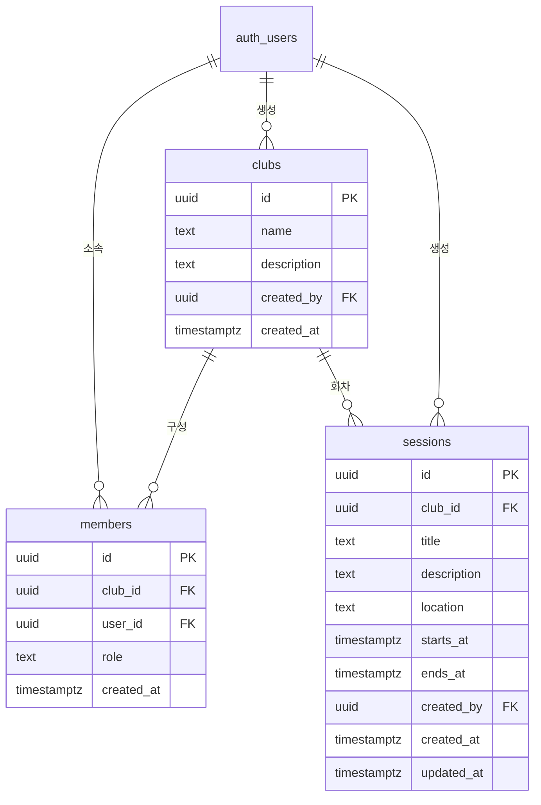

# Database

## 목적

이 문서는 AI Club OS의 데이터 경계와 관계를 관리합니다. 스키마 변경은 `supabase/migrations/` 의 SQL 파일로 관리합니다.

## 핵심 Entity

- Club
- Member
- Session
- Attendance
- AI Log
- Project
- AI Insight
- Web Presentation

## MVP 관계 초안

```text
User
  -> Member
  -> Club
       -> Session
            -> Attendance
            -> AI Log
```

## 데이터 원칙

- 모든 Club 소속 데이터는 Club 식별자를 통해 경계를 확인할 수 있어야 한다.
- Member는 사용자와 Club 사이의 소속과 역할을 나타낸다.
- Attendance는 Member와 Session의 관계를 기록한다.
- AI Log는 작성자와 Club에 속하며 필요할 때 Session과 연결한다.
- 사용자가 작성한 원본 AI Log와 이후 생성된 AI Insight를 구분한다.
- 삭제와 보존 정책은 구현 전에 별도로 결정한다.

## 구현된 구조

지금 있는 테이블은 `clubs`, `members`, `sessions` 입니다. 정의는 `supabase/migrations/` 의 SQL 파일에 있습니다.

| 테이블 | 마이그레이션 | 결정 배경 |
|---|---|---|
| `clubs`, `members` | `20261009165228_create_clubs_and_members.sql` | `docs/adr/0003-club-membership-and-rls.md` |
| `sessions` | `20261009172039_create_sessions.sql` | `docs/adr/0004-session-time-in-korea-standard-time.md` |



`auth_users` 는 Supabase Auth 가 관리하는 `auth.users` 입니다.

### clubs

| 열 | 형식 | 설명 |
|---|---|---|
| `id` | uuid | 기본 키 |
| `name` | text | 앞뒤 공백을 뺀 길이가 1자 이상 50자 이하 |
| `description` | text | 200자 이하. 기본값은 빈 문자열 |
| `created_by` | uuid | 만든 사용자. 사용자가 삭제되면 비운다 |
| `created_at` | timestamptz | 만든 시각 |

### members

| 열 | 형식 | 설명 |
|---|---|---|
| `id` | uuid | 기본 키 |
| `club_id` | uuid | 소속 Club. Club 이 삭제되면 함께 삭제된다 |
| `user_id` | uuid | 사용자. 사용자가 삭제되면 함께 삭제된다 |
| `role` | text | `admin` 은 운영자, `member` 는 구성원 |
| `created_at` | timestamptz | 소속된 시각 |

한 사용자는 한 Club 에 한 번만 소속됩니다.

### sessions

| 열 | 형식 | 설명 |
|---|---|---|
| `id` | uuid | 기본 키 |
| `club_id` | uuid | 소속 Club. Club 이 삭제되면 함께 삭제된다. 만든 뒤에는 바꿀 수 없다 |
| `title` | text | 앞뒤 공백을 뺀 길이가 1자 이상 80자 이하 |
| `description` | text | 목표와 소개. 2000자 이하 |
| `location` | text | 장소. 80자 이하 |
| `starts_at` | timestamptz | 시작 시각 |
| `ends_at` | timestamptz | 종료 시각. 시작 시각보다 뒤여야 한다 |
| `created_by` | uuid | 만든 사용자. 사용자가 삭제되면 비운다 |
| `created_at` | timestamptz | 만든 시각 |
| `updated_at` | timestamptz | 마지막으로 고친 시각. 고칠 때 자동으로 바뀐다 |

### 시각 저장 규칙

시각은 모두 timestamptz 로 저장합니다. 화면에서 입력받고 보여 줄 때는 한국 시간으로만 해석합니다. Club 마다 시간대를 따로 두지 않습니다. Session 이 오늘인지, 예정인지, 끝났는지도 한국 시간의 날짜로 나눕니다.

### 접근 규칙

모든 테이블에 행 단위 보안이 켜져 있습니다. 로그인하지 않은 요청에는 아무 권한이 없습니다.

| 대상 | 동작 | 허용 조건 |
|---|---|---|
| `clubs` | 조회 | 그 Club 의 Member |
| `clubs` | 생성 | 로그인한 사용자. 이름과 소개만 넣을 수 있다 |
| `clubs` | 수정, 삭제 | 아직 없음 |
| `members` | 조회 | 같은 Club 의 Member |
| `members` | 생성 | Club 을 만들 때 만든 사람이 운영자로 자동 등록된다. 그 밖의 방법은 아직 없음 |
| `members` | 수정, 삭제 | 아직 없음 |
| `sessions` | 조회 | 그 Club 의 Member |
| `sessions` | 생성, 수정 | 그 Club 의 운영자 |
| `sessions` | 삭제 | 아직 없음 |

## 이후 결정 사항

Attendance 상태 값과 AI Log 입력 구조는 `docs/REQUIREMENTS.md` 의 잠정 결정을 출발점으로 삼습니다.

- 역할별 세부 권한. Club 수정과 삭제, Member 관리
- Member 의 이름과 이메일을 보여 줄 프로필 구조
- Attendance 상태 값
- AI Log 입력 구조
- 수정 기록과 보존 기간
- 파일 첨부 범위
- 나머지 테이블의 행 단위 보안 정책
