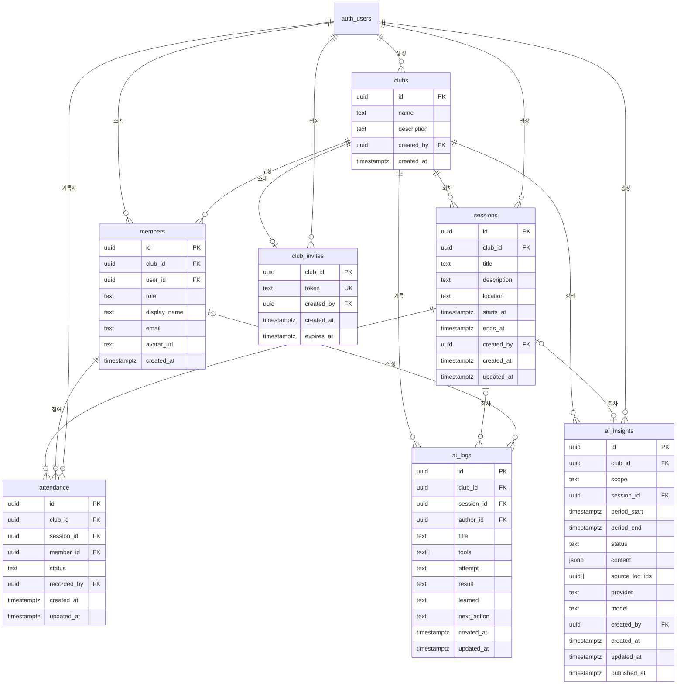

# Database

## 목적

이 문서는 AI Club OS의 데이터 경계와 관계를 관리합니다. 스키마 변경은 `supabase/migrations/` 의 SQL 파일로 관리합니다.

## 핵심 Entity

- Club
- Member
- Session
- Attendance
- AI Log
- Project
- AI Insight
- Web Presentation

## MVP 관계 초안

```text
User
  -> Member
  -> Club
       -> Session
            -> Attendance
            -> AI Log
```

## 데이터 원칙

- 모든 Club 소속 데이터는 Club 식별자를 통해 경계를 확인할 수 있어야 한다.
- Member는 사용자와 Club 사이의 소속과 역할을 나타낸다.
- Attendance는 Member와 Session의 관계를 기록한다.
- AI Log는 작성자와 Club에 속하며 필요할 때 Session과 연결한다.
- 사용자가 작성한 원본 AI Log와 이후 생성된 AI Insight를 구분한다.
- 지운 것은 바로 없어지고 되살리지 않는다. 숨겨 두는 열이나 보관 기간은 두지 않는다. 2026-10-10 결정.

## 구현된 구조

지금 있는 테이블은 `clubs`, `members`, `sessions`, `attendance`, `ai_logs`, `club_invites`, `ai_insights` 입니다. 정의는 `supabase/migrations/` 의 SQL 파일에 있습니다.

| 테이블 | 마이그레이션 | 결정 배경 |
|---|---|---|
| `clubs`, `members` | `20261009165228_create_clubs_and_members.sql` | `docs/adr/0003-club-membership-and-rls.md` |
| `sessions` | `20261009172039_create_sessions.sql` | `docs/adr/0004-session-time-in-korea-standard-time.md` |
| `attendance`, `members` 의 이름과 이메일 열 | `20261009175244_create_attendance.sql` | `docs/adr/0005-attendance-and-member-display-name.md` |
| `ai_logs` | `20261009181137_create_ai_logs.sql` | `docs/adr/0006-ai-log-structure-and-authorship.md` |
| `club_invites`, 참여 함수 | `20261010064838_create_club_invites.sql` | `docs/adr/0007-club-invite-link.md` |
| `members` 의 사진 주소 열, 사진 맞추기 함수 | `20261010070509_add_member_avatar.sql` | `docs/adr/0008-member-avatar-from-google.md` |
| 역할 바꾸기, 내보내기와 나가기, Club 정보 수정 규칙 | `20261010071641_manage_members_and_club.sql` | `docs/adr/0009-member-management-and-last-admin.md` |
| AI Log 검색과 도구 목록 함수 | `20261010075452_add_ai_log_search.sql` | `docs/adr/0011-ai-log-search-functions.md` |
| 검색과 도구 이름을 느슨하게 맞추도록 두 함수 교체 | `20261010080736_loosen_ai_log_search.sql` | `docs/adr/0012-loose-matching-for-search-and-tools.md` |
| 검색이 한 도구의 여러 표기를 함께 찾도록 함수 교체 | `20261010082852_search_tool_spellings.sql` | `docs/adr/0013-known-tool-catalog.md` |
| AI Log, Session, Club 을 지우는 규칙 | `20261010091458_add_delete_rules.sql` | `docs/adr/0015-delete-rules.md` |
| `ai_insights` | `20261010141008_create_ai_insights.sql` | `docs/adr/0017-ai-insight-draft-and-publish.md` |



`auth_users` 는 Supabase Auth 가 관리하는 `auth.users` 입니다.

### clubs

| 열 | 형식 | 설명 |
|---|---|---|
| `id` | uuid | 기본 키 |
| `name` | text | 앞뒤 공백을 뺀 길이가 1자 이상 50자 이하 |
| `description` | text | 200자 이하. 기본값은 빈 문자열 |
| `created_by` | uuid | 만든 사용자. 사용자가 삭제되면 비운다 |
| `created_at` | timestamptz | 만든 시각 |

### members

| 열 | 형식 | 설명 |
|---|---|---|
| `id` | uuid | 기본 키 |
| `club_id` | uuid | 소속 Club. Club 이 삭제되면 함께 삭제된다 |
| `user_id` | uuid | 사용자. 사용자가 삭제되면 함께 삭제된다 |
| `role` | text | `admin` 은 운영자, `member` 는 구성원 |
| `display_name` | text | Club 안에서 보이는 이름. 참여할 때 Google 계정의 이름을 옮겨 적는다. 이름이 없으면 이메일을 쓴다 |
| `email` | text | 참여할 때의 이메일. 같은 Club 의 Member 에게만 보인다 |
| `avatar_url` | text | Google 계정의 프로필 사진 주소. Google 의 사진 주소만 들어갈 수 있고, 없으면 비어 있다. 로그인할 때 지금 값으로 맞춘다 |
| `created_at` | timestamptz | 소속된 시각 |

한 사용자는 한 Club 에 한 번만 소속됩니다. 이름과 이메일은 참여한 시점의 값이며 Google 계정에서 바꿔도 따라 바뀌지 않습니다. 사진 주소만 로그인할 때 `public.sync_my_avatar()` 가 지금 값으로 맞춥니다. 이 함수는 부른 사용자의 행에서 사진 주소만 바꾸고, 로그인한 사용자만 부를 수 있습니다.

### sessions

| 열 | 형식 | 설명 |
|---|---|---|
| `id` | uuid | 기본 키 |
| `club_id` | uuid | 소속 Club. Club 이 삭제되면 함께 삭제된다. 만든 뒤에는 바꿀 수 없다 |
| `title` | text | 앞뒤 공백을 뺀 길이가 1자 이상 80자 이하 |
| `description` | text | 목표와 소개. 2000자 이하 |
| `location` | text | 장소. 80자 이하 |
| `starts_at` | timestamptz | 시작 시각 |
| `ends_at` | timestamptz | 종료 시각. 시작 시각보다 뒤여야 한다 |
| `created_by` | uuid | 만든 사용자. 사용자가 삭제되면 비운다 |
| `created_at` | timestamptz | 만든 시각 |
| `updated_at` | timestamptz | 마지막으로 고친 시각. 고칠 때 자동으로 바뀐다 |

### attendance

| 열 | 형식 | 설명 |
|---|---|---|
| `id` | uuid | 기본 키 |
| `club_id` | uuid | 소속 Club. Session 과 Member 가 모두 이 Club 에 속해야 한다 |
| `session_id` | uuid | 회차. Session 이 삭제되면 함께 삭제된다 |
| `member_id` | uuid | 대상 Member. Member 가 삭제되면 함께 삭제된다 |
| `status` | text | `present` 출석, `late` 지각, `absent` 결석, `excused` 공결 |
| `recorded_by` | uuid | 마지막으로 기록한 사용자. 사용자가 삭제되면 비운다 |
| `created_at` | timestamptz | 처음 기록한 시각 |
| `updated_at` | timestamptz | 마지막으로 고친 시각. 고칠 때 자동으로 바뀐다 |

한 Session 의 한 Member 에게 행은 하나뿐입니다. 행이 없으면 미기록이고, 미기록으로 되돌릴 때는 행을 지웁니다. 만든 뒤에는 `status` 만 고칠 수 있습니다.

### ai_logs

| 열 | 형식 | 설명 |
|---|---|---|
| `id` | uuid | 기본 키 |
| `club_id` | uuid | 소속 Club. Club 이 삭제되면 함께 삭제된다. 만든 뒤에는 바꿀 수 없다 |
| `session_id` | uuid | 기록이 속한 회차. 비어 있으면 Club 의 기록이다. 같은 Club 의 Session 만 넣을 수 있고, Session 이 삭제되면 비운다 |
| `author_id` | uuid | 작성자의 사용자 식별자. 만들 때 로그인한 사용자로 정해진다. Member 가 Club 에서 빠지면 비운다 |
| `title` | text | 제목. 앞뒤 공백을 뺀 길이가 1자 이상 100자 이하 |
| `tools` | text[] | 사용한 도구 이름. 10개 이하이고 이름마다 1자 이상 30자 이하 |
| `attempt` | text | 시도한 내용. 앞뒤 공백을 뺀 길이가 1자 이상 5000자 이하 |
| `result` | text | 결과. 5000자 이하. 기본값은 빈 문자열 |
| `learned` | text | 배운 점. 5000자 이하. 기본값은 빈 문자열 |
| `next_action` | text | 다음 행동. 5000자 이하. 기본값은 빈 문자열 |
| `created_at` | timestamptz | 작성한 시각 |
| `updated_at` | timestamptz | 마지막으로 고친 시각. 내용이 실제로 바뀌었을 때만 바뀐다 |

사용자가 쓴 원본 기록입니다. AI Insight 는 이 테이블에 덮어쓰지 않고 `ai_insights` 에 따로 둡니다.

### AI Log 를 찾는 함수

두 함수 모두 부른 사람의 권한으로 실행하므로 `ai_logs` 의 접근 규칙이 그대로 적용됩니다. 로그인한 사용자만 부를 수 있습니다.

| 함수 | 하는 일 |
|---|---|
| `public.search_ai_logs(target_club_id, search, tool_name)` | 찾는 글자의 낱말이 제목, 내용, 도구 이름에 모두 들어 있는 기록을 `ai_logs` 와 같은 모양으로 돌려준다. `tool_name` 을 주면 그 도구를 쓴 기록만 돌려준다 |
| `public.club_tool_counts(target_club_id)` | 그 Club 의 기록에 쓰인 도구 이름과 쓴 횟수를 많이 쓰인 순서로 돌려준다. 표기만 다른 이름은 하나로 합친다 |

`search` 의 낱말과 `tool_name` 은 `|` 로 여러 표기를 이을 수 있고, 그 가운데 하나만 맞아도 됩니다. 앱은 널리 쓰는 도구의 다른 표기를 이렇게 이어 넘깁니다(`클로드|claude`). 어느 도구가 어떤 표기를 갖는지는 앱의 `src/features/ai-log/tool-catalog.ts` 에 있고 데이터베이스에는 없습니다.

글자를 비교할 때는 `private.search_key` 가 만든 값을 씁니다. 대소문자를 없애고 공백을 모두 뺀 값이라서 "청크 크기" 와 "청크크기", "ChatGPT" 와 "chatgpt" 가 같은 것으로 잡힙니다.

### club_invites

| 열 | 형식 | 설명 |
|---|---|---|
| `club_id` | uuid | 기본 키. Club 마다 초대는 하나뿐이다. Club 이 삭제되면 함께 삭제된다 |
| `token` | text | 링크에 들어가는 값. 데이터베이스가 무작위로 만드는 32자 |
| `created_by` | uuid | 만든 운영자. 사용자가 삭제되면 비운다 |
| `created_at` | timestamptz | 만든 시각 |
| `expires_at` | timestamptz | 만료 시각. 만든 때부터 7일 뒤 |

새 링크는 이전 행을 지우고 다시 넣어 만듭니다. 링크 값과 만료 시각은 앱이 정하거나 고칠 수 없습니다.

### 초대 링크로 참여하는 함수

아직 Member 가 아닌 사람은 `clubs` 와 `members` 를 읽거나 쓸 수 없어서, 아래 두 함수만 만든 사람의 권한으로 실행합니다. 둘 다 로그인한 사용자만 부를 수 있고 안에서 링크 값과 만료를 확인합니다.

| 함수 | 하는 일 |
|---|---|
| `public.preview_club_invite(invite_token)` | 링크가 가리키는 Club 의 이름, 소개, Member 수, 이미 Member 인지를 돌려준다. 링크가 틀렸거나 만료됐으면 아무 행도 돌려주지 않는다 |
| `public.join_club(invite_token)` | 부른 사용자를 그 Club 의 구성원으로 넣고 Club 식별자를 돌려준다. 이미 Member 이면 그대로 둔다. 링크가 틀렸거나 만료됐으면 null 을 돌려준다 |

### ai_insights

| 열 | 형식 | 설명 |
|---|---|---|
| `id` | uuid | 기본 키 |
| `club_id` | uuid | 소속 Club. Club 이 삭제되면 함께 삭제된다. 만든 뒤에는 바꿀 수 없다 |
| `scope` | text | `session` 은 한 회차를, `period` 는 한 기간의 Club 전체 기록을 정리한 것 |
| `session_id` | uuid | 회차를 정리한 것일 때의 Session. 같은 Club 의 것이어야 하고, Session 이 삭제되면 함께 삭제된다 |
| `period_start`, `period_end` | timestamptz | 기간을 정리한 것일 때의 시작과 끝. 끝은 기간에 들지 않는다. 앱은 한국 시간의 한 달을 넣는다 |
| `status` | text | `draft` 는 운영자에게만 보이는 초안, `published` 는 Member 에게 공개된 것. 만들 때는 항상 `draft` |
| `content` | jsonb | 정리한 내용. 객체여야 하고 40000바이트 이하. 모양은 앱의 `src/features/ai-insight/content.ts` 가 정한다 |
| `source_log_ids` | uuid[] | AI 에 보낸 AI Log 의 식별자. 500개 이하. 그 뒤에 기록이 지워져도 고치지 않는다 |
| `provider`, `model` | text | 정리한 AI Provider 와 모델 |
| `created_by` | uuid | 만든 운영자. 사용자가 삭제되면 비운다 |
| `created_at` | timestamptz | 만든 시각 |
| `updated_at` | timestamptz | 마지막으로 내용이나 공개 상태를 바꾼 시각 |
| `published_at` | timestamptz | 공개한 시각. 데이터베이스가 정한다. 초안으로 되돌리면 비워진다 |

한 회차에는 하나, 한 Club 의 같은 기간에도 하나만 둘 수 있습니다. 다시 만들면 같은 행의 내용, 보낸 기록, 모델을 고쳐 쓰고 초안으로 되돌립니다. AI 가 만든 것이라 `ai_logs` 와 달리 원본이 아닙니다.

### 시각 저장 규칙

시각은 모두 timestamptz 로 저장합니다. 화면에서 입력받고 보여 줄 때는 한국 시간으로만 해석합니다. Club 마다 시간대를 따로 두지 않습니다. Session 이 오늘인지, 예정인지, 끝났는지도 한국 시간의 날짜로 나눕니다.

### 접근 규칙

모든 테이블에 행 단위 보안이 켜져 있습니다. 로그인하지 않은 요청에는 아무 권한이 없습니다.

| 대상 | 동작 | 허용 조건 |
|---|---|---|
| `clubs` | 조회 | 그 Club 의 Member |
| `clubs` | 생성 | 로그인한 사용자. 이름과 소개만 넣을 수 있다 |
| `clubs` | 수정 | 그 Club 의 운영자. 이름과 소개만 고칠 수 있다 |
| `clubs` | 삭제 | 그 Club 의 운영자. Member, Session, Attendance, AI Log, 초대 링크가 함께 지워진다. Club 이름을 입력해 확인하는 절차는 앱이 맡는다 |
| `members` | 조회 | 같은 Club 의 Member |
| `members` | 생성 | Club 을 만들 때 만든 사람이 운영자로 자동 등록된다. 그 밖에는 초대 링크로 `join_club` 을 불러 구성원으로 들어온다. 직접 넣을 수는 없다 |
| `members` | 수정 | 그 Club 의 운영자. 역할만 바꿀 수 있다. 본인의 사진 주소는 `sync_my_avatar` 로 맞춘다 |
| `members` | 삭제 | 그 Club 의 운영자는 누구든 내보낼 수 있고, 누구나 자기 행을 지워 스스로 나갈 수 있다 |
| `sessions` | 조회 | 그 Club 의 Member |
| `sessions` | 생성, 수정 | 그 Club 의 운영자 |
| `sessions` | 삭제 | 그 Club 의 운영자. 그 회차의 Attendance 는 함께 지워지고 AI Log 는 Session 연결만 비워진 채 남는다 |
| `attendance` | 조회 | 그 Club 의 Member |
| `attendance` | 생성, 수정, 삭제 | 그 Club 의 운영자. 고칠 수 있는 것은 상태뿐이다 |
| `ai_logs` | 조회 | 그 Club 의 Member |
| `ai_logs` | 생성 | 그 Club 의 Member. 작성자는 본인으로 정해진다 |
| `ai_logs` | 수정 | 작성자 본인. Session 연결과 내용만 고칠 수 있다 |
| `ai_logs` | 삭제 | 작성자 본인과 그 Club 의 운영자. 작성자가 빠진 기록은 운영자만 지운다 |
| `ai_insights` | 조회 | 그 Club 의 운영자는 모두, 구성원은 공개된 것만 |
| `ai_insights` | 생성 | 그 Club 의 운영자. 만든 사람은 본인으로, 상태는 초안으로 정해진다 |
| `ai_insights` | 수정 | 그 Club 의 운영자. 내용, 공개 상태, 보낸 기록, Provider 와 모델만 고칠 수 있다 |
| `ai_insights` | 삭제 | 그 Club 의 운영자 |
| `club_invites` | 조회, 생성, 삭제 | 그 Club 의 운영자. 넣을 수 있는 열은 `club_id` 뿐이다 |
| `club_invites` | 수정 | 없음. 새로 만들려면 지우고 넣는다 |

### 마지막 운영자

Club 에는 운영자가 한 명 이상 남아야 합니다. `members` 의 trigger 가 운영자를 구성원으로 내리거나 지우려 할 때 다른 운영자가 있는지 확인하고, 없으면 오류(`P0001`)를 냅니다. 동시에 들어온 요청이 서로를 지나치지 않도록 확인 전에 그 Club 의 행을 잠급니다. Club 이나 사용자 계정이 삭제되면서 함께 지워지는 경우에는 막지 않습니다. 그래서 운영자가 혼자인 Club 도 통째로 지울 수 있습니다.

Member 가 Club 에서 나가면 그 사람의 Attendance 는 함께 삭제되고, AI Log 는 작성자가 비워진 채 남습니다.

## 이후 결정 사항

Attendance 상태 값과 AI Log 입력 항목은 `docs/REQUIREMENTS.md` 의 잠정 결정대로 구현했습니다. Attendance 상태의 종류가 바뀌면 check 제약과 `src/features/attendance/status.ts` 를, AI Log 입력 항목이 바뀌면 열과 check 제약, `src/features/ai-log/rules.ts` 를 함께 고칩니다.

- 운영자가 없어진 Club 을 되살리는 방법
- Member 가 자기 이름을 고치는 방법
- 이미 저장된 기록의 도구 표기를 한꺼번에 고치는 방법
- 수정 기록을 남길지와, 누가 무엇을 지웠는지 남길지
- 파일 첨부 범위
- 나머지 테이블의 행 단위 보안 정책
