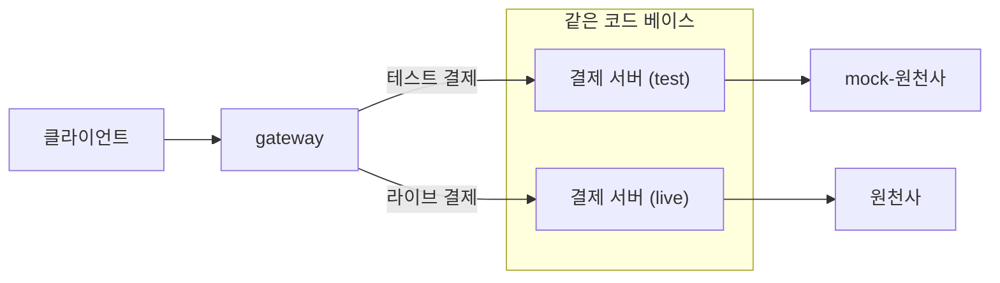

# Docs 쓰는 법

Club 안의 Docs 에 보이는 문서는 이 폴더의 MDX 파일입니다. 모든 Club 에 같은 문서이고, 앱 안에서는 고치지 않습니다. 저장소를 고쳐 배포하면 올라갑니다. 결정의 이유는 `docs/adr/0031-docs-as-mdx-at-build-time.md` 에 있습니다.

## 문서 더하기

1. 이 폴더에 `<slug>.mdx` 를 만듭니다. slug 는 주소에 쓰이므로 영어 소문자, 숫자, 하이픈만 씁니다.
2. 문서 맨 앞에 `---` 줄로 감싼 frontmatter 를 두고 제목과 소개, 날짜, 태그를 적습니다. 화면의 머리말, 왼쪽 문서 목록, 이전 문서와 다음 문서, Session 의 참고 자료가 이 값을 씁니다.
3. `list.ts` 에 slug 를 더합니다. 이 목록의 순서가 문서 목록과 이전 문서, 다음 문서의 순서이고, 목록에 없는 파일은 화면에 나오지 않습니다.
4. 본문의 절은 `##` 부터 씁니다. `##` 과 `###` 이 오른쪽 목차가 됩니다.

```mdx
---
title: Prompt Engineering 시작하기
description: 목표, 상황, 조건, 결과 형태를 나눠 적는 방법을 알려 드려요.
published: 2026-10-21
updated: 2026-10-22
tags: [Prompt, 입문]
---

# Prompt Engineering 시작하기

본문의 첫 문단...
```

| 이름 | 꼭 | 뜻 |
|---|---|---|
| `title` | 예 | 문서 제목 |
| `description` | 예 | 제목 아래의 한 줄 소개. 브라우저 미리 보기에도 쓰입니다. |
| `published` | 아니요 | 처음 올린 날. `2026-10-21` 처럼 씁니다. 적은 문서에만 머리말에 날짜가 보입니다. |
| `updated` | 아니요 | 내용을 크게 고친 날. `published` 와 함께 적고, 그보다 앞설 수 없습니다. |
| `tags` | 아니요 | `[가, 나]` 나 `- 가` 줄의 목록. `#` 을 붙이지 않고 겹치지 않게 씁니다. |

- 값은 한 줄에 `이름: 값` 하나씩 씁니다. 값이 `[` 로 시작하거나 ` #` 이 들어 있으면 따옴표로 감쌉니다. 이 밖의 이름을 쓰면 빌드가 멈춥니다.
- 본문 맨 앞의 `#` 제목은 써도 되고 빼도 됩니다. 쓰면 `title` 과 같아야 하고, 머리말에 이미 보이므로 화면과 "마크다운으로 복사" 에서 빠집니다. 다른 곳에는 `#` 제목을 쓰지 않습니다.

`npm test` 가 목록과 파일이 서로 맞는지, 문서마다 frontmatter 가 규칙에 맞는지, 문서 안의 링크가 있는 화면과 문서, 제목을 가리키는지 봅니다. 빌드도 같은 규칙으로 멈추고 어느 줄이 왜 틀렸는지 알립니다. 문서는 저장소에 그대로 들어가므로 비밀 값과 개인 정보를 적지 않습니다.

## 쓸 수 있는 것

Markdown 의 글, 목록, 표, 인용과 아래의 것을 씁니다.

````mdx
```text
코드 블록. 언어를 적으면 색이 칠해지고 위쪽 막대에 언어 이름이 보입니다.
```

<Callout tone="warning" title="조심할 것">
발표에 넣은 기록은 링크를 아는 누구나 봅니다.
</Callout>

[AI Log 쓰기](../logs/new), [다른 문서](./getting-started), [바깥 주소](https://nextjs.org/docs)
````

- `Callout` 은 import 없이 씁니다. `tone` 은 `info`(알아 둘 것), `success`(잘 되는 방법), `warning`(조심할 것), `danger`(되돌릴 수 없는 일) 가운데 하나이고 `title` 은 빼도 됩니다.
- 앱의 다른 화면은 `../logs/new` 처럼 상대 경로로, 다른 문서는 `./<slug>` 로, 다른 문서의 제목은 `./<slug>#제목-id` 로 겁니다. 제목의 id 는 제목 글의 영어를 소문자로, 띄어쓰기를 `-` 로 바꾸고 문장 부호를 뺀 것입니다. 예: `## AI Log에 기록하기` 는 `#ai-log에-기록하기` 입니다. 바깥 주소는 `https://` 로 시작하는 전체 주소로 적으면 새 탭에서 열립니다.
- 아직 없는 문서로는 링크를 걸지 않습니다. 문서를 쓴 뒤에 `list.ts` 에 더하고 링크를 겁니다.

## 접는 칸

`<details>` 는 자주 하는 질문 목록처럼 위아래에 선만 있는 줄로 보이고, 연달아 놓으면 선 하나를 사이에 둔 한 목록이 됩니다. `<summary>` 다음 줄과 `</details>` 앞 줄을 비워야 안쪽의 Markdown 이 읽힙니다.

```mdx
<details>
  <summary>매번 새 채팅을 열어야 하나요?</summary>

  아닙니다. 주제가 크게 바뀌었을 때 새로 엽니다.

</details>
```

무엇을 접을지는 문서마다 같게 둡니다.

- 복사해서 그대로 쓰는 템플릿, 프롬프트 전문, 긴 예시는 언제나 접습니다. 제목 줄은 "MY CONTEXT 템플릿 보기" 처럼 씁니다.
- 설명 흐름 안의 짧은 비교 예시(나쁜 예와 좋은 예)는 펼쳐 둡니다.
- 문서 끝 가까이에 `## 자주 하는 질문` 을 두고 질문마다 칸 하나를 씁니다. 제목 줄은 "Q." 없이 질문 문장만 씁니다. 한 묶음의 칸 사이에는 다른 글을 끼우지 않습니다.

## 그림

순서나 갈래가 있는 흐름은 글 목록이나 `A → B` 줄 대신 그림으로 그립니다. ```` ```mermaid ```` 코드 블록에 Mermaid 의 flowchart 를 쓰면 빌드할 때 상자와 화살표의 그림이 됩니다. 새 패키지 없이 그 가운데 일부만 받습니다. 결정의 이유는 `docs/adr/0035-docs-flowcharts-at-build-time.md` 에 있습니다.

````mdx

````

- 첫 줄은 `flowchart LR`(왼쪽에서 오른쪽) 이나 `flowchart TD`(위에서 아래)입니다.
- 상자는 `id[글]` 로 씁니다. id 는 영어, 숫자, `_` 로 쓰고, 글은 상자가 처음 나올 때 한 번 붙입니다. 괄호 같은 기호가 든 글은 `id["글"]` 처럼 따옴표로 감쌉니다. `<br>` 로 줄을 나눕니다.
- 화살표는 `-->` 이고, 글은 `-->|글|` 이나 `-- 글 -->` 로 붙입니다. `a --> b --> c` 처럼 한 줄에 이어 써도 됩니다.
- 묶음은 `subgraph id [제목]` 과 `end` 사이에 상자의 id 만 한 줄에 하나씩 적습니다. 화살표는 묶음의 id 로도 이을 수 있습니다.
- `%%` 로 시작하는 줄은 읽지 않습니다.

그릴 수 없는 그림은 빌드가 멈추고 몇 번째 줄이 왜 틀렸는지 알립니다.

- 동그라미 같은 다른 상자 모양, `---` 같은 다른 화살표, 묶음 안의 묶음은 받지 않습니다.
- 묶음 안의 상자는 같은 칸에 놓여야 합니다. 그래서 묶음 안의 상자끼리는 화살표로 잇지 않습니다.
- 화살표가 다른 상자를 지나가게 되면 그리지 않습니다. 건너뛰는 화살표 대신 사이의 상자를 거쳐 가게 씁니다.
- 앞으로 돌아가는 화살표는 그림 아래(TD 는 오른쪽)로 돌아갑니다. 되풀이를 보일 때 하나만 둡니다.

그림은 넓은 화면의 본문 폭(약 730px) 안에 들게 씁니다. 넘치면 그림이 줄어 글자가 작아집니다. 좁은 화면에서는 80% 까지 줄고, 그보다 좁으면 옆으로 밀어 봅니다. 한 줄로 상자 다섯 개 이상 이어지는 흐름은 폭에 들지 않으므로 TD 로 쓰고, 상자의 글이 길면 `<br>` 로 나눕니다. 상자의 글은 화면 읽기 프로그램에 한 줄 설명으로 읽히므로 그림만 보고도 뜻이 통하게 씁니다. "마크다운으로 복사" 에는 코드 블록이 그대로 남아, Mermaid 를 그리는 곳에 붙이면 같은 그림이 됩니다.

## 글의 규칙

- 합니다체로 씁니다. 이모지와 em dash(긴 줄표)를 쓰지 않습니다.
- 회차 문서의 제목(frontmatter 의 `title`)은 `3회차 · Context Engineering` 처럼 가운뎃점으로 잇습니다.
- 절 사이에 `---` 를 두지 않습니다. `##` 제목이 절을 나눕니다.
- 다음 회차를 미리 설명하거나 준비시키지 않습니다. 다음 회차는 정해지지 않았고 바뀔 수 있습니다. 다른 문서는 "Context Engineering 문서" 처럼 문서 이름으로 가리킵니다.
- 모델 이름, 가격, Context Window 크기처럼 금방 낡는 값은 일반적인 말로 쓰거나 언제 기준인지 밝힙니다.

## 마크다운으로 복사

문서 제목 옆의 "마크다운으로 복사" 는 이 파일을 Markdown 으로 바꿔 복사합니다. frontmatter 는 빼고 그 제목과 소개를 맨 앞에 `# 제목` 과 문단으로 넣습니다. `Callout` 은 GitHub 의 알림 인용(`> [!WARNING]` 등)이 되고, 앱 안으로 가는 링크는 누른 사람의 Club 주소로 풀린 전체 주소가 됩니다. `details` 같은 HTML 태그는 그대로 남고, 그 밖의 컴포넌트는 감싼 글만 남습니다.
