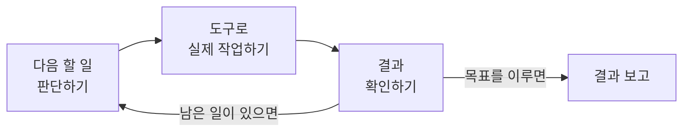
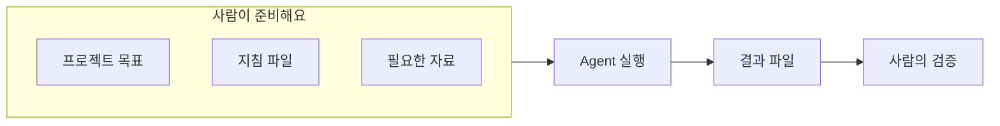

# AI Agent

AI 채팅에 "회의록을 요약해 줘"라고 하면 요약이 화면에 나오고, 그걸 복사해서 저장하는 건 사람의 몫이에요. AI Agent에게 같은 일을 맡기면, Agent가 프로젝트 폴더에서 회의록 파일을 찾아 읽고, 요약 문서를 직접 만들고, 원본과 비교해 검증까지 해요.

목표를 이루기 위해 AI가 다음에 할 일을 판단하고, 연결된 도구로 실제 작업을 하고, 결과를 보고 다음 행동을 고르도록 만든 시스템을 **AI Agent**라고 해요.



이 문서에서는 대표적인 Agent 도구인 **Claude Code**와 **Codex**로 실제 파일을 다뤄 봐요.

이 문서를 따라 하면 다음을 할 수 있어요.

- Claude Code나 Codex로 프로젝트 폴더를 열 수 있어요.
- `AGENTS.md`와 `CLAUDE.md`로 Agent가 따를 프로젝트 규칙을 정할 수 있어요.
- Agent에게 회의록 파일을 읽고 결과 파일을 만들게 할 수 있어요.
- Agent가 실제로 한 일과 하지 못한 일을 구분해서 검증할 수 있어요.

<Callout tone="success" title="Agent를 잘 쓰는 건 좋은 프롬프트 하나로 끝나지 않아요">

목표를 알려 주고, 작업을 맡기고, 실제로 만들어진 결과를 확인하는 과정 전체예요. 이번에는 AI가 실제 파일을 읽고 결과 파일을 만드는 경험을 목표로 해요.

</Callout>

## 준비하기

다음을 준비해 주세요. 코드를 쓰는 작업은 없지만, 폴더와 파일을 만드는 정도는 할 수 있어야 해요.

| 준비물 | 설명 |
| --- | --- |
| Claude Code 또는 Codex | 둘 중 하나면 충분해요. 설치와 로그인은 [Claude Code 공식 문서](https://code.claude.com/docs/ko/overview)나 [Codex CLI 공식 문서](https://learn.chatgpt.com/docs/codex/cli)를 따라 주세요. |
| 실습 폴더 | 1단계에서 함께 만들어요. |

두 도구 모두 프로젝트 폴더의 파일을 읽고, 새 파일을 만들거나 고치고, 명령을 실행할 수 있는 Agent 도구예요. 주로 소프트웨어 개발에 쓰지만 문서를 다루는 작업에도 쓸 수 있어요. 실제로 쓸 수 있는 기능은 제품 버전, 사용 환경, 권한 설정에 따라 달라요.

도구를 설치하기 어렵다면 다른 구성원과 함께 하나의 화면으로 진행하면서 작업 과정을 지켜봐도 괜찮아요.

## 1단계: 실습 폴더와 회의록 만들기

Agent가 읽을 원본 자료와 결과물을 저장할 자리를 만들어요. 원본(`input/`)과 결과물(`output/`)의 폴더를 나눠 두면 Agent가 원본을 실수로 덮어쓰는 일을 막기 쉬워요.

다음 구조로 폴더를 만들어 주세요. `AGENTS.md`와 `CLAUDE.md`는 2~3단계에서 만들어요.

```text
ai-agent-practice/
├── AGENTS.md
├── CLAUDE.md
├── input/
│   └── meeting-01.md
└── output/
```

`input/meeting-01.md` 파일을 만들고 아래 내용을 붙여 넣어 주세요. 실제 회의가 아니라 실습을 위해 만든 가상 회의록이에요.

<details>
<summary>meeting-01.md 내용 보기</summary>

```md
# AI 동아리 4회차 준비 회의

## 회의 일시

2026년 10월 22일

## 참석자

- 참가자 A
- 참가자 B
- 참가자 C

## 논의 내용

### 1. 다음 회차 학습 주제

다음 회차에서는 AI Agent를 직접 사용하는
실습을 진행하기로 했습니다.

Claude Code와 Codex를 활용하는 방법을
소개하기로 했습니다.

### 2. 실습 환경 준비

참가자 A는 실습용 프로젝트 폴더를
준비하기로 했습니다.

준비 기한은 10월 25일입니다.

### 3. 실습 자료

참가자 B는 가상의 회의록 예시를
작성하기로 했습니다.

기한은 아직 정하지 않았습니다.

### 4. 결과 공유

참가자 C는 실습 결과를 공유할
발표 방식을 조사하기로 했습니다.

### 5. 미결정 사항

- 모든 참가자가 같은 도구를 사용할지
- 팀별로 다른 도구를 사용할지
- 최종 결과물을 어디에 저장할지

## 회의 결론

4회차에서는 실제 파일을 다루는
AI Agent 실습을 진행합니다.

세부 도구 선택과 결과물 저장 방식은
추가 논의가 필요합니다.
```

</details>

## 2단계: AGENTS.md로 공통 규칙 정하기

"한국어로 써 줘", "원본은 고치지 마" 같은 규칙을 대화마다 다시 적는 건 번거로워요. 프로젝트에서 반복해서 지킬 규칙은 지침 파일에 적어 두면, Agent가 작업을 시작할 때 읽고 따라요.

`AGENTS.md`는 여러 AI 코딩 도구가 함께 읽는 프로젝트 지침 파일이에요. Codex는 작업을 시작할 때 `AGENTS.md`를 읽어요. Claude Code는 `CLAUDE.md`를 먼저 찾고, 2.1.277 버전부터는 `CLAUDE.md`가 없으면 `AGENTS.md`를 대신 읽어요.

실습 폴더 맨 위에 `AGENTS.md`를 만들고 다음 내용을 넣어 주세요.

```md
# AGENTS.md

## Project

AI Agent의 파일 처리 능력을 실습하는 프로젝트입니다.

## Goal

회의록을 분석하고 결정 사항과
후속 작업을 Markdown 문서로 정리합니다.

## Rules

- 한국어로 작성합니다.
- 원본 회의록은 수정하지 않습니다.
- 결과물은 output/ 폴더에 저장합니다.
- 원문에 없는 사실을 추가하지 않습니다.
- 담당자와 기한이 없다면 "확인 필요"로 표시합니다.
- 확정된 결정과 논의 중인 사항을 구분합니다.

## Verification

- 결과가 원본 내용과 일치하는지 확인합니다.
- 완료하지 못한 작업은 완료했다고 보고하지 않습니다.
- 생성하거나 수정한 파일을 보고합니다.
```

지침 파일에는 프로젝트에서 반복해서 지킬 규칙만 적어 주세요. 이번 한 번만 필요한 지시는 프롬프트에 적는 게 좋아요. 지침이 길어지면 Agent가 일부를 놓칠 수 있어요.

지침 파일을 어디에 두고 무엇을 적을지는 [Claude Code](https://code.claude.com/docs/ko/memory)와 [Codex](https://learn.chatgpt.com/docs/agent-configuration/agents-md)의 공식 문서에서 더 볼 수 있어요.

## 3단계: CLAUDE.md에서 공통 규칙 불러오기

Claude Code는 `CLAUDE.md`가 있으면 `AGENTS.md`를 읽지 않아요. 그래서 두 파일을 함께 둘 때는 `CLAUDE.md`에서 `AGENTS.md`를 불러와야 해요. 이렇게 하면 공통 규칙은 `AGENTS.md` 한 곳에서만 관리하고, Claude Code에서만 필요한 규칙은 `CLAUDE.md`에 더할 수 있어요.

실습 폴더 맨 위에 `CLAUDE.md`를 만들고 다음 내용을 넣어 주세요. 첫 줄의 `@AGENTS.md`가 `AGENTS.md`의 내용을 불러오는 구문이에요.

```md
@AGENTS.md

## Claude Code

- 관련 파일을 먼저 확인합니다.
- 불필요한 파일은 변경하지 않습니다.
- 작업 결과를 사용자에게 간결하게 보고합니다.
```

두 도구는 이렇게 같은 규칙을 읽어요.

```mermaid
flowchart TD
  agents["AGENTS.md<br>공통 규칙"] --> codex[Codex]
  agents -->|@AGENTS.md로 불러와요| claudemd["CLAUDE.md<br>Claude Code만의 규칙"]
  claudemd --> claude[Claude Code]
```

쓰는 도구에 따라 이렇게 정하면 돼요.

| 쓰는 도구 | 만들 파일 |
| --- | --- |
| Codex만 | `AGENTS.md` |
| Claude Code만 | `CLAUDE.md` 하나, 또는 `AGENTS.md` 하나 (2.1.277 이상) |
| 둘 다 | `AGENTS.md`에 공통 규칙, `CLAUDE.md`에서 `@AGENTS.md`로 불러오기 |

<Callout tone="warning" title="두 파일에 규칙을 따로 적지 마세요">

`AGENTS.md`에는 "한국어로, output/에 저장", `CLAUDE.md`에는 "영어로, results/에 저장"처럼 따로 적으면, 같은 프로젝트에서도 도구에 따라 결과가 달라져요. 공통 규칙은 한 파일에만 적어 주세요.

</Callout>

## 4단계: Agent가 규칙을 읽었는지 확인하기

바로 작업을 맡기기 전에, Agent가 올바른 폴더에서 올바른 규칙을 읽었는지 먼저 확인해요. 여기서 어긋나면 이후 작업도 모두 어긋나요.

1. Claude Code나 Codex에서 실습 폴더를 열어요. 터미널이라면 실습 폴더로 이동한 뒤 `claude` 또는 `codex`를 실행해요.
2. 지금 작업 위치가 `ai-agent-practice` 폴더인지 확인해요.
3. 다음과 같이 요청해요.

```text
현재 프로젝트의 지침 파일을 확인해 줘.

먼저 다음 내용을 설명해 줘.
1. 현재 프로젝트의 목적
2. 적용되는 프로젝트 지침
3. 원본 자료가 저장된 위치
4. 결과물을 저장해야 하는 위치
5. 작업하면서 지켜야 하는 규칙

아직 파일을 수정하지 말고, 확인한 내용만 보고해 줘.
```

답을 보고 다음을 확인해 주세요.

- [ ] 올바른 프로젝트 폴더를 확인했나요?
- [ ] 2~3단계에서 적은 규칙을 정확히 설명했나요?
- [ ] 원본 자료와 결과물의 위치를 맞게 말했나요?
- [ ] 요청하지 않은 파일을 바꾸지 않았나요?

<Callout tone="warning" title="파일 이름을 말했다고 내용까지 읽었다고 가정하지 마세요">

Agent가 지침 파일의 이름을 언급해도 내용을 정확히 적용했다는 뜻은 아니에요. Claude Code에서는 `/context` 명령을 실행하면 **Memory files** 아래에서 실제로 불러온 지침 파일을 볼 수 있어요. 어느 도구든 "지금 적용 중인 규칙을 그대로 설명해 줘"라고 물어 확인할 수 있어요.

</Callout>

## 5단계: 회의록 분석 맡기기

규칙을 확인했다면 실제 작업을 맡겨요. 이번 작업은 결과를 채팅으로 받는 게 아니라 파일로 만드는 거예요.

```text
input/meeting-01.md 파일을 읽고 회의 내용을 분석해 줘.

다음 결과물을 작성해 줘.
1. 회의 핵심 요약
2. 확정된 결정 사항
3. 후속 작업 목록
4. 담당자와 기한
5. 아직 결정되지 않은 사항

후속 작업은 작업, 담당자, 기한, 상태 열을 가진 Markdown 표로 정리해 줘.

[작업 조건]
- AGENTS.md의 규칙을 따라 줘.
- 원본 파일은 수정하지 마.
- 회의록에 없는 정보를 만들지 마.
- 담당자나 기한이 없다면 "확인 필요"로 표시해.
- 결과는 output/meeting-summary.md로 저장해 줘.
- 같은 이름의 파일이 있으면 덮어쓰기 전에 물어봐 줘.

[검증]
결과를 만든 뒤 원본 회의록과 비교해 줘.
실제로 만든 파일과 검증 결과를 보고해 줘.
```

Agent가 작업하는 동안 다음을 지켜봐 주세요.

1. **파일 탐색:** 원본 파일을 실제로 읽었나요?
2. **작업 수행:** 결정 사항과 후속 작업을 구분했나요?
3. **파일 생성:** `output/meeting-summary.md`가 실제로 생겼나요?
4. **규칙 준수:** 한국어 작성, 원본 보호, 정보 지어내지 않기를 지켰나요?
5. **결과 검증:** 원본과 결과를 비교했나요?

작업이 끝나면 폴더가 이렇게 바뀌어 있어야 해요.

```text
ai-agent-practice/
├── AGENTS.md
├── CLAUDE.md
├── input/
│   └── meeting-01.md
└── output/
    └── meeting-summary.md
```

Agent가 답을 채팅에만 쓰고 파일을 만들지 않았다면, 이번 작업은 끝나지 않은 거예요.

## 6단계: 결과 검증하기

Agent가 "완료했어요"라고 말하는 것과 결과가 정확한 건 달라요. `output/meeting-summary.md`를 직접 열어서 확인해 주세요.

이번 회의록이라면 결과에 다음 내용이 맞게 들어 있어야 해요.

| 구분 | 들어가야 할 내용 |
| --- | --- |
| 확정된 결정 | 4회차에 AI Agent 실습을 진행하고, Claude Code와 Codex 사용법을 소개해요. |
| 후속 작업 | 참가자 A: 실습 폴더 준비, 기한 10월 25일 |
| | 참가자 B: 가상 회의록 예시 작성, 기한 "확인 필요" |
| | 참가자 C: 결과 공유 발표 방식 조사, 기한 "확인 필요" |
| 미결정 사항 | 모두 같은 도구를 쓸지, 팀별로 다른 도구를 쓸지, 최종 결과물을 어디에 저장할지 |

특히 B와 C의 기한을 Agent가 임의로 채우지 않았는지 확인해 주세요.

그다음 다음 기준으로 전체를 점검해요.

| 기준 | 확인할 질문 |
| --- | --- |
| 지침 반영 | 프로젝트 규칙을 지켰나요? |
| 파일 접근 | 올바른 원본 파일을 읽었나요? |
| 정확성 | 원본에 없는 정보를 만들지 않았나요? |
| 완성도 | 요청한 항목을 모두 작성했나요? |
| 파일 생성 | 요청한 위치에 결과 파일이 있나요? |
| 원본 보호 | `input/meeting-01.md`가 바뀌지 않았나요? |
| 보고 | 실제로 한 일과 하지 못한 일을 구분해 보고했나요? |

Agent에게 스스로 검증하게 할 수도 있어요. 다만 Agent의 검증 결과도 실제 파일과 다시 비교해 주세요.

<details>
<summary>결과 검증 프롬프트 보기</summary>

```text
지금까지 한 작업을 검증해 줘.

다음 항목을 확인해.
1. 실제로 읽은 원본 파일
2. 만든 결과 파일
3. 프로젝트 지침을 지켰는지
4. 원본과 결과 내용이 일치하는지
5. 빠진 결정 사항이나 후속 작업
6. 원본에 없는 정보를 만든 부분
7. 작업 중 발생한 오류
8. 끝내지 못한 작업

검증 결과를 표로 정리해 줘.
실제로 확인하지 못한 내용은 확인했다고 말하지 마.
마지막에 내가 직접 확인해야 할 항목도 적어 줘.
```

</details>

## 7단계: 새 대화에서도 규칙이 지켜지는지 확인하기

지침 파일은 대화가 바뀌어도 남아 있어요. 새 대화에서 이전 설명 없이도 같은 규칙으로 작업하는지 확인해 봐요.

1. 지금 대화를 끝내고 새 대화를 시작해요.
2. 같은 실습 폴더를 열어요.
3. 다음과 같이 요청해요.

```text
현재 프로젝트의 회의록 분석 결과를 확인해 줘.

이번에는 output/meeting-summary.md를 참고해
후속 작업만 따로 Markdown 문서로 정리해 줘.
결과는 output/action-items.md로 저장해 줘.

프로젝트 지침을 따라 줘.
원본 자료에서 확인할 수 없는 내용은 "확인 필요"로 표시해 줘.
기존 파일은 수정하지 마.
```

답과 결과를 보고 다음을 확인해 주세요.

- [ ] 이전 대화를 설명하지 않았는데도 프로젝트 규칙을 지켰나요?
- [ ] 이전 결과 파일을 읽고 작업했나요?
- [ ] 새 결과 파일이 `output/`에 생겼나요?
- [ ] 기존 파일은 그대로인가요?

<Callout tone="info" title="지침 파일은 대화 기록이 아니에요">

`AGENTS.md`와 `CLAUDE.md`는 반복해서 지킬 규칙을 담는 파일이에요. 이전 대화에서 정한 내용이 자동으로 저장되지는 않아요. 이번 작업이 가능했던 건 이전 결과가 `output/` 폴더에 파일로 남아 있었기 때문이에요.

진행 상황이나 확정된 결정은 따로 문서로 남겨 두세요. 방법은 [Context Engineering의 Context 문서 만들기](./context-engineering#3단계-context-문서-만들기)에서 알려 드려요.

</Callout>

## 안전하게 맡기기

Agent는 파일을 고치고, 명령을 실행하고, 외부 서비스에 접근할 수도 있어요. 그래서 맡기기 전에 범위와 권한을 정해 두는 게 중요해요.

### 사람이 확인할 지점 정하기

AI의 작업 과정에 사람이 검토하거나 승인하는 단계를 넣는 방식을 **Human-in-the-Loop**라고 해요.

| 작업 | 맡기는 방식 |
| --- | --- |
| 넣어 준 회의록 읽기 | Agent에게 맡겨요. |
| 회의 내용 요약 | Agent에게 맡겨요. |
| 새 결과 파일 만들기 | 저장 위치와 범위를 정한 뒤 맡겨요. |
| 원본 고치기 | 사람이 검토한 뒤 진행해요. |
| 외부 서비스에 게시하기 | 사람이 승인한 뒤 진행해요. |
| 비용이 드는 작업 | 사람이 승인한 뒤 진행해요. |
| 중요한 파일 지우기 | 사람이 승인한 뒤 진행해요. |

### 맡기기 전에 확인하기

- [ ] 일반 AI 채팅으로 충분한 일은 아닌가요?
- [ ] 어떤 파일을 읽고 어떤 결과를 만들지 정했나요?
- [ ] 프로젝트와 관계없는 파일이나 서비스에 접근하지 못하게 했나요?
- [ ] 원본과 결과물의 저장 위치를 나눴나요?
- [ ] 회사 문서나 개인정보를 승인 없이 넣지 않았나요?
- [ ] 반복 작업과 도구 호출에 드는 비용과 사용량을 확인했나요?
- [ ] 파일이 생긴 것뿐 아니라 내용이 정확한지 확인했나요?

<Callout tone="warning" title="지침 파일은 보안 장치가 아니에요">

`AGENTS.md`에 "파일을 지우지 마"라고 적어도 실제로 삭제를 막지는 못해요. 지침은 Agent가 참고하는 규칙일 뿐이에요. 도구의 권한 설정, 승인 설정, 샌드박스 같은 안전장치를 함께 써 주세요.

외부 문서에 숨은 지시로 Agent를 조종하는 공격(**Prompt Injection**)도 있어요. 도구마다 막는 방법은 [Claude Code 보안](https://code.claude.com/docs/ko/security)과 [Codex 승인과 보안](https://learn.chatgpt.com/docs/agent-approvals-security) 공식 문서에서 볼 수 있어요.

</Callout>

## 두 도구 비교하기

Claude Code와 Codex를 모두 쓸 수 있다면 같은 작업을 맡겨 결과를 비교해 보세요. 꼭 해야 하는 건 아니에요.

1. 같은 원본 회의록과 같은 지침 파일을 써요.
2. 같은 작업을 요청하되, 결과는 도구별 폴더에 따로 저장해요.

```text
output/
├── claude/
│   └── meeting-summary.md
└── codex/
    └── meeting-summary.md
```

3. 다음 질문으로 비교해요.

| 기준 | 확인할 질문 |
| --- | --- |
| 지침 인식 | 두 도구 모두 같은 규칙을 읽었나요? |
| 작업 순서 | 어떤 파일을 어떤 순서로 열었나요? |
| 정확성 | 6단계의 정답과 얼마나 맞았나요? |
| 규칙 준수 | 원본 보호, "확인 필요" 표시를 지켰나요? |
| 보고 | 실제로 한 일과 하지 못한 일을 구분했나요? |
| 사용 편의성 | 어느 쪽이 쓰기 편했고, 왜 그런가요? |

## 내 프로젝트에 적용하기

실습을 마쳤다면 같은 구조를 내 프로젝트에 적용해 보세요. 분야가 달라도 구조는 같아요.



| 분야 | 맡길 작업 |
| --- | --- |
| 마케팅 | 브랜드 자료를 읽고 콘텐츠 초안을 파일로 만들기 |
| 기획 | 사업계획서를 평가 기준과 비교해 개선 보고서 만들기 |
| 디자인 | 브랜드 가이드와 기존 문서를 비교해 개선 체크리스트 만들기 |
| 개발 | 코드를 분석해 오류 원인과 수정안 정리하기 |
| 학습 | 학습 자료로 요약 문서와 복습 문제 만들기 |
| 동아리 운영 | 회차별 회의록을 정리하고 후속 작업 목록 만들기 |

## AI Log에 기록하기

결과를 [AI Log](../logs/new)에 남겨 주세요. 이번에는 요청한 내용보다 **Agent가 실제로 무엇을 했는지**가 중요해요. 읽은 파일, 만든 파일, 직접 고친 부분을 나눠 적어 주세요.

<details>
<summary>AI Log 작성 예시 보기</summary>

```text
제목
Claude Code로 회의록을 읽고 요약 파일 만들기

사용한 도구
Claude Code (터미널)

시도한 내용
AGENTS.md에 공통 규칙을 적고 CLAUDE.md에서 @AGENTS.md로 불러왔다.
먼저 지침을 읽었는지 확인한 뒤, input/meeting-01.md를 분석해
output/meeting-summary.md로 저장해 달라고 요청했다.

결과
읽은 파일: AGENTS.md, CLAUDE.md, input/meeting-01.md
만든 파일: output/meeting-summary.md
참가자 C의 기한을 처음에 "다음 회차 전"으로 채워서, 직접 "확인 필요"로 고쳤다.

배운 점
"원문에 없는 정보를 만들지 마"라는 규칙이 있어도 Agent가 빈칸을 채울 때가 있다.
결과 파일을 원본과 직접 대조하는 단계가 꼭 필요하다.

다음 행동
회의록 요약을 매주 같은 양식으로 반복할 수 있게 만들어 본다.
```

</details>

## 자주 묻는 질문

<details>
<summary>AI Agent를 쓰려면 코딩을 할 줄 알아야 하나요?</summary>

꼭 그렇지는 않아요. Agent 도구에는 자연어로 작업을 맡길 수 있어요.

다만 Claude Code와 Codex는 개발 작업을 중심으로 만든 도구라서, 폴더와 파일, 실행 권한에 대한 기본 지식이 있으면 훨씬 수월해요.

</details>

<details>
<summary>AGENTS.md와 CLAUDE.md를 둘 다 만들어야 하나요?</summary>

아니에요. Codex만 쓴다면 `AGENTS.md`, Claude Code만 쓴다면 `CLAUDE.md`로 시작하면 돼요.

두 도구를 함께 쓴다면 공통 규칙을 `AGENTS.md`에 적고, `CLAUDE.md`에서 `@AGENTS.md`로 불러오는 방법을 추천해요.

</details>

<details>
<summary>AGENTS.md만 있으면 Claude Code도 읽나요?</summary>

2.1.277 버전부터는 읽어요. 프로젝트에 `CLAUDE.md`가 없으면 `AGENTS.md`를 대신 읽어요.

하지만 `CLAUDE.md`가 하나라도 있으면 `AGENTS.md`는 읽지 않아요. 두 파일을 함께 둔다면 `CLAUDE.md`에 `@AGENTS.md`를 적어 주세요. 이전 버전을 쓰는 사람이 있을 때도 이 방법이 안전해요.

</details>

<details>
<summary>지침 파일을 만들면 AI가 이전 대화를 모두 기억하나요?</summary>

아니에요. 지침 파일은 반복해서 지킬 규칙을 담는 파일이고, 대화 내용이 자동으로 저장되지는 않아요. 중요한 결정과 진행 상황은 따로 문서로 남기고, Agent가 필요할 때 읽게 해 주세요.

</details>

<details>
<summary>AGENTS.md와 Skill은 같은 건가요?</summary>

아니에요. `AGENTS.md`는 프로젝트 전체에서 지킬 공통 규칙이에요. Skill은 특정 작업을 다시 쓸 수 있게 지침과 자료를 묶어 둔 거예요.

예를 들어 "모든 문서는 한국어로 쓴다"는 프로젝트 규칙이고, "회의록을 정해진 양식으로 요약한다"는 Skill로 만들 수 있어요. 만들어 보는 방법은 [Skill과 Automation](./skill-automation) 문서에서 따라 해 볼 수 있고, [Claude Code](https://code.claude.com/docs/ko/skills)와 [Codex](https://learn.chatgpt.com/docs/skills-and-plugins)의 공식 문서에서도 볼 수 있어요.

</details>

<details>
<summary>지침 파일이 있으면 결과가 항상 정확해지나요?</summary>

아니에요. 모델이 지침을 잘못 해석하거나 일부를 놓칠 수 있어요. 결과 파일은 늘 직접 확인해 주세요. 보안과 실행 권한 제한도 지침과 별도로 설정해야 해요.

</details>

## 더 알아보기

다음 문서에서 더 자세히 볼 수 있어요. 도구의 기능은 자주 바뀌니 최신 내용은 공식 문서에서 확인해 주세요.

| 문서 | 내용 |
| --- | --- |
| [Context Engineering](./context-engineering) | 진행 상황과 결정을 문서로 남기고 이어 가는 방법 |
| [Anthropic: Building Effective Agents](https://www.anthropic.com/research/building-effective-agents) | Workflow와 Agent의 차이, 가장 단순한 방법부터 시작하는 이유 (영어) |
| [Claude Code의 작동 방식](https://code.claude.com/docs/ko/how-claude-code-works) | Agent Loop, Agent가 쓰는 도구, 권한과 되돌리기 |
| [Claude Code: CLAUDE.md와 AGENTS.md](https://code.claude.com/docs/ko/memory) | 지침 파일 위치, 하위 폴더 지침, 지침을 잘 쓰는 방법 |
| [Codex: AGENTS.md](https://learn.chatgpt.com/docs/agent-configuration/agents-md) | Codex가 지침 파일을 찾는 순서, 하위 폴더 지침 (영어) |
| [Claude Code: Skills](https://code.claude.com/docs/ko/skills) | 반복 작업을 Skill로 만드는 방법 |
| [Claude Code: 보안](https://code.claude.com/docs/ko/security) | 권한 설정, 샌드박스, Prompt Injection 막기 |
| [Codex: 승인과 보안](https://learn.chatgpt.com/docs/agent-approvals-security) | 승인 정책, 샌드박스, Prompt Injection 위험 (영어) |
