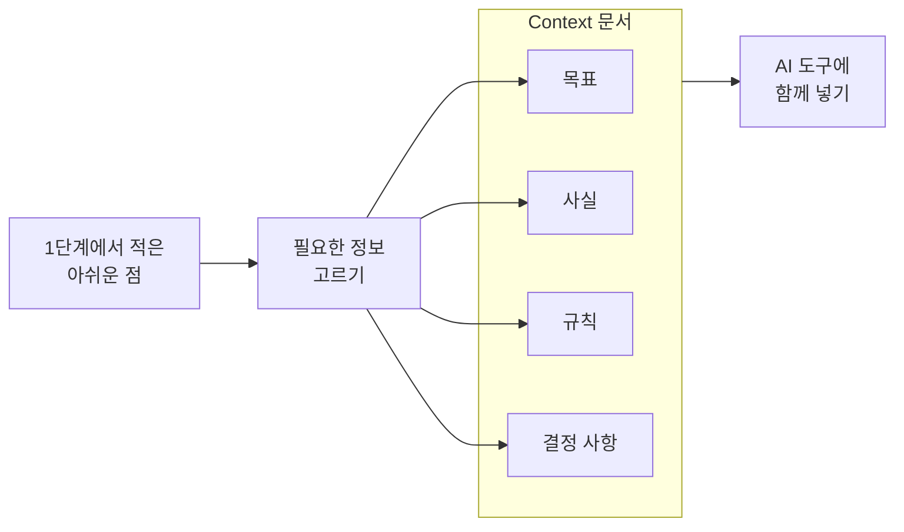
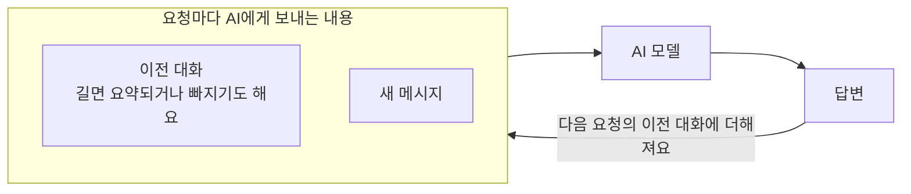
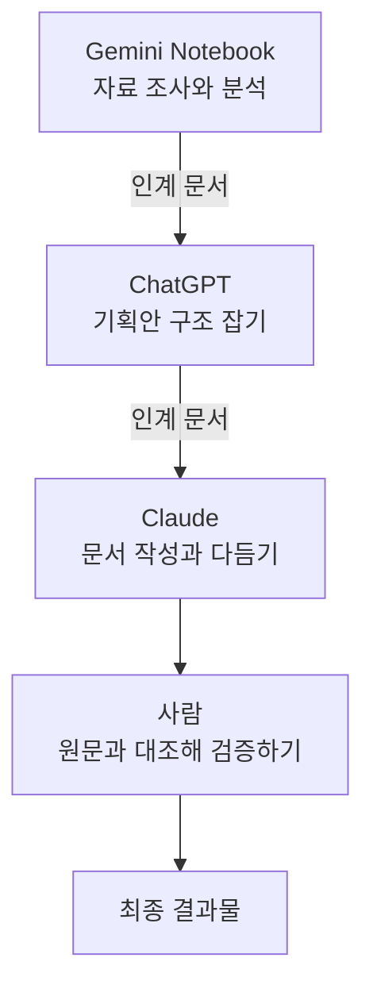

# Context Engineering

AI와 오래 작업하다 보면 이런 일이 생겨요.

- 대화가 길어지자 AI가 앞에서 정한 내용을 놓쳐요.
- 새 채팅을 열 때마다 프로젝트 상황을 처음부터 다시 설명해요.
- 다른 AI 도구로 옮기면서 중요한 정보가 빠져요.
- 자료를 많이 줬는데도 AI가 오래된 자료와 최신 자료를 헷갈려요.

프롬프트를 잘 써도 이 문제는 잘 풀리지 않아요. 무엇을 요청하느냐보다 AI가 무엇을 알고 작업하느냐가 문제거든요.

AI가 작업할 때 참고하는 정보와 맥락을 **Context**라고 해요. 필요한 정보를 고르고, 정리하고, 전달하고, 최신으로 유지하는 과정을 **Context Engineering**이라고 해요. [Prompt Engineering](./prompt-engineering)이 무엇을 어떻게 요청할지 다룬다면, Context Engineering은 AI가 무엇을 알고 작업해야 하는지 다뤄요.

이 문서를 따라 하면 다음을 할 수 있어요.

- 내 프로젝트의 Context 문서를 만들 수 있어요.
- 긴 대화에서 중요한 결정을 잃지 않을 수 있어요.
- 새 대화나 다른 AI 도구로 작업을 이어 갈 수 있어요.

<Callout tone="success" title="많이 넣는 것보다 필요한 것을 넣는 게 중요해요">

Context Engineering은 AI에게 정보를 최대한 많이 주는 기술이 아니에요. 지금 작업에 필요한 정보를 골라 주고, 바뀐 내용을 계속 반영하는 과정이에요.

</Callout>

## 준비하기

다음 두 가지를 준비해 주세요. 코딩 경험은 없어도 괜찮아요.

| 준비물 | 설명 |
| --- | --- |
| AI 도구 | ChatGPT, Claude, Gemini처럼 대화할 수 있는 AI 도구라면 무엇이든 괜찮아요. |
| 내 프로젝트 | 진행 중인 프로젝트나 반복 업무를 하나 골라요. 없다면 블로그 글쓰기, SNS 홍보, 회의록 정리, 학습 계획 관리 중 하나를 골라도 돼요. |

이 문서는 'AI 동아리 홍보 프로젝트'를 예시로 써요. 각 단계에서 예시를 보고, 같은 작업을 내 프로젝트로 해 보세요.

## 1단계: Context 없이 요청해 보기

먼저 평소처럼 요청해서 비교할 기준을 만들어요. Context를 넣은 뒤 무엇이 달라졌는지 확인하려면 넣기 전의 결과가 있어야 해요.

```text
이번 주 동아리 홍보 글을 써 줘.
```

결과를 저장해 두고, 결과에서 아쉬운 점을 적어 보세요. 예시 프로젝트라면 이런 점이 아쉬울 수 있어요.

- 어떤 동아리인지 몰라서 일반적인 소개 글이 나왔어요.
- 누구를 대상으로 쓰는지 몰라서 전문 용어가 섞였어요.
- 확인되지 않은 혜택을 지어냈어요.

이 아쉬운 점이 곧 AI에게 알려 줘야 할 정보예요.

## 2단계: 필요한 정보 고르기

1단계에서 적은 아쉬운 점을 보고 AI에게 줄 정보를 골라요. 정보를 고를 때는 다음 질문으로 확인해 주세요.

| 기준 | 확인할 질문 |
| --- | --- |
| 관련성 | 지금 작업에 필요한 정보인가요? |
| 정확성 | 믿을 수 있는 자료인가요? |
| 최신성 | 오래된 정보와 최신 정보를 구분했나요? |
| 명확성 | 목표와 조건이 분명한가요? |
| 일관성 | 서로 부딪치는 규칙은 없나요? |
| 출처 | 정보의 출처를 확인할 수 있나요? |
| 재사용 | 다음 작업에서도 고쳐서 다시 쓸 수 있나요? |
| 안전성 | 넣으면 안 되는 정보를 뺐나요? |

고른 정보는 목표, 사실, 규칙, 결정 사항으로 나눠 두세요. 이미 정한 것과 아직 정하지 않은 것을 나눠 두면, AI가 미정인 내용을 확정된 것처럼 쓰는 일을 줄일 수 있어요.



자료가 너무 많아 고르기 어렵다면 자료를 중심으로 답하는 도구를 써 보세요. 예를 들어 [Gemini Notebook](https://support.google.com/gemininotebook/answer/16164461?hl=ko)(옛 이름 NotebookLM)은 올린 자료를 바탕으로 답하고, 답의 근거가 된 부분을 인용으로 보여 줘요.

<Callout tone="warning" title="민감한 정보는 넣기 전에 빼 주세요">

Context로 넣은 자료는 AI 서비스로 전송돼요. 서비스와 설정에 따라 보관되거나 서비스 개선에 쓰일 수도 있어요.

개인정보, 비밀번호와 API Key, 외부로 내보내면 안 되는 내부 자료는 빼거나 가린 뒤 넣어 주세요. 여러 사람이 함께 보는 Context 문서에도 비밀 값을 적지 마세요. 대화가 서비스 개선에 쓰이는지는 쓰는 서비스의 개인정보 설정과 공식 안내에서 확인해 주세요.

</Callout>

## 3단계: Context 문서 만들기

고른 정보를 문서 하나에 정리해요. 이 문서를 만들어 두면 대화마다 같은 설명을 반복하지 않아도 되고, 새 대화나 다른 도구로 넘길 때도 그대로 쓸 수 있어요.

이 문서에서는 `CONTEXT.md`라는 이름의 Markdown 파일로 만들지만, 이름과 형식은 자유예요. Notion이나 Google Docs 문서로 만들어도 괜찮아요.

다음 템플릿을 복사해서 내 프로젝트로 채워 보세요.

```md
# 프로젝트 Context

## 1. 프로젝트 이름

## 2. 목표
해결하려는 문제와 최종적으로 얻고 싶은 결과

## 3. 대상
결과물을 쓰는 사람, 작업의 대상

## 4. 현재 상황
지금까지 한 일과 지금 풀어야 할 문제

## 5. 참고 자료
AI가 참고해야 할 문서, 데이터, 이미지

## 6. 작업 규칙
반드시 지킬 조건과 피해야 할 행동

## 7. 확정된 사항
이미 정한 내용

## 8. 미확정 사항
아직 정하지 않았거나 확인이 필요한 내용

## 9. 다음 작업
다음에 할 일
```

<details>
<summary>예시 프로젝트의 Context 문서 보기</summary>

```md
# 프로젝트 Context

## 1. 프로젝트 이름
AI 동아리 홍보 프로젝트

## 2. 목표
AI 활용 경험이 많지 않은 사람도 관심을 갖고
동아리에 새로 참여하도록 한다.

## 3. 대상
- 개발자
- 마케터
- 기획자
- 디자이너
- AI에 관심 있는 비전공자

## 4. 현재 상황
- 동아리 소개 문구를 작성했다.
- 홍보 콘텐츠 초안을 만들고 있다.

## 5. 참고 자료
- 기존 동아리 소개 문서
- 회차별 활동 계획
- 기존 홍보 콘텐츠

## 6. 작업 규칙
- 전문 용어를 남용하지 않는다.
- 확인되지 않은 혜택을 홍보하지 않는다.
- 초보자도 이해할 수 있게 설명한다.

## 7. 확정된 사항
- 강의보다 직접 실습하고 경험을 나누는 모임이다.
- 주요 활동은 AI 활용 사례 공유, 프롬프트 실습, 팀 프로젝트다.

## 8. 미확정 사항
- 최종 홍보 채널
- 홍보 일정
- 사용할 이미지

## 9. 다음 작업
홍보 문구를 검토하고 채널별 콘텐츠로 발전시킨다.
```

</details>

지금까지 나눈 대화가 있다면 AI에게 초안을 맡겨도 돼요. [6단계](#6단계-새-대화나-다른-도구로-넘기기)의 인계 문서 프롬프트에서 앞의 두 문단을 "지금까지 나눈 대화를 바탕으로 `CONTEXT.md` 문서를 작성해 줘."로 바꿔 쓰면 돼요.

Claude Code나 Codex 같은 코딩 도구는 `CLAUDE.md`, `AGENTS.md` 같은 지침 파일을 대화를 시작할 때 자동으로 읽어요. 도구별 파일 이름과 읽는 방식은 [Claude Code](https://code.claude.com/docs/ko/memory)와 [Codex](https://learn.chatgpt.com/docs/agent-configuration/agents-md)의 공식 문서에서 볼 수 있어요.

<Callout tone="warning" title="AI가 쓴 Context 문서는 꼭 검토해 주세요">

AI가 쓴 문서에는 실제로 정하지 않은 규칙이나 잘못된 정보가 들어갈 수 있어요. 사람이 읽고 확정한 뒤에 쓰세요.

문서가 너무 길거나 규칙끼리 부딪치면 AI가 일부를 놓치거나 한쪽만 따를 수 있어요. 짧게 유지하고 가끔 정리해 주세요.

</Callout>

## 4단계: Context를 넣고 다시 요청하기

만든 Context 문서를 넣고 1단계와 같은 작업을 다시 요청해요.

```text
아래 프로젝트 Context를 참고해서 작업해 줘.

먼저 프로젝트의 목표와 현재 상황을 확인해.
그다음 요청한 작업을 하되, 작업 규칙을 반드시 지켜 줘.
Context에 없는 정보를 확정된 사실처럼 만들지 마.
추가로 확인할 내용은 "확인 필요"로 표시해 줘.

<Project Context>
(3단계에서 만든 Context 문서를 붙여 넣기)
</Project Context>

[Task]
이번 주 동아리 홍보 글을 써 줘.
```

Context가 길다면 다음 순서를 지켜 주세요. 입력이 길어지면 AI가 가운데 있는 정보를 덜 활용하는 경향이 있어서, 꼭 지킬 내용이 가운데에 묻히지 않게 해야 해요.

- 긴 자료는 앞에, 할 일과 꼭 지킬 조건은 마지막에 적어요. 위의 프롬프트처럼 지킬 조건을 자료 앞에도 짧게 적어 두면 더 좋아요.
- 오래된 버전의 자료는 빼거나 "이전 버전"이라고 표시해요.

결과가 나오면 1단계의 결과와 비교해 보세요.

- 프로젝트 목표를 반영했나요?
- 대상과 작업 규칙을 지켰나요?
- 결과가 더 구체적인가요?
- 지어낸 정보가 줄었나요?
- 실제로 쓸 수 있나요?

## 5단계: 긴 대화 정리하기

AI 모델은 대화를 기억하지 않아요. 서비스가 이전 대화를 요청마다 다시 넣어 줘서 대화가 이어지는 것처럼 보일 뿐이에요. 한 번에 다룰 수 있는 양(**Context Window**)에는 한도가 있어서, 대화가 길어지면 서비스가 앞부분을 요약하거나 일부만 넣기도 해요. 그래서 채팅 화면에 보이는 내용이 모두 AI에게 전달되는 건 아니에요.



자세한 원리는 Claude 공식 문서의 [컨텍스트 윈도우](https://platform.claude.com/docs/ko/build-with-claude/context-windows) 설명에서 볼 수 있어요.

대화가 길어져 처음 정한 조건이나 최신 결정을 AI가 놓친다면 다음 방법 가운데 하나를 골라요.

| 방법 | 하는 일 | 이럴 때 써요 |
| --- | --- | --- |
| 압축하기 (Compact) | 지금까지의 대화를 요약으로 바꿔 줄여요. | 같은 작업을 계속 이어 가고 싶을 때 |
| 새로 시작하기 (Clear) | 대화를 비우고 빈 상태로 시작해요. | 작업 주제가 크게 바뀌었을 때 |
| 넘기기 (Handoff) | 필요한 정보만 정리해 새 대화로 넘겨요. | 새 대화나 다른 도구에서 이어 가고 싶을 때 |

### 압축하기

Claude Code나 Codex 같은 도구는 `/compact` 명령으로 대화를 요약해서 줄일 수 있어요. 압축하면 세부 내용이 빠질 수 있으니, 압축한 뒤에는 다음을 확인해 주세요.

- 프로젝트 목표가 남아 있나요?
- 확정된 결정이 빠지지 않았나요?
- 꼭 지킬 규칙이 남아 있나요?
- 아직 풀지 못한 문제가 기록돼 있나요?

대화 초반에 준 자세한 지시는 압축할 때 사라지기 쉬워요. 계속 지켜야 할 규칙은 대화가 아니라 Context 문서에 적어 두세요.

### 새로 시작하기

일반 AI 채팅에서는 새 채팅을 여는 게 새로 시작하기예요. 쌓인 불필요한 내용과 함께 필요한 정보도 사라지니까, 시작하기 전에 Context 문서를 최신으로 고쳐 두세요.

새 대화는 이럴 때 열어요.

- 새로운 종류의 작업을 시작할 때
- 이전 대화에 불필요한 정보가 많이 쌓였을 때
- 자료 조사와 글쓰기를 나누고 싶을 때
- 여러 대안을 서로 섞이지 않게 비교하고 싶을 때

## 6단계: 새 대화나 다른 도구로 넘기기

새 대화나 다른 AI 도구는 이전 대화를 그대로 이어받지 못해요. 지난 대화를 참고하는 메모리나 연결 기능이 있어도 실제로 볼 수 있는 범위는 제품과 설정에 따라 달라요. 그래서 작업을 넘길 때는 다음 작업에 필요한 정보를 정리한 **인계 문서**를 함께 넘겨요. 이 문서에서는 이 과정을 **Context Handoff**라고 불러요.

인계 문서에는 다음 내용을 담아요. 3단계의 Context 문서와 거의 같아서, Context 문서가 최신이라면 그대로 넘겨도 돼요.

| 항목 | 적을 내용 |
| --- | --- |
| 목표와 배경 | 프로젝트가 무엇을 이루려 하는지 |
| 주요 요구사항 | 결과물이 갖춰야 할 것 |
| 확정된 결정 | 이미 정한 내용 |
| 지켜야 할 규칙 | 반드시 지킬 조건 |
| 현재 상황 | 어디까지 했는지 |
| 미해결 문제 | 아직 풀지 못한 문제 |
| 다음 작업 | 바로 이어서 할 일 |
| 참고 자료 | 자료 이름과 출처 |

인계 문서는 직접 써도 되고, 지금 대화의 AI에게 맡겨도 돼요.

<details>
<summary>인계 문서 작성 프롬프트 보기</summary>

```text
지금 대화에서 진행한 작업을
새 대화(또는 다른 AI 도구)에서 이어 가려고 해.

다음 AI가 프로젝트를 이해하고 바로 작업할 수 있도록
인계 문서를 작성해 줘.

[포함할 내용]
1. 프로젝트 목표와 배경
2. 지금까지 완료한 작업
3. 주요 요구사항
4. 확정된 결정 사항
5. 반드시 지켜야 할 규칙
6. 해결하지 못한 문제
7. 다음에 할 작업
8. 참고해야 할 자료와 출처

[작성 조건]
- 실제 대화에서 확인된 사실만 작성해.
- 확정된 내용과 제안 단계의 내용을 구분해.
- 중요한 내용을 임의로 생략하지 마.
- 정보가 부족하면 "확인 필요"로 표시해.
- 간결하고 구조적인 Markdown으로 작성해.

마지막에는 넘기기 전에 내가 직접 확인해야 할 항목도 정리해 줘.
```

</details>

AI가 정리한 인계 문서에도 빠지거나 잘못 요약된 내용이 있을 수 있어요. 넘기기 전에 한 번 읽어 주세요.

### 다른 도구로 이어 가기

도구마다 잘하는 일이 달라서 여러 도구를 이어 쓰기도 해요. 예를 들면 이런 흐름이에요.



도구별 역할이 정해져 있는 건 아니에요. 프로젝트와 쓸 수 있는 기능에 따라 바꿔 쓰면 돼요.

예시 프로젝트라면 ChatGPT에서 다듬은 홍보 문구와 인계 문서를 Claude로 넘겨, 채널별 콘텐츠를 만들 수 있어요. 넘긴 뒤에는 다음을 확인해 주세요.

- [ ] 프로젝트 목표가 정확히 전달됐나요?
- [ ] 기존 결정이 빠지지 않았나요?
- [ ] 미확정 사항이 확정된 것처럼 바뀌지 않았나요?
- [ ] 새 AI가 참고 자료를 실제로 볼 수 있나요? 파일은 다시 올려야 할 수 있어요.
- [ ] 이전 작업과 부딪치는 답을 내지 않나요?

## AI Log에 기록하기

실습 결과를 [AI Log](../logs/new)에 남겨 주세요. 이번에는 프롬프트보다 **어떤 정보를 더했고, 왜 더했는지**를 적는 게 중요해요. 그래야 다른 구성원도 어떤 Context가 효과 있었는지 알 수 있어요.

<details>
<summary>AI Log 작성 예시 보기</summary>

```text
제목
동아리 홍보 글에 프로젝트 Context 넣어 보기

사용한 도구
ChatGPT

시도한 내용
처음에는 "이번 주 동아리 홍보 글을 써 줘"라고만 요청했다.
목표, 대상, 작업 규칙, 확정·미확정 사항을 담은 Context 문서를 만들어
같은 작업을 다시 요청했다.

결과
첫 번째 결과: 일반적인 소개 글이 나왔고, 없는 수료증 혜택을 지어냈다.
Context를 넣은 결과: 실습 중심 모임이라는 점과 대상 직군이 드러났다.
홍보 채널은 미확정이라 "확인 필요"로 표시됐다.

배운 점
작업 규칙보다 "확정된 사항"을 적은 게 효과가 컸다.
대상 목록은 길게 적어도 결과가 크게 달라지지 않았다.

다음 행동
Context 문서를 Claude로 넘겨 채널별 콘텐츠를 만들어 본다.
```

</details>

## 자주 묻는 질문

<details>
<summary>새 채팅을 자주 열면 결과가 더 정확해지나요?</summary>

꼭 그렇지는 않아요. 새 채팅은 쌓인 불필요한 내용을 줄여 주지만, 필요한 정보를 함께 넘기지 않으면 오히려 결과가 나빠질 수 있어요.

지금 대화에서 필요한 맥락이 잘 유지되고 있다면 계속 쓰세요. 작업 주제가 크게 바뀌었거나 오래된 정보가 많이 쌓였을 때 인계 문서와 함께 새 채팅을 열면 돼요.

</details>

<details>
<summary>AGENTS.md나 CLAUDE.md를 만들어 두면 AI가 항상 따르나요?</summary>

아니에요. 지침 문서는 AI가 참고하는 Context일 뿐, 반드시 지켜지는 설정이 아니에요. 지침이 길거나 서로 부딪치면 일부를 놓칠 수 있어요.

지침 문서는 대개 대화를 시작할 때 읽어요. 대화 중에 고친 내용은 새 대화에서야 반영될 수 있어요. 결과에서 규칙이 실제로 지켜졌는지 확인해 주세요.

</details>

<details>
<summary>Notion에 자료를 넣어 두면 AI가 모두 기억하나요?</summary>

아니에요. Notion에 자료를 저장하는 것과 AI가 그 자료를 읽고 쓰는 건 달라요. AI가 쓸 수 있는 정보는 연결 도구, 접근 권한, 검색 범위에 따라 달라져요. 필요한 부분을 찾아 Context로 넣어 줘야 AI가 활용할 수 있어요.

</details>

<details>
<summary>다른 AI로 옮길 때 대화를 모두 복사해야 하나요?</summary>

그럴 필요 없어요. 긴 대화를 통째로 옮기면 바뀌기 전의 결정과 바뀐 뒤의 결정이 섞이기 쉬워요.

인계 문서와 필요한 원문 자료만 넘기고, 요약하면서 빠진 내용이 없는지 확인해 주세요.

</details>

<details>
<summary>다른 AI에 넘길 문서는 PRD로 써야 하나요?</summary>

그럴 필요 없어요. **PRD(Product Requirements Document)** 는 주로 제품의 요구사항을 정리하는 문서예요. 작업을 이어 가는 데 필요한 배경, 결정, 진행 상황을 넘기는 게 목적이라면 간단한 인계 문서로 충분해요.

</details>
