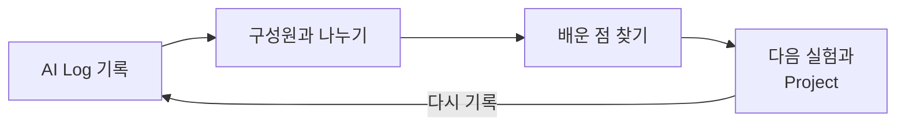
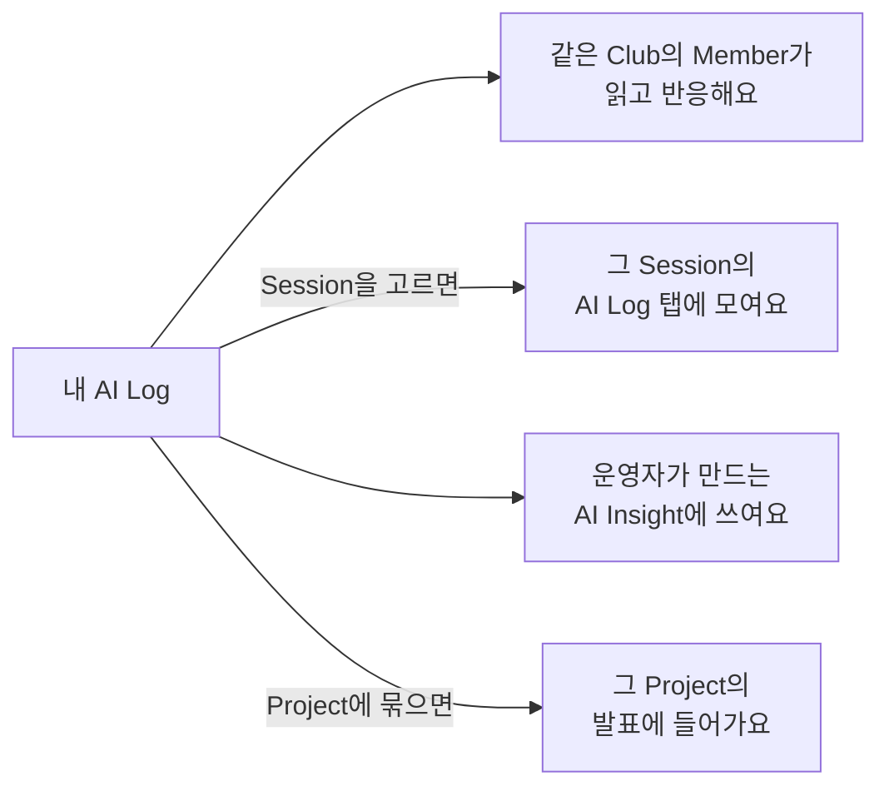

# AI Club OS 시작하기

AI Club OS는 동아리와 스터디에서 AI를 써 본 경험을 기록하고 나누는 공간이에요. 기록이 쌓이면 다른 구성원의 시도에서 배우고, 배운 것을 다음 실험과 Project로 이어 갈 수 있어요.



이 문서를 따라 하면 10분 안에 다음을 할 수 있어요.

- 초대 링크로 Club에 참여해요.
- 참여할 Session을 확인해요.
- 첫 AI Log를 작성하고 저장해요.
- 다른 구성원의 AI Log를 찾아 읽고 반응을 남겨요.

## 준비하기

시작하기 전에 두 가지만 준비해 주세요.

| 준비물 | 설명 |
| --- | --- |
| Google 계정 | AI Club OS에는 Google 계정으로 로그인해요. |
| 초대 링크 | Club 운영자에게 받아요. 만든 날부터 7일 동안 쓸 수 있어요. |

AI로 해 본 경험을 하나 떠올려 두면 3단계에서 바로 쓸 수 있어요. 회의록 요약이나 이메일 초안 작성처럼 작은 경험이면 충분해요.

## 1단계: Club에 참여하기

Club은 함께 활동하는 동아리나 스터디 공간이에요. Club에 참여해야 그 Club의 Session과 AI Log를 볼 수 있어요.

1. 운영자에게 받은 초대 링크를 열어요.
2. 로그인 화면이 나오면 Google 계정으로 로그인해요.
3. Club 소개를 확인하고 **참여하기**를 눌러요.

참여하면 바로 그 Club의 개요 화면이 열리고, 첫 화면의 **내 Club**에도 보여요. 다른 Club도 함께 보이지만, 이름, 소개, 로고, Member 수만 볼 수 있어요. 다른 Club에 들어가려면 그 Club의 초대 링크가 있어야 해요.

초대 링크가 열리지 않으면 [문제 해결하기](#문제-해결하기)를 확인해 주세요.

## 2단계: Session 확인하기

Session은 동아리나 스터디의 활동 회차예요. 회차를 미리 확인하면 일정과 목표를 알고, 참고 자료를 읽은 뒤 참여할 수 있어요.

1. [Session 목록](../sessions)을 열어요.
2. **오늘** 또는 **예정**으로 표시된 회차를 골라요.
3. **개요** 탭에서 날짜, 장소, 목표, 시간표를 확인해요.
4. 참고 자료가 있으면 미리 읽어 두세요.

Session 시각은 한국 시간으로 보여요. 출석은 운영자가 기록하고, Session 화면의 **Attendance** 탭에서 누구나 볼 수 있어요.

## 3단계: 첫 AI Log 작성하기

AI Log는 AI로 시도한 방법과 결과, 배운 점을 남기는 기록이에요. 같은 Club의 구성원 모두가 읽을 수 있어서, 내 시도가 다른 사람의 출발점이 돼요.

성공한 경험만 남길 필요는 없어요. 원하는 결과를 얻지 못한 시도도 좋은 기록이에요.

저장한 AI Log는 이렇게 쓰여요. 따로 고르지 않아도 모든 기록에 같아요.



<Callout tone="warning" title="개인정보와 인증 정보는 적지 마세요">

AI Log는 같은 Club의 구성원 모두가 읽고, Project에 묶은 기록은 발표 링크를 받은 Club 밖의 사람도 읽어요. 다른 사람의 개인정보, 조직의 비공개 자료, 비밀번호나 API Key 같은 인증 정보는 적지 마세요.

</Callout>

### 필수 항목만 채워 저장하기

제목과 시도한 내용, 두 칸만 채우면 저장할 수 있어요.

1. [AI Log 작성](../logs/new) 화면을 열어요.
2. 2단계에서 확인한 회차와 관련된 경험이라면 **Session**을 골라요. 그 회차의 **AI Log** 탭에 기록이 모여요.
3. **제목**에 무엇을 시도했는지 한 줄로 적어요.
4. **시도한 내용**에 해결하려던 문제와 AI에 입력한 프롬프트를 적어요.
5. **저장**을 눌러요.

필수 항목만 채우면 이렇게 돼요.

```text
제목
회의록을 세 줄로 요약하기

시도한 내용
회의 메모가 길어서 핵심만 빠르게 보고 싶었다.
ChatGPT에 메모 전체를 붙여 넣고 "이 회의록을 세 줄로 요약해 줘"라고 요청했다.
```

### 선택 항목까지 채우기

**사용한 도구**, **결과**, **배운 점**, **다음 행동**까지 채우면 나중에 같은 문제를 만났을 때 기록을 다시 쓸 수 있어요. 이미 저장한 기록은 AI Log 화면의 **수정**에서 채우면 돼요.

처음 입력한 프롬프트와 고친 프롬프트를 함께 남겨 주세요. 무엇을 바꿔서 결과가 좋아졌는지 다른 구성원도 알 수 있어요.

<details>
<summary>선택 항목까지 채운 예시 보기</summary>

```text
제목
회의록을 결정 사항과 후속 작업으로 나눠 정리하기

사용한 도구
ChatGPT

시도한 내용
회의 메모에서 결정 사항과 후속 작업을 골라내는 데 시간이 오래 걸렸다.
처음에는 "이 회의록을 세 줄로 요약해 줘"라고 요청했다.
결과가 아쉬워서 프롬프트를 다음과 같이 고쳤다.

"회의록을 핵심 요약, 결정된 사항, 후속 작업, 확인이 필요한 질문으로 나눠 정리해 줘.
후속 작업에는 담당자와 기한을 함께 적어 줘.
원문에 없는 담당자나 기한은 만들지 말고 '확인 필요'로 표시해 줘."

결과
첫 번째 프롬프트: 내용은 짧아졌지만 결정 사항과 후속 작업이 섞였다.
고친 프롬프트: 결정 사항과 후속 작업이 나뉘었다.
담당자가 없는 작업은 '확인 필요'로 표시되어 따로 확인할 수 있었다.

배운 점
결과의 구조를 정해 주면 필요한 정보를 찾기 쉽다.
원문에 없는 내용을 만들지 말라는 조건도 함께 줘야 한다.

다음 행동
고친 프롬프트를 저장해 두고 다음 회의에도 써 본다.
```

</details>

저장한 뒤에는 AI Log 화면의 **이미지 붙이기**로 화면 캡처를 붙일 수 있어요. PNG, JPEG, WebP, GIF 파일을 한 장에 5MB까지, 한 기록에 4장까지 붙일 수 있어요. 이미지는 Club의 Member만 보고, AI Insight와 발표에는 쓰이지 않아요.

더 궁금한 내용은 아래 문서에서 확인해 주세요.

- 다시 쓸 수 있는 기록을 남기는 방법: [Prompt Engineering의 AI Log에 기록하기](./prompt-engineering#ai-log에-기록하기)
- 프롬프트를 고치는 방법: [Prompt Engineering](./prompt-engineering)

## 4단계: 다른 구성원의 AI Log 읽기

같은 AI 도구라도 사람마다 쓰는 방법이 달라요. 다른 구성원의 기록을 읽다 보면 내 작업에 쓸 방법을 찾을 수 있어요.

1. [AI Log 목록](../logs)을 열어요.
2. 관심 있는 주제나 도구를 검색해요. 제목, 내용, 도구로 검색하고 Session이나 도구로 걸러 볼 수 있어요.
3. 기록을 열고 어떤 문제를 어떤 프롬프트로 풀었는지 읽어요.
4. 도움이 됐다면 **도움이 됐어요**를 누르거나 댓글을 남겨요.

댓글로 이렇게 물어볼 수 있어요.

- "이 방법을 고른 이유가 있나요?"
- "이런 조건을 더하면 결과가 어떻게 달라질까요?"
- "비슷한 문제를 겪고 있는데, 이 방법을 적용해 봐도 될까요?"

내 기록에 댓글이나 **도움이 됐어요**가 달리면 [알림](../notifications)에서 알려 드려요.

## 5단계: 다음 행동 정하기

배운 점은 다음 실험으로 이어질 때 더 쓸모 있어져요. 첫 AI Log의 **다음 행동**을 보고, 지금 상황에 맞는 일을 하나 골라 보세요.

| 상황 | 할 일 |
| --- | --- |
| 같은 문제를 다른 방법으로 풀어 보고 싶어요 | 새 AI Log를 작성해요. |
| 반복해서 쓸 만한 작업을 찾았어요 | [Project](../projects)를 만들어요. |
| 다른 구성원과 함께 풀고 싶은 문제가 있어요 | 그 사람이 참여하는 Project에 **참여 요청**을 보내요. |
| 회차나 Project를 마쳤어요 | 회고를 작성해요. |

회차의 회고는 Session 화면의 **회고** 탭에서, Project의 회고는 Project 화면에서 그 Project의 참여자가 써요. 한 달을 돌아보는 회고는 [회고](../retros) 화면에서 써요.

## 문제 해결하기

<details>
<summary>초대 링크로 참여할 수 없다고 나와요</summary>

링크의 유효 기간 7일이 지났거나, 운영자가 새 링크를 만들어 이전 링크가 막혔을 수 있어요. 운영자에게 새 초대 링크를 요청해 주세요.

운영자가 나를 Club에서 내보내면서 다시 들어오지 못하게 막았다면, 그 Club의 운영자에게 차단을 풀어 달라고 요청해야 해요.

</details>

<details>
<summary>AI Log를 쓰다가 창을 닫았어요</summary>

작성 중인 내용은 지금 쓰는 브라우저에 7일 동안 임시 저장돼요. 같은 브라우저에서 [AI Log 작성](../logs/new) 화면을 다시 열면 이어서 쓸 수 있어요.

임시 저장된 내용은 서버로 보내지 않아서 다른 기기에서는 이어서 쓸 수 없어요. 다 쓰고 나면 **저장**을 눌러야 Club에 기록이 남아요.

</details>

<details>
<summary>Club에 보이는 내 이름을 바꾸고 싶어요</summary>

[Member](../members) 화면에서 내 이름 옆 메뉴를 열고 **내 이름 고치기**를 골라요. 바꾼 이름은 그 Club 안에서만 쓰여요.

처음 이름과 프로필 사진은 Google 계정에서 가져와요.

</details>
