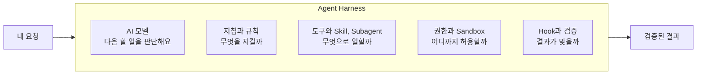
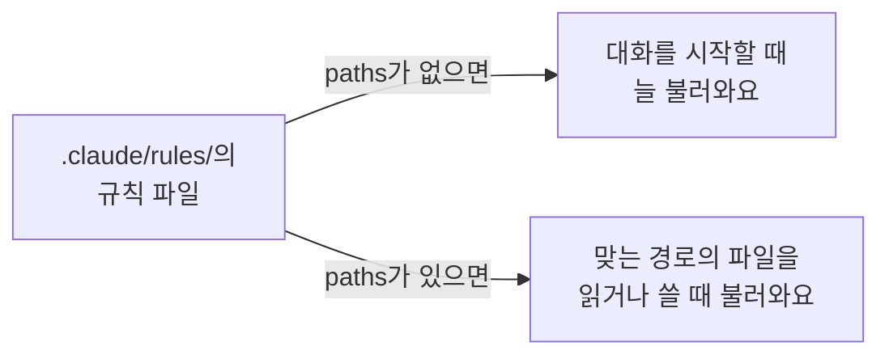
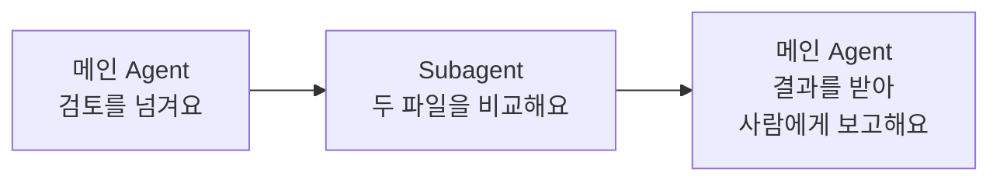
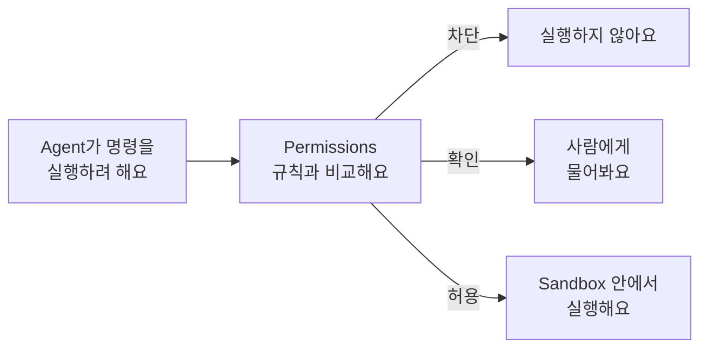
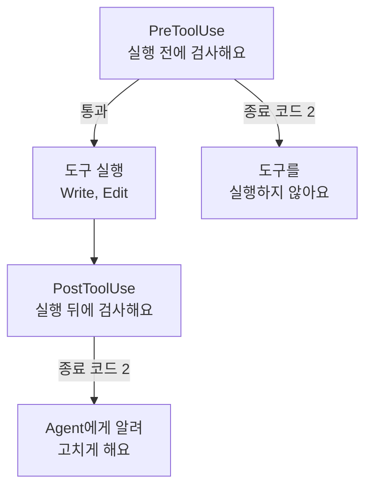
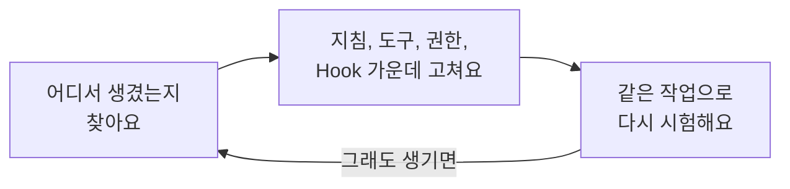

# Harness Engineering

AI Agent를 쓰다 보면 이런 일이 생겨요.

- 프로젝트 규칙을 매번 다시 설명해요.
- 같은 작업인데 결과 형식이 매번 달라요.
- 고치지 말아야 할 파일을 Agent가 고쳐요.
- 결과가 잘못됐을 때 어디서 틀렸는지 찾기 어려워요.

이런 문제는 프롬프트를 길게 쓴다고 다 풀리지 않아요. Agent가 일하는 **환경**을 손봐야 해요.

AI 모델이 실제 작업을 할 수 있게 받쳐 주는 주변 장치를 **Agent Harness**라고 해요. 지침 파일, 규칙, Skill, 도구, 권한, 검증 장치가 모두 여기에 들어가요. 이 환경을 목적에 맞게 꾸리고 고쳐 가는 일을 **Harness Engineering**이라고 해요.



지금까지 다룬 문서와 비교하면 이래요.

| 문서 | 정하는 것 |
| --- | --- |
| [Prompt Engineering](./prompt-engineering) | 무엇을 요청할까? |
| [Context Engineering](./context-engineering) | 어떤 정보를 줄까? |
| [AI Agent](./ai-agent) | 어떤 작업을 맡길까? |
| [Skill과 Automation](./skill-automation) | 반복 작업을 어떻게 다시 쓰고, 언제 실행할까? |
| Harness Engineering | Agent가 어떤 환경과 제약 안에서 일하고, 결과를 어떻게 검증할까? |

이 문서를 따라 하면 다음을 할 수 있어요.

- 공통 지침과 세부 규칙을 나눠 둘 수 있어요.
- 검토만 맡는 Subagent를 만들어 작업을 넘길 수 있어요.
- Agent의 권한과 실행 범위를 확인할 수 있어요.
- Hook으로 매번 실행돼야 하는 검사를 걸 수 있어요.

<Callout tone="success" title="설정 파일을 많이 만드는 게 목표가 아니에요">

필요한 규칙과 도구를 알맞게 주고, 결과를 검증할 수 있게 만드는 게 목표예요. 단순한 작업이라면 공통 지침 하나로 충분할 때도 많아요. 이번에는 서비스를 개발하지 않고, 작은 회의록 정리 작업에 장치를 하나씩 더해 봐요.

</Callout>

## 준비하기

| 준비물 | 설명 |
| --- | --- |
| Claude Code 또는 Codex | 둘 중 하나만 골라 주세요. 두 도구를 모두 설정할 필요는 없어요. |
| Agent 사용 경험 | [AI Agent](./ai-agent)와 [Skill과 Automation](./skill-automation) 문서를 따라 해 봤다면 충분해요. |

두 도구는 설정 파일의 위치와 형식이 달라요. 이 문서에서 쓰는 파일만 추리면 이래요.

| 용도 | Claude Code | Codex |
| --- | --- | --- |
| 프로젝트 공통 지침 | `CLAUDE.md` | `AGENTS.md` |
| 세부 작업 규칙 | `.claude/rules/*.md` | `AGENTS.md` 안의 절, 또는 하위 폴더의 `AGENTS.md` |
| Subagent 정의 | `.claude/agents/*.md` | `.codex/agents/*.toml` |
| 권한과 실행 설정 | `.claude/settings.json` | `.codex/config.toml` |
| 명령 실행 정책 | `.claude/settings.json`의 `permissions` | `.codex/rules/*.rules` |

## 1단계: 실습 폴더와 공통 지침 만들기

다음 구조로 폴더를 만들어 주세요. 도구별 설정 폴더(`.claude/` 또는 `.codex/`)는 다음 단계부터 더해요.

```text
harness-practice/
├── AGENTS.md
├── CLAUDE.md
├── input/
│   └── meeting.md
└── output/
```

`input/meeting.md`에는 다음 가상 회의록을 넣어 주세요.

<details>
<summary>input/meeting.md 내용 보기</summary>

```md
# 가상 동아리 운영 회의

## 논의 내용

다음 모임에서는 AI Agent 활용 사례를 공유하기로 했습니다.

구성원들은 각자 사용해 본 AI 도구를 소개하기로 했습니다.

발표 형식은 아직 결정되지 않았습니다.

## 결정 사항

- 다음 모임에서 AI 활용 사례를 공유합니다.
- 각자 하나 이상의 사례를 준비합니다.

## 확인 필요

- 발표 시간
- 발표 순서
- 자료 제출 기한

## 담당자

현재 담당자는 확정되지 않았습니다.
```

</details>

`AGENTS.md`에는 프로젝트 전체에서 늘 지킬 규칙을 적어요.

```md
# AGENTS.md

## Project

AI Agent Harness 학습용 프로젝트입니다.

## Common Rules

- 모든 결과는 한국어로 작성합니다.
- input/ 폴더의 원본 파일은 수정하지 않습니다.
- 결과 파일은 output/ 폴더에 저장합니다.
- 원문에 없는 내용을 추측해서 작성하지 않습니다.
- 불확실한 정보는 "확인 필요"로 표시합니다.

## Verification

- 결과 파일이 실제로 생성되었는지 확인합니다.
- 원본 내용과 결과가 일치하는지 확인합니다.
- 수행하지 않은 작업을 완료했다고 보고하지 않습니다.
```

Claude Code를 쓴다면 `CLAUDE.md`에서 이 규칙을 불러와요. Codex만 쓴다면 `CLAUDE.md`는 만들지 않아도 돼요. 두 파일을 함께 두는 이유는 [AI Agent의 3단계](./ai-agent#3단계-claudemd에서-공통-규칙-불러오기)에서 알려 드려요.

```md
@AGENTS.md

## Claude Code

- 작업 전에 관련 파일을 확인합니다.
- 작업이 끝나면 변경된 파일을 보고합니다.
```

## 2단계: 세부 규칙 나누기

공통 지침에 모든 규칙을 넣으면 파일이 길어지고, 길어질수록 Agent가 일부를 놓치기 쉬워요. 특정 파일을 다룰 때만 필요한 규칙은 따로 떼어 두면, 필요할 때만 불러와져요.

이번에는 `output/`에 저장할 요약 문서의 작성 규칙을 따로 만들어요.

### Claude Code: `.claude/rules/`

`.claude/rules/summary.md`를 만들고 다음 내용을 넣어 주세요. 맨 위 `---` 사이의 `paths`가 이 규칙을 적용할 파일을 정해요.

```md
---
paths:
  - "output/**/*.md"
---

# Summary Rules

- 첫 줄에 원본 파일 경로를 적습니다.
- "회의 요약", "결정 사항", "확인이 필요한 사항" 순서로 제목을 둡니다.
- 결정 사항은 원본의 "결정 사항"에 적힌 것만 옮깁니다.
- 담당자가 없으면 "미정"으로 둡니다.
```

규칙 파일은 `paths`가 있느냐에 따라 불러오는 때가 달라요.



### Codex: `AGENTS.md` 안에 나눠 적기

Codex에는 위와 같은 Markdown 규칙 폴더가 없어요. 대신 `AGENTS.md`에 절을 나눠 적어요.

```md
## Summary Rules (output/ 문서에 적용)

- 첫 줄에 원본 파일 경로를 적습니다.
- "회의 요약", "결정 사항", "확인이 필요한 사항" 순서로 제목을 둡니다.
- 결정 사항은 원본의 "결정 사항"에 적힌 것만 옮깁니다.
- 담당자가 없으면 "미정"으로 둡니다.
```

하위 폴더에 `AGENTS.md`를 따로 둘 수도 있어요. Codex는 프로젝트 루트부터 작업을 시작한 폴더까지 내려가며 `AGENTS.md`를 차례로 읽어요.

<Callout tone="warning" title="Codex의 .rules 파일은 작업 지침이 아니에요">

Codex에도 `.codex/rules/*.rules` 파일이 있지만, 이건 명령 실행을 허용하거나 확인하거나 막는 **실행 정책**이에요. Claude Code의 `.claude/rules/*.md`(작업 지침)와 이름만 비슷하고 하는 일이 달라요. 실행 정책은 6단계에서 다뤄요.

</Callout>

규칙을 둘 곳은 적용 범위로 정해요.

| 이런 규칙이라면 | 여기에 둬요 |
| --- | --- |
| 모든 프로젝트에서 쓰는 내 습관 (예: 답은 한국어로) | 사용자 전역 지침 (`~/.claude/CLAUDE.md`, `~/.codex/AGENTS.md`) |
| 이 프로젝트의 모든 구성원이 지킬 규칙 (예: 원본 고치지 않기) | 프로젝트 지침 (`CLAUDE.md`, `AGENTS.md`) |
| 특정 파일에만 필요한 규칙 (예: 요약 문서 형식) | 세부 규칙 (`.claude/rules/`, `AGENTS.md`의 절이나 하위 폴더) |
| 나만 쓰는 이 프로젝트 설정 | 개인 설정 (`CLAUDE.local.md`, `.claude/settings.local.json`) |

## 3단계: 요약 작업 맡기기

규칙이 실제로 적용되는지 보려고 요약 작업을 맡겨요.

```text
input/meeting.md를 읽고 회의 요약 문서를 작성해 줘.
프로젝트 공통 지침과 요약 규칙을 따라 줘.

다음 항목을 포함해 줘.
1. 회의 요약
2. 결정 사항
3. 확인이 필요한 사항

결과는 output/summary.md로 저장해 줘.
파일을 만든 뒤 실제 결과를 확인하고, 변경한 파일을 보고해 줘.
```

`output/summary.md`를 열어 다음 내용이 들어 있는지 확인해 주세요.

| 항목 | 들어가야 할 내용 |
| --- | --- |
| 첫 줄 | 원본 파일 경로 (`input/meeting.md`) |
| 결정 사항 | 다음 모임에서 AI 활용 사례를 공유한다. 각자 하나 이상의 사례를 준비한다. |
| 확인이 필요한 사항 | 발표 시간, 발표 순서, 자료 제출 기한, 발표 형식 |
| 담당자 | 미정 |

- [ ] 요약 규칙(첫 줄, 제목 순서, "미정")이 적용됐나요?
- [ ] 원본 파일은 그대로인가요?
- [ ] 비어 있는 정보를 지어내지 않았나요?

## 4단계: 검토 Subagent 만들기

**Subagent**는 메인 Agent가 특정 작업을 맡기는 별도의 Agent예요. 메인 Agent와 다른 대화 맥락에서 일하고, 역할과 쓸 수 있는 도구를 따로 정할 수 있어요. 이번에는 요약 결과를 원본과 비교만 하고 파일은 건드리지 않는 검토 담당을 만들어요.

지침, Skill, Subagent는 이렇게 달라요.

| 구분 | 정하는 것 | 예시 |
| --- | --- | --- |
| 지침과 규칙 | 무엇을 지킬까? | 원문에 없는 내용을 만들지 않기 |
| Skill | 어떻게 할까? | 문서 요약 절차 |
| Subagent | 누가 맡을까? | 원본과 요약을 비교하는 검토 담당 |

Subagent는 이럴 때 쓰면 좋아요.

- 작성한 쪽과 분리된 독립적인 검토가 필요할 때
- 자료 조사와 결과 작성을 나누고 싶을 때
- 작업마다 쓸 수 있는 도구를 다르게 제한하고 싶을 때

파일 하나를 간단히 요약하는 것처럼 단순한 작업이라면 메인 Agent 하나로 충분해요. Subagent를 늘리면 시간과 사용량도 늘어나요.

### Claude Code: `.claude/agents/document-reviewer.md`

<details>
<summary>document-reviewer.md 내용 보기</summary>

```md
---
name: document-reviewer
description: 원본 문서와 요약 결과를 비교하여 누락, 왜곡, 근거 없는 내용이 있는지 검토합니다. 문서 검토 요청 시 사용합니다.
tools: Read, Grep, Glob
---

당신은 문서 검토 담당 Agent입니다.

## Role

원본 문서와 생성된 결과물을 비교해 정확성과 일관성을 검토합니다.

## Responsibilities

1. 원본 문서를 읽습니다.
2. 결과 문서를 읽습니다.
3. 두 문서의 내용을 비교합니다.
4. 누락된 내용을 확인합니다.
5. 원문에 없는 내용을 확인합니다.
6. 수정이 필요한 부분을 보고합니다.

## Rules

- 원본과 결과 파일을 수정하지 않습니다.
- 실제 문서 내용에 근거하여 검토합니다.
- 발견하지 못한 문제를 추측해서 작성하지 않습니다.
- 문제의 근거를 함께 제시합니다.

## Output

1. 검토 결과
2. 발견한 문제
3. 문제의 근거
4. 수정 제안
5. 확인이 필요한 사항
```

</details>

맨 위의 세 항목이 하는 일은 이래요.

| 항목 | 하는 일 |
| --- | --- |
| `name` | Subagent의 이름이에요. 이 이름으로 불러요. |
| `description` | 언제 이 Subagent에게 맡길지 알려 줘요. 메인 Agent가 이 설명을 보고 작업을 넘겨요. |
| `tools` | 쓸 수 있는 도구를 정해요. `Read, Grep, Glob`은 파일을 읽고 찾는 도구뿐이라, 검토 담당이 파일을 고칠 수 없어요. 빼면 메인 Agent의 도구를 모두 물려받아요. |

Claude Code는 `.claude/agents/`의 파일을 더하거나 고치면 바로 알아채요. 다만 대화를 시작할 때 `.claude/agents/` 폴더가 없었다면, 폴더를 만든 뒤 Claude Code를 다시 시작해야 해요.

### Codex: `.codex/agents/document-reviewer.toml`

Codex에서는 TOML 파일로 정의해요. `name`과 `description`은 꼭 있어야 하고, 역할과 규칙은 `developer_instructions`에 적어요.

<details>
<summary>document-reviewer.toml 내용 보기</summary>

```toml
name = "document_reviewer"
description = "원본 문서와 요약 결과의 정확성을 검토하는 읽기 전용 Agent"
sandbox_mode = "read-only"

developer_instructions = """
당신은 문서 검토 담당 Agent입니다.
원본과 생성된 결과물을 비교합니다.

다음 항목을 확인합니다.
1. 누락된 정보
2. 원본에 없는 정보
3. 잘못 해석한 내용
4. 불명확한 정보
5. 수정이 필요한 부분

원본 및 결과 파일을 직접 수정하지 않습니다.
검토 결과는 문제점과 근거를 포함해 보고합니다.
"""
```

</details>

`sandbox_mode = "read-only"`는 이 Subagent를 읽기 전용으로 실행해요. 이 줄을 빼면 Subagent는 메인 세션의 Sandbox 설정을 그대로 물려받아요.

## 5단계: Subagent에게 검토 맡기기

메인 Agent에게 검토를 Subagent에 넘기라고 요청해요. 이름을 분명히 불러 주세요. Claude Code에서는 `@agent-document-reviewer`처럼 멘션해서 바로 부를 수도 있어요. Codex라면 아래 프롬프트의 이름을 `document_reviewer`로 바꿔 주세요.

```text
document-reviewer Subagent에게
input/meeting.md와 output/summary.md를 비교하도록 맡겨 줘.

다음을 확인해 줘.
1. 중요한 정보가 빠졌는가?
2. 원본에 없는 내용이 더해졌는가?
3. 잘못 해석한 부분이 있는가?
4. 확인이 필요한 내용을 확정된 것처럼 썼는가?

파일은 바꾸지 말고 검토 결과만 보고해 줘.
```

일은 이렇게 나뉘어 흘러가요.



이번 회의록에는 검토하기 좋은 지점이 하나 있어요. 논의 내용에는 "각자 사용해 본 AI 도구를 소개하기로 했다"고 적혀 있지만, 결정 사항 목록에는 없어요. 요약이 이걸 결정 사항에 넣었는지, Subagent가 그 점을 짚었는지 확인해 보세요.

실행한 뒤에는 다음을 확인해 주세요.

- [ ] 작업이 실제로 Subagent에게 넘어갔나요? 실행 기록에 Subagent가 따로 실행된 흔적이 있는지 봐 주세요.
- [ ] Subagent가 파일을 고치지 않았나요?
- [ ] 검토 결과가 메인 Agent에게 전달됐나요?

Subagent가 꼭 새 문제를 찾아야 하는 건 아니에요. 따로 정의한 역할에 작업이 실제로 넘어갔는지 확인하는 게 이번 단계의 목적이에요. 다음 질문도 생각해 보세요.

1. Subagent 없이도 같은 검토를 할 수 있었나요?
2. 역할을 나눠서 얻은 점이 있었나요?
3. 나눈 만큼 시간이나 사용량이 더 들었나요?

## 6단계: 권한과 실행 범위 확인하기

지금까지 적은 지침과 규칙은 Agent가 **참고**하는 글이에요. `AGENTS.md`에 "파일을 지우지 마"라고 적어도 실제로 삭제를 막지는 못해요. 정말 막으려면 도구가 제공하는 권한과 Sandbox 설정을 써야 해요.

| 구분 | 하는 일 | 예시 |
| --- | --- | --- |
| 지침과 규칙 | Agent에게 작업 방법을 알려 줘요. 따르지 않을 수도 있어요. | "원본을 고치지 마" |
| Permissions | 어떤 도구와 명령을 허용(Allow), 확인(Ask), 차단(Deny)할지 정해요. 도구가 직접 막아요. | `git push` 명령 차단 |
| Sandbox | 명령이 실제로 닿을 수 있는 파일과 네트워크 범위를 제한해요. | 작업 폴더 밖에 쓰지 못하게 하기 |

Agent가 명령을 실행하려 하면 이렇게 걸러져요.



### 지금 권한 확인하기

- **Claude Code:** `/permissions`를 입력하면 허용, 확인, 차단 규칙과 그 규칙이 적힌 설정 파일을 볼 수 있어요.
- **Codex:** 쓰는 화면의 권한 설정과 `config.toml`의 승인, Sandbox 설정을 확인해요.

다음을 확인해 보세요.

- 파일 읽기와 고치기 중 어디까지 허용돼 있나요?
- 명령을 실행하기 전에 확인을 받나요?
- 외부 도구나 네트워크에 접근할 수 있나요?

### 차단 규칙 예시

Claude Code에서는 `.claude/settings.json`에 이렇게 적어 `git push` 명령을 막을 수 있어요.

```json
{
  "permissions": {
    "deny": [
      "Bash(git push *)"
    ]
  }
}
```

Codex에서는 `.codex/rules/default.rules`에 명령 실행 정책을 적어요. 아래 규칙은 `gh pr view` 명령을 Sandbox 밖에서 실행하기 전에 확인을 받아요. `decision`은 `allow`(허용), `prompt`(확인), `forbidden`(차단) 가운데 하나를 골라요. 여러 규칙이 겹치면 가장 엄격한 결정을 따라요.

```python
prefix_rule(
    pattern = ["gh", "pr", "view"],
    decision = "prompt",
    justification = "PR 조회 명령은 승인 후 실행합니다.",
)
```

Codex의 Rules는 실험 기능이라 바뀔 수 있어요. 프로젝트 폴더의 규칙은 그 프로젝트를 신뢰한다고 설정했을 때만 적용돼요.

이번 실습에서는 권한을 무리하게 바꾸지 말고, 지금 설정을 확인하는 데까지만 해 주세요. 다음도 지켜 주세요.

- 실습용 폴더에서만 작업해요.
- 실제 개인정보나 비밀번호를 쓰지 않아요.
- 모든 권한을 푸는 설정은 쓰지 않아요.
- Subagent도 같은 실행 환경의 영향을 받아요. 역할을 나누는 것과 권한을 줄이는 건 따로 챙겨 주세요.

## 7단계: Hook으로 검증 걸기 (선택)

규칙에 "파일을 고친 뒤 검사해 줘"라고 적어도 Agent가 잊을 수 있어요. 매번 꼭 실행돼야 하는 검사라면 **Hook**으로 걸어요. Hook은 특정 이벤트가 생기면 정해 둔 명령을 도구가 직접 실행해요. Agent가 기억하든 말든 실행돼요.

Claude Code의 주요 Hook 이벤트는 이래요.

| 이벤트 | 실행되는 때 | 쓰임 예시 |
| --- | --- | --- |
| SessionStart | 대화를 시작하거나 이어 갈 때 | 환경 확인 |
| PreToolUse | 도구를 실행하기 전 | 위험한 작업 막기 |
| PostToolUse | 도구 실행이 성공한 뒤 | 파일 저장 후 형식 검사 |
| Notification | 알림을 보낼 때 | 확인 요청 알림 |
| Stop | Agent의 응답이 끝날 때 | 마무리 검증 |

도구 실행 앞뒤의 두 Hook은 할 수 있는 일이 달라요. 검사 명령이 종료 코드 2로 끝나면 이렇게 돼요.



다음 설정은 Agent가 파일을 쓰거나 고칠 때마다 검사 스크립트를 실행해요. `.claude/settings.json`에 넣어요. 6단계의 `permissions`가 이미 있다면 같은 파일 안에 `hooks`를 나란히 적어 주세요.

```json
{
  "hooks": {
    "PostToolUse": [
      {
        "matcher": "Write|Edit",
        "hooks": [
          {
            "type": "command",
            "command": "python3 scripts/check_output.py"
          }
        ]
      }
    ]
  }
}
```

실제로 쓰려면 `scripts/check_output.py`가 있고 Python이 설치돼 있어야 해요. 스크립트를 만들지 않더라도 다음 질문에 답할 수 있으면 충분해요.

- 어떤 이벤트에서 실행되나요?
- 어떤 명령을 실행하나요?
- 검사가 실패하면 무슨 일이 생기나요?
- 그 명령은 안전한가요?

<Callout tone="warning" title="Hook은 명령을 자동으로 실행해요">

다른 사람이 만든 Hook 설정은 내용을 확인하기 전에 그대로 쓰지 마세요. PostToolUse Hook은 도구가 실행된 **뒤에** 동작해서, 이미 바뀐 파일을 되돌리지 못해요. 실행 자체를 막아야 한다면 PreToolUse Hook을 써요.

</Callout>

## 내 프로젝트 구성 점검하기

장치를 다 갖추는 것보다, 필요한 것만 더하는 게 중요해요. 내 프로젝트를 다음 질문으로 점검해 보세요.

| 영역 | 확인할 질문 |
| --- | --- |
| 지침 | 프로젝트 지침이 짧고 분명한가요? |
| 규칙 | 공통 규칙과 세부 규칙을 나눴나요? |
| Skill | 반복 작업을 Skill로 뺄 필요가 있나요? |
| Subagent | 역할을 나눌 이유가 분명한가요? |
| 권한 | 필요 이상으로 허용하지 않았나요? |
| Sandbox | 명령이 닿을 수 있는 범위를 알고 있나요? |
| Hook | 매번 자동으로 실행돼야 하는 검사가 있나요? |
| 검증 | 결과가 맞는지 확인할 방법이 있나요? |

상황에 따라 이렇게 고를 수 있어요.

| 상황 | 더할 것 |
| --- | --- |
| 단순한 문서 요약 | 공통 지침만으로 충분해요. |
| 같은 작업을 반복 | Skill |
| 독립적인 검토가 필요 | Subagent |
| 파일을 고칠 때마다 같은 검사 | Hook이나 검사 도구 |
| 위험한 명령 실행을 관리 | Permissions와 Sandbox |

같은 문제가 되풀이된다면 프롬프트만 고치지 말고, 지침, 도구, 실행 환경 가운데 어디를 고쳐야 할지 살펴보세요.



## AI Log에 기록하기

결과를 [AI Log](../logs/new)에 남겨 주세요. 이번에는 **어떤 환경을 꾸렸고, 실제로 어떻게 동작했는지**를 적는 게 중요해요.

설정 파일에서 바꾼 줄은 AI Log 본문에 코드 블록으로 붙이면 다른 구성원이 바로 따라 할 수 있어요. 방법은 [AI Club OS 시작하기의 Markdown으로 꾸미기](./getting-started#markdown으로-꾸미기)에서 알려 드려요.

<details>
<summary>AI Log 작성 예시 보기</summary>

```text
제목
요약 규칙과 검토 Subagent로 회의록 정리 환경 만들기

사용한 도구
Claude Code

시도한 내용
AGENTS.md에 공통 규칙을, .claude/rules/summary.md에 요약 문서 규칙(paths: output/**/*.md)을 나눠 적었다.
읽기 도구만 쓰는 document-reviewer Subagent를 만들고, 요약 결과의 검토를 맡겼다.
/permissions로 현재 권한을 확인했다.

결과
요약 규칙의 제목 순서와 "미정" 표시가 그대로 적용됐다.
요약에서 "AI 도구 소개"를 결정 사항에 넣었는데, Subagent가 원본의 결정 사항 목록에 없다고 짚었다.
Subagent는 파일을 고치지 않았다.

배운 점
작성한 Agent와 다른 맥락에서 검토하니, 작성 중에 놓친 해석 문제가 드러났다.
"파일을 지우지 마" 같은 지침은 실제 권한 설정과 따로 챙겨야 한다.

다음 행동
요약 파일을 저장할 때마다 제목 형식을 검사하는 Hook을 만들어 본다.
```

</details>

## 자주 묻는 질문

<details>
<summary>Harness Engineering은 AI Agent를 직접 만드는 기술인가요?</summary>

꼭 그렇지는 않아요. 이미 있는 Agent의 실행 환경을 꾸리고 고치는 일도 Harness Engineering이에요. 이 문서에서는 Claude Code와 Codex가 제공하는 기능만 써요.

</details>

<details>
<summary>AGENTS.md와 CLAUDE.md만 있으면 Harness가 완성되나요?</summary>

아니에요. 두 파일은 프로젝트 지침을 주는 방법 가운데 하나예요. Harness에는 도구, Context 관리, 권한, 검증, 오류 처리도 들어가요.

</details>

<details>
<summary>규칙과 Skill 중 무엇을 써야 하나요?</summary>

늘 지킬 기준이라면 규칙, 특정 작업의 절차를 다시 쓰고 싶다면 Skill이에요. 둘을 함께 쓸 수 있어요. Skill을 만드는 방법은 [Skill과 Automation](./skill-automation) 문서에서 따라 해 볼 수 있어요.

</details>

<details>
<summary>Subagent를 많이 만들면 성능이 좋아지나요?</summary>

꼭 그렇지는 않아요. 역할을 나눌 이유가 있는 작업에서는 도움이 되지만, 단순한 작업에서는 시간과 사용량만 늘 수 있어요.

</details>

<details>
<summary>Permissions와 Sandbox는 같은 기능인가요?</summary>

아니에요. Permissions는 어떤 도구와 명령을 허용할지 정하고, Sandbox는 실행된 명령이 실제로 닿을 수 있는 파일과 네트워크 범위를 제한해요. 둘은 서로 보완해요.

</details>

<details>
<summary>Hook과 Automation은 무엇이 다른가요?</summary>

Hook은 Agent가 일하는 도중 특정 이벤트가 생길 때 실행돼요. Automation은 예약 실행이나 외부 이벤트에 따라 작업을 반복하는 더 넓은 개념이에요. Hook을 Automation의 한 부분으로 쓸 수도 있어요.

</details>

<details>
<summary>개발자가 아니어도 Harness Engineering을 배울 수 있나요?</summary>

네. 회의록 정리, 문서 검토, 콘텐츠 제작처럼 반복되는 지식 작업에도 쓸 수 있어요. 프로그래밍보다 먼저 어떤 규칙과 검증이 필요한지 생각해 보는 게 중요해요.

</details>

## 더 알아보기

다음 문서에서 더 자세히 볼 수 있어요. 도구는 자주 바뀌니 실습할 때 쓰는 버전의 공식 문서를 확인해 주세요.

| 문서 | 내용 |
| --- | --- |
| [AI Agent](./ai-agent) | Agent에게 파일 작업을 맡기고 검증하는 방법, 안전하게 맡기는 기준 |
| [Skill과 Automation](./skill-automation) | 반복 작업을 Skill로 만들고 정해진 때에 실행하는 방법 |
| [Claude Code의 작동 방식](https://code.claude.com/docs/ko/how-claude-code-works) | Agent Loop, Agent가 쓰는 도구, 권한과 되돌리기 |
| [Claude Code: CLAUDE.md와 Rules](https://code.claude.com/docs/ko/memory) | 지침 파일 위치, `.claude/rules/`와 `paths` |
| [Claude Code: Subagents](https://code.claude.com/docs/ko/sub-agents) | Subagent 파일 형식, 도구 제한, 직접 부르는 방법 |
| [Claude Code: 권한](https://code.claude.com/docs/ko/permissions) | 허용, 확인, 차단 규칙의 형식과 우선순위 |
| [Claude Code: Hooks](https://code.claude.com/docs/ko/hooks-guide) | Hook 이벤트, 설정 방법, 종료 코드 |
| [Claude Code: 보안](https://code.claude.com/docs/ko/security) | 권한 설정, Sandbox, Prompt Injection 막기 |
| [Codex: AGENTS.md](https://learn.chatgpt.com/docs/agent-configuration/agents-md) | Codex가 지침 파일을 찾는 순서, 하위 폴더 지침 (영어) |
| [Codex: Subagents](https://developers.openai.com/codex/subagents) | Codex의 사용자 정의 Agent 파일과 Sandbox 설정 (영어) |
| [Codex: Rules](https://developers.openai.com/codex/rules) | 명령 실행 정책의 형식과 적용 범위 (영어) |
| [Codex: 승인과 보안](https://learn.chatgpt.com/docs/agent-approvals-security) | 승인 정책, Sandbox, Prompt Injection 위험 (영어) |
| [OpenAI: Harness Engineering](https://openai.com/index/harness-engineering/) | Codex 팀이 Agent가 일하는 환경을 설계한 경험 (영어) |
