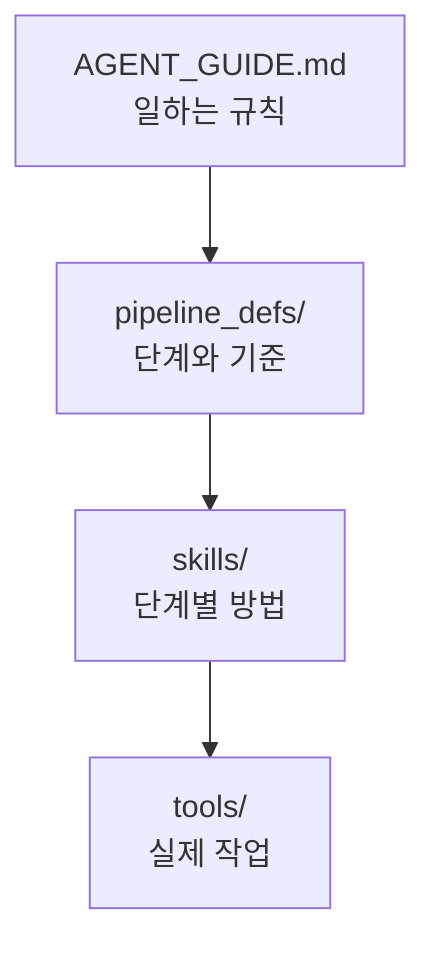
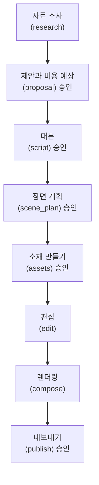
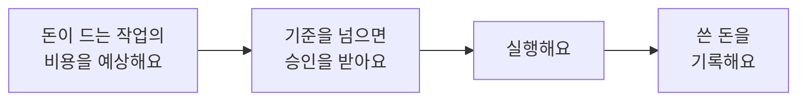

# OpenMontage

AI 영상 도구는 대부분 프롬프트 하나로 짧은 클립 하나를 만들어요. 그런데 실제 영상은 자료 조사, 대본, 장면 계획, 소재 만들기, 편집, 합성을 거쳐야 완성돼요.

**OpenMontage**는 이 과정을 Claude Code나 Codex 같은 AI Agent에게 단계별로 맡기는 오픈 소스 프로젝트예요. 만들고 싶은 영상을 말로 설명하면, Agent가 정해진 단계와 규칙을 따라 영상을 끝까지 만들어요.

이 문서는 OpenMontage를 영상 도구로 소개하는 데서 그치지 않아요. [Skill과 Automation](./skill-automation)과 [Harness Engineering](./harness-engineering) 문서에서 다룬 지침, Skill, 도구, 검증, 사람의 승인이 큰 프로젝트에서 어떻게 쓰이는지 보여 주는 예로 함께 살펴봐요.

이 문서를 따라 하면 다음을 할 수 있어요.

- OpenMontage가 Agent에게 일을 맡기는 구조를 설명할 수 있어요.
- 설치하고 API 키 없이 첫 영상을 만들어 볼 수 있어요.
- 비용, 승인 단계, 라이선스처럼 쓰기 전에 확인할 것을 챙길 수 있어요.

<Callout tone="info" title="2026년 11월 기준으로 확인했어요">

이 문서의 내용은 2026년 11월 8일의 [OpenMontage 저장소](https://github.com/calesthio/OpenMontage)를 직접 열어 확인했어요. 활발히 바뀌는 프로젝트라서 파이프라인 수, 지원하는 서비스, 설치 방법이 달라질 수 있어요. 따라 하기 전에 저장소의 README를 먼저 확인해 주세요.

</Callout>

## OpenMontage는 어떻게 짜여 있나요?

OpenMontage에는 작업 순서를 정하고 지시하는 별도의 프로그램이 없어요. 대신 **AI Agent가 지휘자**가 되고, 저장소에 들어 있는 글과 도구가 Agent를 이끌어요.

| 폴더와 파일 | 담는 것 | 이전 문서의 개념 |
| --- | --- | --- |
| `AGENT_GUIDE.md` | Agent가 일하는 규칙. 어떤 요청에 무엇부터 할지 정해요. | 지침 |
| `pipeline_defs/` | 영상 종류마다 거칠 단계, 쓸 도구, 통과 기준을 적은 YAML | 작업 절차 |
| `skills/` | 단계마다 일하는 방법을 적은 Markdown. 단계별 담당은 "director skill"이라고 불러요. | Skill |
| `.agents/skills/` | 영상 생성 서비스, FFmpeg 같은 외부 기술을 쓰는 요령 | Skill의 참고 자료 |
| `tools/` | 이미지 생성, 음성 합성, 편집, 렌더링을 실제로 하는 Python 도구 | 도구 |

Claude Code가 읽는 `CLAUDE.md`, Codex가 읽는 `AGENTS.md`, 그리고 `CODEX.md`에는 "먼저 `AGENT_GUIDE.md`를 읽어라"만 적혀 있어요. 도구마다 지침을 따로 두지 않고 한 파일로 모은 거예요. [AI Agent 문서](./ai-agent#3단계-claudemd에서-공통-규칙-불러오기)에서 `CLAUDE.md`가 `AGENTS.md`를 불러오게 한 것과 같은 생각이에요.

요청을 받은 Agent는 이 순서로 글을 읽고 도구를 써요.



### 파이프라인과 단계

영상 종류마다 **파이프라인**이 하나씩 있어요. 저장소의 `pipeline_defs/`에는 설명 영상(Animated Explainer), 다큐멘터리 몽타주, 화면 녹화 데모, 팟캐스트 다시 쓰기, 번역과 더빙, 캐릭터 애니메이션 등 12개의 제작 파이프라인이 있어요.

파이프라인은 모두 비슷한 단계를 거쳐요. 설명 영상 파이프라인을 예로 들면 이래요. 괄호 안이 `pipeline_defs/`에 적힌 단계 이름이에요.



"승인"이 붙은 단계는 기본 설정에서 Agent가 멈추고 사람의 확인을 기다려요. 단계마다 Agent는 그 단계의 director skill을 먼저 읽고, 도구를 쓰고, 스스로 결과를 검토하고, 진행 상황을 파일로 남겨요. 그래서 중간에 멈췄다가 이어 갈 수 있어요.

## 준비하기

| 준비물 | 설명 |
| --- | --- |
| AI Agent 도구 | Claude Code나 Codex처럼 파일을 읽고 명령을 실행할 수 있는 도구. 처음이라면 [AI Agent](./ai-agent) 문서를 먼저 따라 해 주세요. |
| Python 3.10 이상 | 도구를 실행해요. |
| FFmpeg | 영상과 음성을 붙이고 인코딩해요. |
| Node.js | 렌더링 엔진(Remotion, HyperFrames)이 써요. 지원하는 버전은 저장소 README에서 확인해 주세요. |
| Git과 make | 저장소를 받고 설치 명령을 실행해요. |

설치하면 Python 패키지, Node.js 패키지, 무료 음성 합성 도구가 함께 내려받아져요. 시간과 디스크 공간이 꽤 들 수 있어요.

## 1단계: 설치하기

터미널에서 저장소를 받고 설치해요.

```bash
git clone https://github.com/calesthio/OpenMontage.git
cd OpenMontage
make setup
```

`make setup`은 다음을 해요.

- Python 가상 환경을 만들고 필요한 패키지를 설치해요.
- 렌더링 엔진 Remotion의 패키지를 설치해요.
- 인터넷 없이 쓰는 음성 합성 도구 Piper를 설치해요. 목소리 모델은 따로 내려받아야 해요. 내레이션을 만들 때 모델이 없으면 Agent가 내려받는 명령을 알려 줘요.
- `.env.example`을 복사해 API 키를 적을 `.env` 파일을 만들어요.

`make`가 없는 환경의 설치 방법은 저장소 README의 Quick Start에 따로 적혀 있어요.

## 2단계: API 키 없이 첫 영상 만들기

API 키가 없어도 영상을 만들 수 있어요. 기본 설치만으로 이런 것들을 쓸 수 있어요.

| 하는 일 | 무료로 쓰는 것 |
| --- | --- |
| 내레이션 | Piper (인터넷 없이 동작하는 음성 합성) |
| 영상 자료 | Archive.org, NASA, Wikimedia Commons의 공개 자료 |
| 화면 구성 | Remotion, HyperFrames (애니메이션 장면, 글자, 차트) |
| 편집과 자막 | FFmpeg, 단어 단위 자막 |

설치한 폴더를 Claude Code나 Codex로 열고 이렇게 요청해 보세요.

```text
Make a 45-second animated explainer about why the sky is blue
```

한국어로 요청해도 돼요. 다만 저장소의 지침과 예시가 영어이고, 무료 음성 합성은 고른 목소리 모델이 지원하는 언어로만 말해요. 원하는 언어의 목소리를 쓸 수 있는지 제안 단계에서 꼭 확인해 주세요.

```text
하늘이 왜 파란지 설명하는 45초짜리 애니메이션 설명 영상을 만들어 줘.
자막은 한국어로 하고, 내레이션은 쓸 수 있는 무료 목소리를 먼저 알려 줘.
돈이 드는 서비스는 쓰지 말고, 단계마다 결과를 보여 주고 승인을 받아 줘.
```

진행하면서 다음을 확인해 주세요.

- [ ] Agent가 어떤 파이프라인을 골랐는지 알려 줬나요?
- [ ] 제안 단계에서 쓸 도구와 예상 비용을 보여 줬나요?
- [ ] 대본과 장면 계획에서 승인을 기다렸나요?
- [ ] 완성된 영상이 `projects/` 폴더 아래에 실제로 생겼나요?

설치가 잘 됐는지만 먼저 보고 싶다면 `make demo`를 실행해 보세요. API 키 없이 예시 영상을 렌더링해요.

## 3단계: 참고 영상으로 시작하기 (선택)

빈 프롬프트에서 시작하는 것보다, 마음에 드는 영상을 보여 주고 시작하는 편이 빠를 때가 많아요. OpenMontage는 YouTube 영상이나 Shorts, 내 컴퓨터의 영상 파일을 참고 자료로 받을 수 있어요.

```text
이 YouTube Short의 속도감과 시작 방식이 좋아.
같은 느낌으로 양자 컴퓨팅을 설명하는 영상을 만들어 줘.
(영상 주소)
```

Agent는 참고 영상의 자막, 장면 전환, 속도, 스타일을 분석하고, 그대로 베끼지 않은 2~3개의 안을 비용 예상과 함께 보여 줘요.

<Callout tone="warning" title="참고 영상의 권리를 확인해 주세요">

분석에 쓰는 것과 결과물에 그대로 쓰는 것은 달라요. 다른 사람의 영상, 음악, 캐릭터를 결과물에 넣지 않았는지 확인해 주세요. 공개 자료라도 자료마다 이용 조건이 다르니, 영상을 공개하기 전에 출처와 조건을 살펴 주세요.

</Callout>

## 4단계: 비용과 승인 확인하기

API 키를 `.env`에 넣으면 영상 생성, 이미지 생성, 고급 음성 합성 같은 유료 서비스를 쓸 수 있어요. 키가 많을수록 고를 수 있는 도구가 늘지만, 돈이 들어요.

OpenMontage는 돈이 드는 작업 전에 비용을 예상하고, 설정한 기준에 따라 멈춰요. 저장소의 `config.yaml` 기본값은 이래요.

| 설정 | 기본값 | 뜻 |
| --- | --- | --- |
| `budget.mode` | `warn` | 예산을 넘으면 경고를 남겨요. 실행을 막지는 않아요. |
| `budget.total_usd` | `10.00` | 전체 예산 (미국 달러) |
| `budget.single_action_approval_usd` | `0.50` | 한 작업이 이 금액을 넘으면 실행 전에 승인을 받아요. |
| `budget.require_approval_for_new_paid_tool` | `true` | 처음 쓰는 유료 도구는 승인을 받아요. |

`mode`는 `observe`(기록만), `warn`(넘으면 경고), `cap`(넘으면 멈춤) 가운데 하나예요. **기본값인 `warn`은 예산을 넘어도 멈추지 않아요.** 예산을 넘지 않게 막고 싶다면 `cap`으로 바꿔 주세요.



<Callout tone="danger" title="API 키를 저장소에 올리지 마세요">

API 키는 `.env` 파일에만 적어요. 이 파일은 저장소의 `.gitignore`에 들어 있어 Git에 올라가지 않지만, 화면 공유나 AI Log에 키가 보이지 않게 조심해 주세요. 키가 드러났다면 그 서비스에서 바로 키를 새로 만들고 예전 키는 지워 주세요.

</Callout>

## 쓰기 전에 확인할 것

OpenMontage는 Agent가 명령을 실행하고, 패키지를 설치하고, 외부 서비스를 부르는 프로젝트예요. [Harness Engineering의 6단계](./harness-engineering#6단계-권한과-실행-범위-확인하기)에서 다룬 것처럼 권한과 실행 범위를 먼저 확인해 주세요.

- [ ] `AGENT_GUIDE.md`와 쓸 파이프라인의 지침을 읽어 봤나요? 다른 사람이 만든 지침은 내용을 확인한 뒤에 맡겨 주세요. 이유는 [Skill과 Automation의 안전하게 쓰기](./skill-automation#안전하게-쓰기)에서 알려 드려요.
- [ ] 실습용 폴더에서 실행하고 있나요?
- [ ] 예산 설정을 확인했나요?
- [ ] 영상 생성 서비스에 보내는 대본과 이미지에 개인 정보나 공개하면 안 되는 자료가 없나요? 유료 서비스에 보낸 글과 이미지는 그 서비스의 정책에 따라 처리돼요.
- [ ] 라이선스를 확인했나요? OpenMontage는 **GNU AGPLv3**로 공개돼 있어요. 코드를 고쳐 다른 사람에게 배포하거나 네트워크 서비스로 제공하려면 이 라이선스의 조건을 따라야 해요.

## AI Log에 기록하기

결과를 [AI Log](../logs/new)에 남겨 주세요. 이번에는 **Agent가 어떤 파이프라인과 도구를 골랐고, 어디서 승인을 받았고, 비용이 얼마나 들었는지**를 적는 게 중요해요.

<details>
<summary>AI Log 작성 예시 보기</summary>

```text
제목
OpenMontage로 API 키 없이 45초 설명 영상 만들기

사용한 도구
Claude Code, OpenMontage

시도한 내용
make setup으로 설치하고, "하늘이 왜 파란지" 설명 영상을 한국어 자막으로 요청했다.
돈이 드는 서비스는 쓰지 말라고 적었다.

결과
Agent가 설명 영상 파이프라인을 골랐다.
제안, 대본, 장면 계획에서 승인을 기다렸고, 대본에서 한 문장을 고쳐 달라고 했다.
Piper 목소리 모델이 없어서 Agent가 알려 준 명령으로 영어 목소리를 내려받았다.
내레이션은 Piper, 화면은 Remotion으로 만들었고 비용은 0원이었다.
projects/ 아래에 영상이 생겼다.

배운 점
단계마다 사람이 확인하는 지점이 정해져 있어서 중간에 방향을 바꾸기 쉬웠다.
무료 목소리는 언어가 정해져 있어서, 내레이션 언어를 제안 단계에서 먼저 정해야 했다.

다음 행동
budget.mode를 cap으로 바꾸고 유료 이미지 생성 서비스를 하나 연결해 본다.
```

</details>

## 자주 묻는 질문

<details>
<summary>OpenMontage는 하나의 Skill인가요?</summary>

아니에요. Skill과 지침, 파이프라인 정의, Python 도구를 묶은 하나의 프로젝트예요. 저장소 폴더를 Agent 도구로 열어서 써요. 다른 프로젝트에 Skill 하나를 설치하듯 쓰는 방식이 아니에요.

</details>

<details>
<summary>Claude Code와 Codex 말고 다른 도구에서도 쓸 수 있나요?</summary>

README에 따르면 파일을 읽고 Python을 실행할 수 있는 AI 코딩 도구라면 쓸 수 있어요. Cursor, GitHub Copilot, Windsurf를 위한 지침 파일도 들어 있어요. 모두 `AGENT_GUIDE.md`를 가리켜요.

</details>

<details>
<summary>API 키가 없으면 어떤 영상까지 만들 수 있나요?</summary>

이미지와 글, 차트를 움직여 만드는 설명 영상, 공개 자료 영상을 이어 붙인 다큐멘터리 몽타주, SVG 캐릭터 애니메이션을 만들 수 있어요. AI로 새 영상 장면을 만들거나 고급 음성을 쓰려면 유료 서비스의 키가 필요해요.

</details>

<details>
<summary>Agent가 승인 없이 계속 진행하면 어떻게 하나요?</summary>

멈추라고 말하고, 어느 단계에서 승인을 받아야 했는지 물어보세요. 요청할 때 "단계마다 결과를 보여 주고 승인을 받아 줘"라고 적어 두면 좋아요. 비용이 걱정된다면 예산 설정을 `cap`으로 바꿔 두세요.

</details>

<details>
<summary>만든 영상을 동아리 발표에 써도 되나요?</summary>

영상에 쓴 자료마다 이용 조건을 확인해 주세요. 공개 자료라도 출처 표기를 요구하는 경우가 있고, 생성 서비스마다 결과물의 이용 조건이 달라요.

</details>

## 더 알아보기

| 문서 | 내용 |
| --- | --- |
| [OpenMontage 저장소](https://github.com/calesthio/OpenMontage) | README, 설치 방법, 파이프라인 목록 (영어) |
| [OpenMontage: Agent Guide](https://github.com/calesthio/OpenMontage/blob/main/AGENT_GUIDE.md) | Agent가 따르는 규칙 전문 (영어) |
| [OpenMontage: Prompt Gallery](https://github.com/calesthio/OpenMontage/blob/main/PROMPT_GALLERY.md) | 시험해 본 프롬프트와 예상 비용 (영어) |
| [OpenMontage: Providers](https://github.com/calesthio/OpenMontage/blob/main/docs/PROVIDERS.md) | 연결할 수 있는 서비스와 요금, 무료 등급 (영어) |
| [Skill과 Automation](./skill-automation) | 작업 절차를 Skill로 만들어 다시 쓰는 방법 |
| [Harness Engineering](./harness-engineering) | 지침, Subagent, 권한, Hook으로 Agent가 일하는 환경을 꾸리는 방법 |
| [GNU AGPLv3](https://www.gnu.org/licenses/agpl-3.0.html) | OpenMontage가 따르는 라이선스 (영어) |
