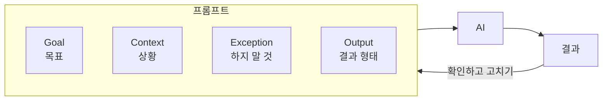
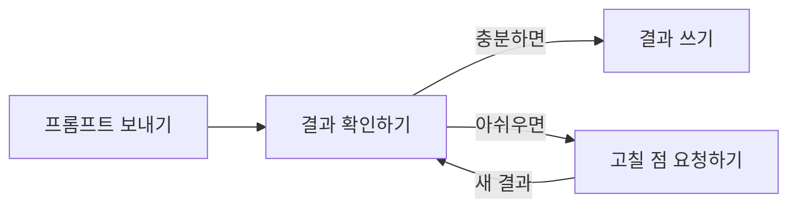

# Prompt Engineering

AI에게 평소 말하듯 물어봐도 쓸 만한 답을 받을 수 있어요. 하지만 내 상황에 꼭 맞는 답을 받으려면 목표와 상황, 지켜야 할 조건을 AI에게 알려 줘야 해요. 모델이 아무리 좋아져도 알려 주지 않은 정보는 알 수 없거든요. 정보가 비어 있으면 AI는 가장 흔한 경우를 가정해 빈칸을 채우고, 그 결과는 그럴듯하지만 내 상황과 맞지 않을 수 있어요.

AI에게 보내는 요청을 **프롬프트(Prompt)** 라고 해요. 프롬프트를 설계하고, 결과를 확인하고, 다시 고치는 과정을 **Prompt Engineering**이라고 해요.



이 문서를 따라 하면 다음을 할 수 있어요.

- 프롬프트를 Goal, Context, Exception, Output 네 부분으로 나눠 쓸 수 있어요.
- 예시를 넣어 AI가 따를 기준을 보여 줄 수 있어요.
- AI가 만든 결과를 확인하고 프롬프트를 고칠 수 있어요.

<Callout tone="success" title="좋은 프롬프트가 길 필요는 없어요">

처음에는 평소처럼 요청해 보세요. 결과가 아쉬울 때 이 문서의 네 부분 가운데 빠진 것을 하나씩 더하면 돼요.

무엇을 알려 줘야 할지 모르겠다면 "시작하기 전에 필요한 정보를 먼저 물어봐 줘"라고 덧붙여 보세요.

</Callout>

## 준비하기

다음 두 가지를 준비해 주세요.

| 준비물 | 설명 |
| --- | --- |
| AI 도구 | ChatGPT, Claude, Gemini처럼 대화할 수 있는 AI 도구라면 무엇이든 괜찮아요. |
| 맡길 작업 | AI에게 맡기고 싶은 작업을 하나 정해요. 이 문서에서는 회의 메모 정리를 예시로 써요. |

이 문서는 다음 한 줄짜리 프롬프트에서 출발해요. 단계를 지날 때마다 한 부분씩 더해서 완성해 볼게요.

```text
회의록을 요약해 줘.
```

## 1단계: Goal로 목표 적기

Goal은 이 작업으로 최종적으로 얻고 싶은 것이에요. 목표를 알면 AI가 무엇을 남기고 무엇을 뺄지 스스로 판단할 수 있어요.

"요약해 줘"만으로는 누구를 위해, 왜 요약하는지 알 수 없어요. 결과를 누가, 어디에 쓸지 적어 주세요.

```text
[Goal]
어제 회의에 빠진 팀원들이 결정된 내용과 자기가 맡은 일을
빠르게 파악할 수 있도록 회의 메모를 정리해 줘.
```

Goal을 적을 때는 다음을 떠올려 보세요.

- 최종적으로 무엇을 얻고 싶나요?
- 누구를 위한 결과물인가요?
- 결과물을 어디에 쓸 건가요?

## 2단계: Context로 상황 알려 주기

Context는 AI가 작업할 때 참고할 배경 정보와 자료예요. 같은 요청이라도 어떤 Context를 주느냐에 따라 결과가 달라져요.

회의 메모 예시에서는 메모가 어떤 상태인지, 팀이 어떤 상황인지 알려 줘요. 정리할 메모 본문도 함께 넣어요.

```text
[Context]
- 회의 중에 급하게 적은 메모라서 일부 정보가 빠져 있을 수 있어.
- 팀원은 5명이고, 다음 주 금요일에 서비스를 출시할 예정이야.
- 정리할 메모는 아래 <회의 메모> 안에 있어.

<회의 메모>
- 출시일 다음 주 금요일로 확정
- 랜딩 페이지 문구 수정 필요 (민수?)
- 결제 오류 원인 아직 모름, 다음 회의에서 다시 논의
- QA 일정 정리하기
</회의 메모>
```

Context에는 다음과 같은 정보를 넣을 수 있어요.

| 정보 | 예시 |
| --- | --- |
| 배경 | 어떤 상황에서 필요한 작업인가요? |
| 대상 | 결과물을 누가 쓰나요? |
| 목적 | 왜 이 작업을 하나요? |
| 참고 자료 | 기존 문서, 예시, 데이터 |
| 환경 | 쓰는 도구, 프로젝트, 작업 방식 |
| 제약 사항 | 예산, 일정, 규칙 |

모든 정보를 넣을 필요는 없어요. 지금 작업에 필요한 정보만 골라서 넣어 주세요.

참고 자료는 이름만 적지 말고 본문이나 파일을 함께 넣어야 해요. "공고문을 참고해 줘"처럼 이름만 적으면 AI는 내용을 모르는 채로 그럴듯하게 채울 수 있어요.

<Callout tone="warning" title="자료를 넣기 전에 민감한 정보를 확인하세요">

회사 내부 문서, 다른 사람의 개인정보, 비밀번호나 API Key가 들어 있지 않은지 먼저 확인해 주세요. 조직의 AI 사용 정책과 AI 서비스의 데이터 처리 조건도 확인해야 해요.

웹 페이지나 파일 같은 외부 자료에 숨은 지시로 AI를 조종하는 공격도 있어요. 이런 공격을 Prompt Injection이라고 해요. 자세한 내용은 OWASP의 [Prompt Injection 설명](https://genai.owasp.org/llmrisk/llm01-prompt-injection/)(영어)에서 볼 수 있어요.

</Callout>

## 3단계: Exception으로 하지 말 것 정하기

Exception은 AI가 하지 말아야 할 일과, 정보가 없거나 애매할 때 처리할 방법이에요.

1단계의 메모에는 담당자가 불확실한 작업과 아직 결정되지 않은 논의가 섞여 있어요. 그대로 맡기면 AI가 담당자를 지어내거나, 논의 중인 내용을 결정된 것처럼 정리할 수 있어요.

```text
[Exception]
- 메모에 없는 사실을 만들지 마.
- 담당자가 적혀 있지 않으면 임의로 정하지 말고 "미정"으로 둬.
- 결정된 사항과 논의 중인 사항을 구분해.
- 불확실한 정보는 "확인 필요"로 표시해.
```

"하지 마"만 적기보다 그럴 때 대신 할 일을 함께 적어 주세요. 담당자가 없으면 "미정"으로 두라고 적은 것처럼요. AI가 훨씬 따르기 쉬워져요.

Exception을 적어도 모든 오류를 막을 수는 없어요. 결과는 [6단계](#6단계-결과-확인하고-고치기)에서 꼭 확인해 주세요.

## 4단계: Output으로 결과 형태 정하기

Output은 받고 싶은 결과물의 구조와 형식이에요. 형식을 정해 두면 필요한 정보를 찾기 쉽고, 결과를 다른 곳에 바로 옮길 수 있어요.

```text
[Output]
다음 순서로 작성해 줘.
1. 회의 핵심 요약 (3줄 이내)
2. 결정된 사항
3. 후속 작업: 작업, 담당자, 기한, 상태 열을 가진 Markdown 표
4. 확인이 필요한 질문
```

결과물을 어디에 쓸지 알려 주면 더 좋아요. 예를 들어 Notion에 붙여 넣을 문서라면 이렇게 적을 수 있어요.

```text
[Output]
Notion에 붙여 넣을 문서야.
Markdown으로 작성하고 전체 내용을 하나의 코드 블록에 담아 줘.
```

원하는 형식을 말로 길게 설명하기보다 짧은 예시로 보여 주면 더 정확하게 따라요.

<Callout tone="info" title="Output은 필요할 때만 정해도 돼요">

간단한 질문이라면 자연스러운 답변으로 충분해요.

같은 형식의 문서를 반복해서 만들거나 결과를 다른 프로그램에 넘길 때는 Output을 꼭 정해 주세요. 프로그램에 넘길 데이터는 프롬프트로 형식을 정해도 어긋날 수 있으니, 받은 결과를 프로그램으로 한 번 더 검사해 주세요.

</Callout>

1단계부터 4단계까지 더한 프롬프트는 다음과 같아요.

<details>
<summary>완성한 프롬프트 보기</summary>

```text
[Goal]
어제 회의에 빠진 팀원들이 결정된 내용과 자기가 맡은 일을
빠르게 파악할 수 있도록 회의 메모를 정리해 줘.

[Context]
- 회의 중에 급하게 적은 메모라서 일부 정보가 빠져 있을 수 있어.
- 팀원은 5명이고, 다음 주 금요일에 서비스를 출시할 예정이야.
- 정리할 메모는 아래 <회의 메모> 안에 있어.

<회의 메모>
- 출시일 다음 주 금요일로 확정
- 랜딩 페이지 문구 수정 필요 (민수?)
- 결제 오류 원인 아직 모름, 다음 회의에서 다시 논의
- QA 일정 정리하기
</회의 메모>

[Exception]
- 메모에 없는 사실을 만들지 마.
- 담당자가 적혀 있지 않으면 임의로 정하지 말고 "미정"으로 둬.
- 결정된 사항과 논의 중인 사항을 구분해.
- 불확실한 정보는 "확인 필요"로 표시해.

[Output]
다음 순서로 작성해 줘.
1. 회의 핵심 요약 (3줄 이내)
2. 결정된 사항
3. 후속 작업: 작업, 담당자, 기한, 상태 열을 가진 Markdown 표
4. 확인이 필요한 질문
```

</details>

## 5단계: 예시로 기준 보여 주기

지금까지 만든 프롬프트처럼 예시 없이 요청하는 방식을 **Zero-shot**이라고 해요. 목표와 조건을 자세히 적었더라도, 입력과 답을 짝지은 예시가 없으면 Zero-shot이에요. 일반적인 작업은 대부분 Zero-shot으로 충분해요.

AI가 따라야 할 분류 기준이나 형식이 있다면 예시를 몇 개 보여 주세요. 이 방식을 **Few-shot**이라고 하고, 예시가 하나뿐이면 **One-shot**이라고도 해요.

예를 들어 회의 뒤에 받은 의견을 분류한다면 다음처럼 쓸 수 있어요.

```text
문장을 긍정, 부정, 중립 중 하나로 분류해 줘.

입력: 오늘 발표 정말 좋았어요.
출력: 긍정
입력: 설명이 부족해서 이해하기 어려웠어요.
출력: 부정
입력: 다음 주에 다시 모이기로 했습니다.
출력: 중립

입력: 실습 시간이 조금 더 길었으면 좋겠어요.
출력:
```

마지막 문장처럼 애매한 경우는 예시만으로 기준이 정해지지 않아 답이 갈릴 수 있어요. 이런 경우를 어떻게 분류할지 보여 주는 예시를 하나 더 넣으면 AI가 그 기준을 따르기 쉬워져요.

AI는 예시를 생각보다 충실히 따라 해요. 예시가 틀리면 잘못된 패턴을 따를 수 있고, 예시가 모두 비슷하면 길이와 말투, 주제까지 닮아 갈 수 있어요. 서로 다른 예시를 고르게 넣어 주세요.

## 6단계: 결과 확인하고 고치기

AI의 답이 자연스럽다고 해서 정확한 건 아니에요. AI는 기본적으로 사실을 찾아본 뒤 답하는 게 아니라, 학습한 내용을 바탕으로 그럴듯한 다음 말을 이어 붙여 답을 만들어요. 그래서 틀린 내용도 확신에 찬 말투로 말할 수 있어요. 웹 검색 기능으로 자료를 찾아 답할 때도 찾은 내용을 잘못 옮길 수 있어요. 이렇게 사실과 다르거나 근거 없는 내용을 그럴듯하게 만드는 현상을 **Hallucination(환각)** 이라고 해요.

환각은 이런 모습으로 나타나요.

- 존재하지 않는 정보, 출처, 링크를 만들어요.
- 주지 않은 숫자를 임의로 적어요.
- 원문에 없는 담당자나 일정을 더해요.
- 오래된 정보를 최신 정보처럼 말해요. 검색 없이 답하면 모델은 학습한 시점 이후의 일을 모르기 때문이에요.

요청한 형식이나 조건을 지키지 않는 경우도 있어요. 둘 다 결과를 직접 확인해야 찾을 수 있어요.

### 결과 확인하기

받은 결과를 다음 기준으로 확인해 주세요.

- [ ] 요청한 목표에 맞나요?
- [ ] 넣어 준 자료의 사실과 일치하나요?
- [ ] 원문에 없는 내용을 만들지 않았나요?
- [ ] 날짜, 금액, 계산 결과가 정확한가요?
- [ ] 조건과 출력 형식을 지켰나요?
- [ ] 추가로 확인할 부분을 구분해 두었나요?

AI에게 검토를 맡길 수도 있어요. 근거가 된 원문 문장을 함께 보여 달라고 하면 직접 대조하기 쉬워져요.

<details>
<summary>결과 검토용 프롬프트 보기</summary>

```text
방금 작성한 결과를 검토해 줘.

다음 항목을 중심으로 확인해.
1. 제공한 자료와 일치하지 않는 내용
2. 근거 없이 추정한 내용
3. 누락된 중요 정보
4. 조건을 위반한 부분

검토 결과는 | 문제 | 근거가 된 원문 | 수정 방향 | 표로 정리해 줘.
확인할 수 없는 정보는 추측하지 말고 "확인 필요"로 표시해 줘.
```

</details>

<Callout tone="warning" title="AI의 자체 검토만 믿으면 안 돼요">

AI가 다시 검토해도 오류가 남아 있을 수 있어요. 중요한 숫자, 외부 정보, 법률·의료·재무 관련 내용은 믿을 수 있는 원문과 직접 비교해 주세요.

</Callout>

### 프롬프트 고치기

결과가 아쉬우면 같은 대화에서 고칠 점을 구체적으로 요청해요. 이렇게 결과를 보며 반복해서 고치는 방식을 **Iterative Prompting**이라고 해요.



```text
1차: (4단계에서 완성한 프롬프트)
2차: 후속 작업 표에 우선순위 열도 추가해 줘.
3차: 팀 메신저에 올릴 수 있게 핵심 요약을 두 줄로 줄여 줘.
```

"다시 해 줘"나 "별로야"보다 무엇이 부족하고 어떻게 바뀌어야 하는지 적어 주세요. 예를 들어 "결정된 사항과 논의 중인 사항이 섞여 있으니 두 목록으로 나눠 줘"처럼요.

대화가 길어지면 AI가 앞에서 말한 조건을 놓치기도 해요. 그럴 때는 그동안 더한 조건을 처음 프롬프트에 합쳐서 새 대화로 다시 요청해 주세요. 긴 대화를 관리하는 방법은 [Context Engineering](./context-engineering)에서 알려 드려요.

## 복잡한 작업에 적용하기

네 부분만으로도 대부분의 요청은 충분해요. 작업이 복잡하면 다음처럼 더 나눠 적을 수 있어요.

| 요소 | 의미 | 예시 |
| --- | --- | --- |
| **Goal** | 최종적으로 이룰 목표 | 신규 회원 모집 |
| **Context** | 작업에 필요한 배경 정보 | 실습 중심 AI 동아리 |
| **Task** | AI가 실제로 할 일 | 홍보글 작성 |
| **Constraints** | 지켜야 할 조건 전체 (Exception 포함) | 300자 이내, 과장 금지 |
| **Output** | 결과물의 형태 | 제목 3개와 본문 1개 |
| **Evaluation** | 결과가 좋은지 판단할 기준 | 처음 온 사람도 이해할 수 있는가 |

할 일이 여러 개라면 Goal에서 떼어 **Task**로 따로 적어요. 하지 말아야 할 것이 많으면 Exception을 Constraints와 별도 항목으로 둬도 괜찮아요. 정해진 공식은 없어요. 상황에 맞는 요소만 골라 쓰면 돼요.

예를 들어 정부 지원 사업에 낼 사업계획서의 구조를 잡는다면 다음처럼 쓸 수 있어요. 한 번에 완성해 달라고 하기보다 필요한 자료를 AI와 함께 확인하면서 쓰는 방식이에요.

<details>
<summary>사업계획서 프롬프트 보기</summary>

```text
[Goal]
정부 지원 사업에 제출할 사업계획서 초안의 구조를 잡고 싶어.

[Context]
- 사업 아이디어: 지역 소상공인을 위한 AI 마케팅 지원 서비스
- 주요 대상: 마케팅 인력이 부족한 소규모 사업장
- 해결하려는 문제: 홍보 콘텐츠를 만들고 관리하는 데 시간과 비용이 많이 듦
- 첨부 자료: 기존 사업 소개서, 지원 사업 공고문, 사업계획서 작성 양식

[Task]
첨부한 자료를 분석해서 사업계획서의 전체 구조를 정리해 줘.
문제 정의, 목표 고객, 해결 방법, 서비스 차별성, 운영 계획, 향후 발전 방향을 포함해.

[Exception]
- 확인되지 않은 시장 규모, 매출, 성장률을 만들어내지 마.
- 지원 사업 공고문에 없는 조건을 추가하지 마.
- 꼭 필요한 정보가 없으면 먼저 질문하고, 답이 없으면 "확인 필요"로 표시해.

[Output]
각 항목을 Markdown으로 작성하고, 항목마다
"현재 제공된 정보", "추가로 필요한 자료", "작성 가능한 초안"을 구분해 줘.
```

</details>

실제로 제출할 문서라면 지원 기관의 최신 공고문과 평가 기준을 직접 확인해 주세요.

## 직접 해 보기

배운 내용을 연습할 수 있는 과제예요. 가상의 동네 카페가 신메뉴를 출시하려고 해요. AI로 홍보 전략을 만들어 보세요.

| 항목 | 내용 |
| --- | --- |
| 매장 | 동네 소규모 카페 |
| 신메뉴 | 딸기 말차 라떼 |
| 홍보 예산 | 300,000원 |
| 준비 기간 | 2주 |
| 목표 | 신메뉴 인지도 높이기, 매장 방문 늘리기 |
| 쓸 수 있는 채널 | SNS, 매장 안내물, 지역 커뮤니티 |

### Round 1: 평소처럼 요청하기

평소 AI를 쓰던 방식대로 홍보 전략을 요청해요. 처음 쓴 프롬프트와 결과를 저장해 두세요.

### Round 2: 네 부분으로 나눠 요청하기

Goal, Context, Exception, Output을 넣어 다시 요청해요. 필요하면 Task도 따로 적어 보세요.

<details>
<summary>참고 프롬프트 보기</summary>

```text
[Goal]
동네 카페의 신메뉴 인지도를 높이고
실제 매장 방문을 유도하고 싶어.

[Context]
- 매장: 소규모 동네 카페
- 신메뉴: 딸기 말차 라떼
- 준비 기간: 2주
- 홍보 예산: 300,000원
- 활용 채널: SNS, 매장 안내물, 지역 커뮤니티

[Task]
예산과 준비 기간을 고려한
신메뉴 출시 홍보 전략을 작성해 줘.

[Exception]
- 300,000원의 예산을 초과하지 마.
- 실제 확인하지 않은 매출이나 고객 수를 만들지 마.
- 실행하기 어려운 대규모 광고는 제안하지 마.
- 추가 정보가 필요하다면 "확인 필요"로 표시해.

[Output]
다음 항목으로 작성해 줘.
1. 핵심 타깃 고객
2. 홍보 핵심 메시지
3. 온라인 홍보 전략
4. 오프라인 홍보 전략
5. 2주 실행 일정
6. 예산 배분표
7. 성공 여부를 확인할 지표
```

</details>

### Round 3: 두 결과 비교하기

두 결과를 다음 기준으로 비교해 보세요.

| 기준 | 확인할 질문 |
| --- | --- |
| 목표 | 신메뉴 인지도와 매장 방문을 늘리는 전략인가요? |
| 실행 가능성 | 작은 카페가 2주 안에 실제로 할 수 있나요? |
| 예산 | 300,000원 안에서 끝나나요? |
| 구체성 | 언제, 어디에, 무엇을 할지 나와 있나요? |
| 사실 확인 | 근거 없는 숫자나 고객 수를 지어내지 않았나요? |
| 재사용 | 다른 메뉴를 출시할 때도 이 프롬프트를 쓸 수 있나요? |

함께 하는 사람이 있다면 다음 질문으로 이야기해 보세요.

1. 첫 번째 프롬프트에서 빠뜨린 정보는 무엇이었나요?
2. 가장 효과가 컸던 조건은 무엇이었나요?
3. AI가 지어낸 정보가 있었나요?
4. 다른 사람의 프롬프트에서 가져오고 싶은 점은 무엇인가요?

모두 같은 과제를 해도 프롬프트와 결과는 달라요. 누가 가장 좋은 결과를 냈는지보다, 각자 어떻게 요청하고 고쳤는지 비교해 보세요.

## 템플릿으로 시작하기

다음 템플릿을 복사해서 빈칸을 채우면 바로 쓸 수 있어요.

```text
[Goal]
내가 이루고 싶은 목표:

[Context]
현재 상황:
참고할 정보:
대상 사용자:

[Exception]
하지 말아야 할 것:
정보가 없거나 불확실할 때 처리 방법:

[Output]
결과물 형식:
```

작업이 복잡하면 [복잡한 작업에 적용하기](#복잡한-작업에-적용하기)의 표를 보고 Task, Constraints, Evaluation을 더해 보세요. AI와 함께 프롬프트를 고치는 방법은 [자주 묻는 질문](#자주-묻는-질문)에 있어요.

## AI Log에 기록하기

쓴 프롬프트와 고친 과정을 [AI Log](../logs/new)에 남겨 주세요. 처음 프롬프트와 고친 프롬프트를 함께 남기면, 무엇을 바꿔서 결과가 좋아졌는지 다른 구성원도 알 수 있어요.

<details>
<summary>AI Log 작성 예시 보기</summary>

```text
제목
딸기 말차 라떼 홍보 전략을 네 부분 프롬프트로 다시 요청하기

사용한 도구
ChatGPT

시도한 내용
처음에는 "카페 신메뉴 홍보 전략 짜 줘"라고 요청했다.
Goal, Context, Exception, Output을 나눠 적은 프롬프트로 다시 요청했다.
(고친 프롬프트 붙여 넣기)

결과
첫 번째 결과: 예산을 넘는 TV 광고와 인플루언서 협업을 제안했다.
고친 결과: 30만 원 안에서 2주 일정과 예산 배분표가 나왔다.

배운 점
예산과 기간을 Exception에 적어 두니 실행할 수 있는 안만 나왔다.

다음 행동
같은 프롬프트로 다른 메뉴 홍보 전략도 만들어 본다.
```

</details>

## 자주 묻는 질문

<details>
<summary>프롬프트는 길게 쓸수록 좋은가요?</summary>

아니에요. 필요한 정보가 빠지면 결과가 흐려지지만, 작업과 관계없는 정보가 많아도 AI가 엉뚱한 부분에 끌려갈 수 있어요.

길이보다 지금 작업에 필요한 정보가 빠짐없이 들어 있는지 확인해 주세요. 어떤 정보를 골라 넣을지는 [Context Engineering](./context-engineering)에서 알려 드려요.

</details>

<details>
<summary>영어로 쓰면 결과가 더 좋은가요?</summary>

학습 자료에 영어가 많아서 언어에 따라 성능 차이가 난다는 연구가 있어요. 다만 그 차이는 모델과 작업에 따라 달라요. 널리 쓰이는 모델은 일상적인 작업이라면 한국어로도 좋은 결과를 내는 경우가 많아요.

가장 정확하게 쓸 수 있는 언어로 쓰고, 전문 용어는 원어를 함께 적고, 답을 받을 언어를 따로 적어 주세요. 결과가 아쉽다면 같은 요청을 영어로도 해 보고 비교해 보세요.

</details>

<details>
<summary>"너는 마케팅 전문가야"처럼 역할을 정해 주면 효과가 있나요?</summary>

말투, 관점, 설명 수준을 맞추는 데는 도움이 돼요. 하지만 역할을 정한다고 모델이 모르던 지식이 생기지는 않아요. 사실을 묻는 문제에서는 역할을 정해도 정답률이 나아지지 않았다는 연구도 있어요.

역할 한 줄보다 누구를 위해, 무엇을, 어떤 기준으로 써야 하는지 적는 편이 결과를 더 크게 바꿔요.

</details>

<details>
<summary>같은 프롬프트인데 왜 답이 매번 다른가요?</summary>

AI는 다음에 올 말을 확률에 따라 고르면서 답을 만들어요. 그래서 같은 요청에도 표현과 내용이 조금씩 달라져요. 서비스가 모델을 바꾸거나 고치는 일, 앞선 대화 내용도 결과에 영향을 줘요.

결과를 일정하게 받고 싶다면 형식과 기준을 분명히 적고 예시를 보여 주세요. 중요한 일이라면 여러 번 받아서 비교해 보는 것도 방법이에요.

</details>

<details>
<summary>"단계별로 생각해 줘"라고 쓰면 더 정확해지나요?</summary>

계산이나 논리처럼 여러 단계를 거치는 문제에서 이런 지시가 정확도를 높였다는 연구가 있어요.

다만 이 문서를 쓴 시점에는 답하기 전에 스스로 추론하는 모델이 많아졌어요. 이런 모델에는 이 문장이 따로 필요 없다고 안내하는 AI 회사도 있어요. 그보다 결과에 근거를 함께 적어 달라고 하면 확인하기 쉬워져요.

</details>

<details>
<summary>AI에게 프롬프트를 고쳐 달라고 해도 되나요?</summary>

네, 괜찮아요. 지금 쓰는 프롬프트와 기대한 결과, 아쉬웠던 점을 함께 주고 빠진 정보를 먼저 물어 달라고 해 보세요. [템플릿으로 시작하기](#템플릿으로-시작하기)의 템플릿을 함께 주고 그 형식에 맞춰 고쳐 달라고 해도 좋아요.

고친 프롬프트가 정말 더 좋은지는 직접 실행해 보고 결과로 판단해 주세요.

</details>

<details>
<summary>회사 자료나 개인정보를 넣어도 되나요?</summary>

먼저 조직의 AI 사용 정책과 쓰는 서비스의 데이터 처리 조건을 확인해 주세요. 허용되지 않았다면 넣지 않는 게 원칙이에요.

꼭 써야 한다면 이름, 연락처, 계정 정보처럼 사람을 알아볼 수 있는 부분을 지우거나 가린 뒤 넣어 주세요. 비밀번호와 API Key는 넣지 마세요.

넣은 대화를 모델 학습에 쓰는지는 서비스와 설정에 따라 달라요. [ChatGPT](https://help.openai.com/en/articles/7730893-data-controls-faq), [Claude](https://privacy.claude.com/ko/articles/10023580), [Gemini](https://support.google.com/gemini/answer/13594961?hl=ko)의 안내에서 확인할 수 있어요.

</details>
