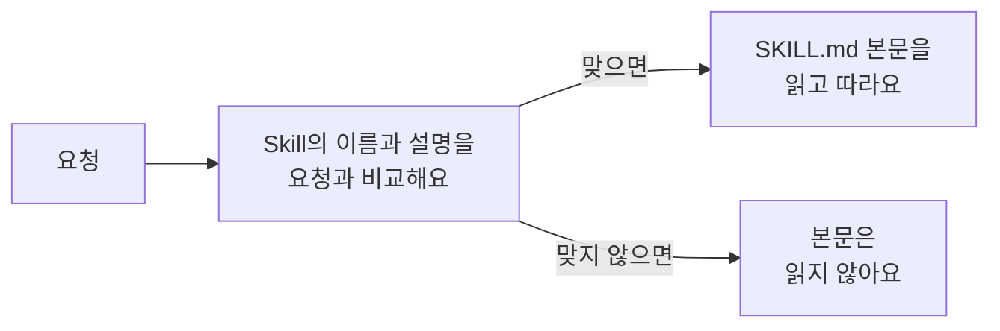
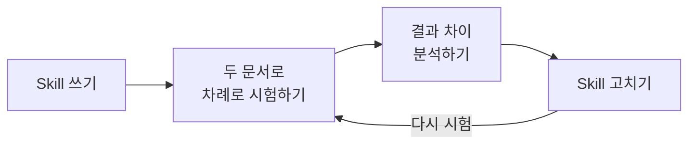
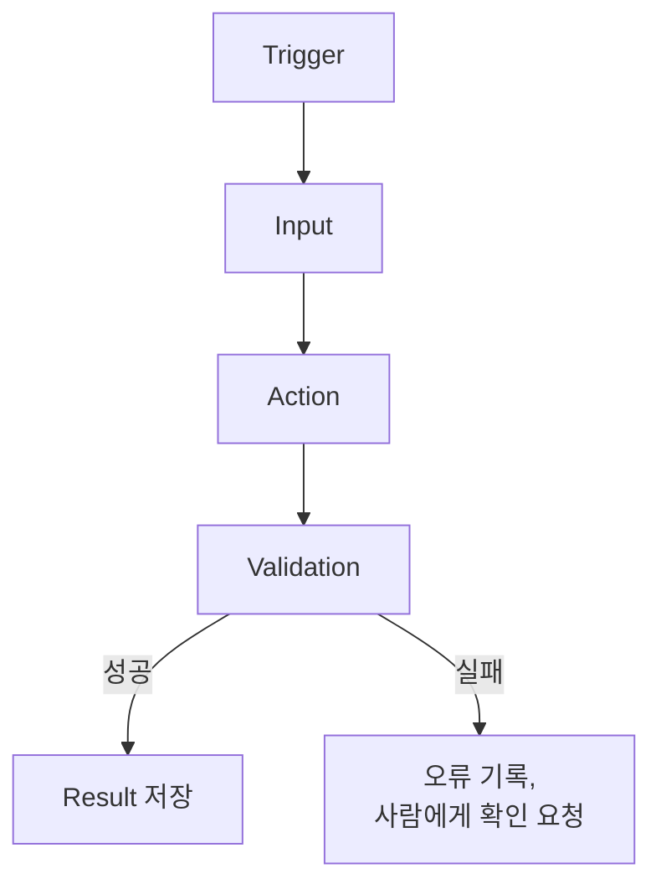

# Skill과 Automation

회의가 끝날 때마다 같은 형식으로 회의록을 정리해 달라고 하거나, 블로그 글을 쓸 때마다 같은 작성 규칙을 설명하고 있다면, 그 설명을 한 번만 써 두고 다시 쓸 수 있어요.

특정 작업을 하는 방법(절차, 규칙, 결과 형식, 검증 기준)을 묶어 두고 필요할 때 다시 불러 쓰는 것을 **Skill**이라고 해요. Skill의 내용은 `SKILL.md` 파일에 적어요. 정해진 시간이나 조건이 되면 작업이 저절로 실행되게 하는 것을 **Automation**이라고 해요.

이 문서를 따라 하면 다음을 할 수 있어요.

- 어떤 작업을 Skill로 만들면 좋을지 고를 수 있어요.
- `SKILL.md`를 직접 써서 Claude Code나 Codex에서 실행할 수 있어요.
- 같은 Skill을 서로 다른 자료에 적용하고, 결과를 비교해 Skill을 고칠 수 있어요.
- Skill을 언제 실행할지 정하는 Automation을 설계할 수 있어요.

<Callout tone="info" title="Skill은 방법이고, Automation은 시점이에요">

Skill은 작업을 **어떻게** 할지 정해요. Automation은 작업을 **언제** 실행할지 정해요. `SKILL.md`를 만들었다고 작업이 저절로 실행되지는 않아요.

</Callout>

## 준비하기

| 준비물 | 설명 |
| --- | --- |
| Claude Code 또는 Codex | 둘 중 하나만 골라 주세요. 이번 목표는 두 도구 비교가 아니라 Skill 하나를 만들어 여러 번 써 보는 거예요. |
| Agent 사용 경험 | 프로젝트 폴더를 열고 Agent에게 파일 작업을 맡겨 봤다면 충분해요. 처음이라면 [AI Agent](./ai-agent) 문서를 먼저 따라 해 주세요. |

## 1단계: Skill로 만들 작업 고르기

모든 작업을 Skill로 만들 필요는 없어요. 한 번만 하는 간단한 작업이라면 프롬프트로 요청하는 편이 빨라요. 다음 질문에 "네"가 많을수록 Skill로 만들기 좋은 작업이에요.

1. 이 작업을 여러 번 하나요?
2. 할 때마다 비슷한 규칙을 다시 설명하나요?
3. 결과물의 형식이 매번 같나요?
4. 결과를 확인할 기준이 있나요?
5. 입력 자료가 달라져도 같은 절차를 쓸 수 있나요?

이런 작업들이 Skill로 만들기 좋아요.

| 분야 | 반복 작업 |
| --- | --- |
| 동아리 운영 | 회의록에서 결정 사항과 후속 작업 정리하기 |
| 블로그 | 메모를 바탕으로 정해진 문체로 글쓰기 |
| 마케팅 | SNS 콘텐츠 초안 쓰기 |
| 기획 | 기획서를 정해진 기준으로 검토하기 |
| 개발 | 코드 변경 사항 검토하기 |
| 학습 | 학습 자료를 같은 형식으로 요약하기 |

Skill은 [Prompt Engineering](./prompt-engineering)과 [AI Agent](./ai-agent) 문서에서 다룬 프롬프트, 지침 파일과 역할이 달라요.

| 구분 | 담는 내용 | 예시 |
| --- | --- | --- |
| 프롬프트 | 이번 요청 | "input/meeting-02.md를 회의록 정리 Skill로 처리해 줘" |
| `AGENTS.md`, `CLAUDE.md` | 프로젝트 전체에서 늘 지킬 규칙 | 한국어로 쓰기, 원본 고치지 않기 |
| `SKILL.md` | 특정 작업을 하는 절차 | 회의록 읽기, 결정 사항 나누기, 후속 작업 정리, 검증의 순서 |

모든 절차를 `AGENTS.md`에 넣으면 지침이 길어져 Agent가 일부를 놓칠 수 있어요. 늘 지킬 규칙은 지침 파일에, 특정 작업의 절차는 Skill에 나눠 주세요. Skill은 그 작업을 할 때만 불러와져요.

## 2단계: 실습 폴더와 자료 만들기

이번에는 가상의 센터 안내 문서 두 개를 같은 형식으로 정리하는 `center-document-brief` Skill을 만들어요. 서로 다른 두 문서로 시험해야 Skill이 정말 다시 쓸 수 있는지 알 수 있어요.

쓰는 도구에 따라 Skill을 두는 폴더가 달라요.

| 도구 | Skill 위치 |
| --- | --- |
| Claude Code | `.claude/skills/center-document-brief/SKILL.md` |
| Codex | `.agents/skills/center-document-brief/SKILL.md` |

Claude Code를 쓴다면 폴더를 이렇게 만들어 주세요. Codex라면 `.claude/skills/` 대신 `.agents/skills/`를 만들면 돼요. `SKILL.md`는 3단계에서 써요.

```text
center-ai-practice/
├── AGENTS.md
├── CLAUDE.md
├── .claude/
│   └── skills/
│       └── center-document-brief/
│           └── SKILL.md
├── input/
│   ├── guide-01.md
│   └── guide-02.md
└── output/
```

`AGENTS.md`에는 프로젝트 전체 규칙을 적어요.

```md
# AGENTS.md

## Project

가상 안내 문서 분석 실습 프로젝트입니다.

## Rules

- 모든 결과물은 한국어로 작성합니다.
- input/ 폴더의 원본 파일은 수정하지 않습니다.
- 결과물은 output/ 폴더에 생성합니다.
- 원문에 없는 내용을 만들어내지 않습니다.
- 미확정 정보는 "확인 필요"로 표시합니다.
- 실제 센터 내부 자료는 사용하지 않습니다.

## Verification

- 원문과 결과를 비교합니다.
- 생성한 파일을 확인합니다.
- 누락된 내용과 오류를 보고합니다.
```

Claude Code를 쓴다면 `CLAUDE.md`에서 이 규칙을 불러와요. Codex만 쓴다면 `CLAUDE.md`는 만들지 않아도 돼요. 두 파일을 함께 두는 이유는 [AI Agent의 3단계](./ai-agent#3단계-claudemd에서-공통-규칙-불러오기)에서 알려 드려요.

```md
@AGENTS.md

## Claude Code

- 작업 전 관련 파일을 확인합니다.
- 결과 생성 후 변경된 파일을 보고합니다.
```

그다음 `input/` 폴더에 안내 문서 두 개를 만들어 주세요.

<details>
<summary>input/guide-01.md 내용 보기</summary>

```md
# 가상센터 시설 이용 안내

문서 ID: GUIDE-001
문서 버전: 1.0
작성일: 2026-11-01

## 목적

가상센터의 공용 공간을
안전하고 원활하게 이용하기 위한 안내입니다.

## 적용 대상

가상센터 프로그램 참여자

## 이용 시간

공용 학습 공간은
평일 오전 9시부터 오후 6시까지 이용할 수 있습니다.

## 이용 규칙

- 공간 사용 후 자리를 정리합니다.
- 개인 물품을 장시간 방치하지 않습니다.
- 시설 고장이나 문제가 발생하면 담당자에게 알립니다.

## 문의

시설 관리 담당자에게 문의합니다.

담당자 이름과 연락처는 별도로 기재되어 있지 않습니다.
```

</details>

<details>
<summary>input/guide-02.md 내용 보기</summary>

```md
# 가상센터 프로그램 참여 안내

문서 ID: GUIDE-002
문서 버전: 1.0
작성일: 2026-11-01

## 목적

가상센터의 교육 프로그램에
참여하는 방법을 안내합니다.

## 적용 대상

가상센터 프로그램 참여자

## 신청 방법

프로그램 신청은
담당자가 안내한 신청 양식으로 진행합니다.

## 신청 일정

신청 일정은
프로그램별 공지를 통해 안내합니다.

## 참여 규칙

- 신청한 프로그램의 일정을 확인합니다.
- 참여가 어려운 경우 담당자에게 미리 알립니다.
- 프로그램별 추가 안내 사항을 확인합니다.

## 문의

프로그램 운영 담당자에게 문의합니다.

구체적인 담당자 이름과 연락처는
본 문서에 포함되어 있지 않습니다.
```

</details>

<Callout tone="warning" title="모든 안내 내용은 가상의 예시예요">

이용 시간과 프로그램 규칙은 실제 센터의 공식 지침이 아니에요. 실습을 위해 만든 자료라서 실제 이용 규정으로 쓰면 안 돼요.

</Callout>

## 3단계: SKILL.md 쓰기

`SKILL.md`는 두 부분으로 이뤄져요.

| 부분 | 위치 | 내용 |
| --- | --- | --- |
| Frontmatter | 파일 맨 위 `---` 사이 | Skill의 이름(`name`)과 설명(`description`) |
| 본문 | Frontmatter 아래 | 작업 절차, 규칙, 결과 형식, 검증 기준 |

Agent는 평소에 Skill의 이름과 설명만 보고 있다가, 요청이 설명과 맞으면 그때 본문 전체를 읽어요.



그래서 `description`이 분명해야 필요한 순간에 Skill이 쓰여요. Codex에서는 `name`과 `description`이 모두 있어야 해요. Claude Code는 `name`이 없으면 폴더 이름을 쓰지만, 두 도구에서 함께 쓰려면 둘 다 적어 주세요.

`description`에는 무엇을 하는지, 언제 쓰는지, 무엇을 입력으로 받는지 적어 주세요.

```yaml
# 부족한 설명
description: 문서를 정리하는 Skill

# 고친 설명
description: 회의록 파일에서 결정 사항, 후속 작업, 담당자와 기한을 뽑아 표준 Markdown 회의 보고서로 정리합니다. 회의 요약이나 후속 작업 정리를 요청받았을 때 사용합니다.
```

이제 2단계에서 만든 Skill 폴더에 `SKILL.md`를 만들고 다음 내용을 넣어 주세요.

<details>
<summary>center-document-brief/SKILL.md 내용 보기</summary>

```md
---
name: center-document-brief
description: 가상 안내 문서를 읽고 문서 정보, 적용 대상, 주요 규칙, 일정, 문의 사항을 표준 Markdown 형식으로 정리합니다. 안내 문서 요약이나 구조화 요청에 사용합니다.
---

# Center Document Brief

## Goal

안내 문서에 포함된 핵심 정보를
일관된 Markdown 형식으로 정리합니다.

## Input

사용자가 지정한 Markdown 안내 문서입니다.

입력 경로가 없으면
처리할 파일을 먼저 확인합니다.

## Workflow

1. 입력 파일이 존재하는지 확인합니다.
2. 원본 문서를 읽습니다.
3. 문서 제목과 문서 ID를 확인합니다.
4. 문서 버전과 작성일을 확인합니다.
5. 적용 대상을 추출합니다.
6. 주요 규칙과 절차를 정리합니다.
7. 일정 또는 시간 정보를 추출합니다.
8. 문의 대상을 확인합니다.
9. 불명확한 정보를 구분합니다.
10. 결과를 원본과 비교해 검증합니다.

## Rules

- 원본 파일을 수정하지 않습니다.
- 원문에 없는 사실을 만들어내지 않습니다.
- 문서에 없는 값은 "확인 필요"로 표시합니다.
- 추측한 내용을 공식 규칙처럼 작성하지 않습니다.
- 서로 다른 문서의 내용을 임의로 합치지 않습니다.
- 개인 정보와 비공개 자료를 외부에 전송하지 않습니다.

## Output

결과 문서는 다음 항목을 포함합니다.

1. 문서 제목
2. 원본 파일 경로
3. 문서 ID
4. 문서 버전 및 작성일
5. 적용 대상
6. 주요 내용 요약
7. 핵심 규칙 또는 절차
8. 일정 및 시간
9. 문의 대상
10. 확인이 필요한 사항

## Save

결과는 output/ 폴더에 저장합니다.

파일 이름은 원본 이름에
-brief 접미사를 붙여 작성합니다.

예시:

input/guide-01.md
→ output/guide-01-brief.md

기존 결과 파일이 있으면
덮어쓰기 전에 사용자에게 확인합니다.

## Verification

결과를 저장한 후 다음 내용을 확인합니다.

- 원본과 내용이 일치하는가?
- 필수 항목이 누락되지 않았는가?
- 존재하지 않는 정보를 생성하지 않았는가?
- 원본 파일이 변경되지 않았는가?
- 결과 파일이 실제로 생성되었는가?

## Completion Report

다음 내용을 보고합니다.

1. 처리한 원본 파일
2. 생성한 결과 파일
3. 검증 결과
4. 확인이 필요한 사항
5. 처리하지 못한 작업
```

</details>

이 Skill에서 각 부분이 하는 일은 이래요.

| 부분 | 하는 일 |
| --- | --- |
| Workflow | 매번 같은 순서로 작업하게 해요. |
| Rules | 작업 중에 지킬 조건을 정해요. |
| Output, Save | 결과의 형식과 저장 위치를 통일해요. |
| Verification | 작업이 성공했는지 판단할 기준을 줘요. |
| Completion Report | 실제로 한 일과 하지 못한 일을 보고하게 해요. |

처음에는 `SKILL.md` 하나로 충분해요. 필요해지면 Skill 폴더에 참고 자료(`references/`), 출력 템플릿(`assets/`), 검증 스크립트(`scripts/`)를 더할 수 있어요.

## 4단계: Skill 실행하기

실습 폴더를 Claude Code나 Codex로 열고 다음과 같이 요청해요.

```text
center-document-brief Skill을 사용해서
input/guide-01.md 문서를 정리해 줘.

Skill에 정의된 절차와 프로젝트 공통 지침을 따라 줘.
결과 파일을 만들고 실제로 저장됐는지 확인해 줘.
```

Skill 이름을 직접 불러 실행할 수도 있어요. Claude Code에서는 `/center-document-brief`, Codex에서는 `$center-document-brief`를 입력해요. Codex는 `/skills`로 목록을 열어 고를 수도 있어요.

작업이 끝나면 다음을 확인해 주세요.

- [ ] Agent가 Skill을 불러왔나요?
- [ ] `input/guide-01.md`를 읽었나요?
- [ ] Skill의 Workflow 순서대로 작업했나요?
- [ ] `output/guide-01-brief.md`가 실제로 생겼나요?
- [ ] 원본 파일은 그대로인가요?
- [ ] Completion Report 형식으로 보고했나요?

Skill을 불러오지 못한다면 다음을 확인해 주세요.

- 실습 폴더에서 Agent를 열었나요?
- 폴더 경로가 도구에 맞나요? (Claude Code는 `.claude/skills/`, Codex는 `.agents/skills/`)
- 파일 이름이 정확히 `SKILL.md`인가요?
- Frontmatter가 파일 첫 줄의 `---`로 시작하나요?
- Claude Code는 Skill을 더하거나 고치면 다시 시작하지 않아도 바로 반영해요. Codex도 바뀐 것을 스스로 알아채지만, 새 Skill이 보이지 않으면 Codex를 다시 시작해 보세요.

## 5단계: 다른 문서에 같은 Skill 적용하기

Skill은 입력이 바뀌어도 같은 절차로 동작해야 쓸모가 있어요. 이번에는 Skill을 고치지 않고 입력 문서만 바꿔요.

```text
같은 center-document-brief Skill로 input/guide-02.md 문서를 처리해 줘.
첫 번째 문서와 같은 출력 구조를 써 줘.
원본에 없는 정보를 만들지 말고, 실제로 만든 파일을 확인해 줘.
```

이제 `output/` 폴더에 결과 파일이 두 개 있어야 해요.

```text
output/
├── guide-01-brief.md
└── guide-02-brief.md
```

두 결과를 원본과 비교해 주세요. 특히 원본에 값이 없는 칸을 Agent가 지어내지 않았는지 확인해야 해요.

| 항목 | guide-01에 들어가야 할 내용 | guide-02에 들어가야 할 내용 |
| --- | --- | --- |
| 문서 ID | GUIDE-001 | GUIDE-002 |
| 적용 대상 | 가상센터 프로그램 참여자 | 가상센터 프로그램 참여자 |
| 일정과 시간 | 공용 학습 공간: 평일 오전 9시~오후 6시 | "프로그램별 공지로 안내"까지만 적혀 있어요. 구체적인 날짜는 "확인 필요" |
| 절차 | 이용 규칙 3가지 | 담당자가 안내한 신청 양식으로 신청. 양식을 어디서 받는지는 "확인 필요" |
| 문의 | 시설 관리 담당자. 이름과 연락처는 "확인 필요" | 프로그램 운영 담당자. 이름과 연락처는 "확인 필요" |

guide-02는 일정과 신청 양식 정보가 비어 있어서, guide-01에서는 드러나지 않던 문제가 나타나기 쉬워요. 이런 문서로 시험해 봐야 Skill의 약점이 보여요.

다음 질문도 함께 생각해 보세요.

1. 두 문서를 같은 Skill로 처리할 수 있었나요?
2. 다시 설명하지 않아도 된 부분은 무엇인가요?
3. 두 결과의 형식이 같았나요?
4. 정보가 없는 칸을 어떻게 처리했나요?

## 6단계: Skill 고치기

두 번째 입력에서 이런 문제가 나타날 수 있어요.

- 일정이 없는데 날짜를 지어내요.
- 담당자가 없는데 임의로 정해요.
- 원문에 없는 신청 절차를 더해요.
- 중요한 예외 사항을 빠뜨려요.
- 두 문서를 하나의 결과로 합쳐요.

문제를 찾았다면 `SKILL.md`의 Rules나 Verification을 고쳐요. 고치기 전에 Agent에게 원인과 변경안을 먼저 물어보세요.

<details>
<summary>Skill 개선 프롬프트 보기</summary>

```text
center-document-brief Skill의 실행 결과를 검토해 줘.
두 입력 문서와 각각의 결과 파일을 비교해서 다음 문제를 찾아 줘.

1. 빠진 정보
2. 원본에 없는 정보
3. 잘못 해석한 내용
4. 두 결과의 형식 차이
5. 확인이 필요한 항목

문제의 원인을 설명하고, SKILL.md에서 고칠 부분을 제안해 줘.
파일을 바로 고치지 말고 먼저 변경안을 보여 줘.
```

</details>

Skill을 고친 뒤에는 두 문서로 다시 시험해 주세요. 한 문서에서 잘 동작했다고 다른 문서에서도 잘 동작한다는 보장은 없어요.



## 7단계: Automation 설계하기

지금까지는 사람이 직접 Skill을 실행했어요. 새 안내 문서가 들어올 때마다 사람이 확인하고 실행하는 대신, 정해진 조건이 되면 저절로 실행되게 하는 게 Automation이에요.

Automation 자체는 AI 없이도 만들 수 있어요. 정해진 시간에 파일을 백업하는 것도 Automation이에요. AI Agent를 쓰는 Automation에서는 문서 분석처럼 판단이 필요한 단계에 AI가 들어가요.

| 구분 | Skill | Automation |
| --- | --- | --- |
| 정하는 것 | 어떻게 할까? | 언제 실행할까? |
| 중심 요소 | 절차, 규칙, 검증 기준 | 실행 조건, 실행할 작업, 일정 |
| 담는 곳 | `SKILL.md` | 쓰는 도구의 설정 |
| 실행 | 사람이 부르거나 Agent가 골라요. | 조건이 되면 실행돼요. |

### 다섯 가지로 나눠 설계하기

Automation은 다음 다섯 가지로 나눠 설계해요.

| 요소 | 질문 | 예시 |
| --- | --- | --- |
| Trigger | 언제 시작할까요? | 정해진 시각, 새 파일 추가, 버튼 클릭 |
| Input | 무엇을 처리할까요? | 새로 추가된 안내 문서 |
| Action | 무엇을 할까요? | `center-document-brief` Skill 실행 |
| Validation | 결과가 맞나요? | 원문과 결과 비교, 오류 확인 |
| Result | 무엇을 남길까요? | 결과 문서, 실행 기록 |

다섯 가지는 이 순서로 이어지고, 검증에 실패하면 결과를 남기지 않고 사람에게 넘겨요.



실습 상황을 이 틀로 설계하면 이렇게 돼요.

| 항목 | 내용 |
| --- | --- |
| 이름 | 안내 문서 자동 정리 |
| Trigger | 새 안내 문서가 `input/`에 추가됨 |
| Input | 새로 추가된 Markdown 문서 |
| Action | `center-document-brief` Skill 실행 |
| Validation | 원문과 결과 비교 |
| Result | `output/`에 정리 문서 저장 |
| 사람의 승인 | 자료를 외부에 공개하기 전에 승인 |
| 실패 처리 | 오류를 기록하고 담당자에게 알림 |

실제로 운영할 Automation이라면 다음도 정해야 해요.

- 실행 권한
- 실패했을 때 다시 시도할지
- 같은 작업이 두 번 실행되지 않게 막는 방법
- 실행 기록
- 비용과 실행 횟수 제한
- 결과 알림
- 자동화를 잠시 멈추는 방법

### 예약 실행 해 보기 (선택)

예약 실행 기능을 쓸 수 있다면 간단한 Automation을 직접 만들어 볼 수 있어요. [Claude Code](https://code.claude.com/docs/ko/scheduled-tasks)와 [Codex](https://learn.chatgpt.com/docs/automations)에도 예약 작업 기능이 있고, GitHub Actions, n8n, Zapier, Make 같은 자동화 도구도 있어요. 도구마다 실행 환경, 연결 방식, 쓸 수 있는 요금제가 달라요.

특히 예약 작업이 어디에서 실행되는지 먼저 확인해 주세요. 실행 환경이 Skill 파일에 접근할 수 있어야 Skill을 쓸 수 있어요.

| 실행 위치 | 내 컴퓨터의 파일 | 확인할 것 |
| --- | --- | --- |
| 내 컴퓨터 | 읽을 수 있어요. | 실행할 때 컴퓨터가 켜져 있고, 도구가 요구하면 앱도 열려 있어야 해요. |
| 클라우드 | 읽지 못해요. | Skill과 자료를 GitHub 저장소에 올려 두어야 해요. |

예를 들어 매주 프로젝트 진행 상황을 정리하는 Automation은 이렇게 요청할 수 있어요.

<details>
<summary>주간 진행 상황 Automation 요청 보기</summary>

```text
[자동화 목표]
매주 정해진 시간에 프로젝트 진행 상황을 정리해 줘.

[Trigger]
매주 금요일 오후 5시

[Action]
접근할 수 있는 프로젝트 자료를 확인하고 진행 상황 보고서 초안을 작성해 줘.

[Output]
- 완료된 작업
- 진행 중인 작업
- 확인할 사항
- 다음 작업

[Constraints]
- 자료를 확인하지 못했다면 추측하지 마.
- 외부로 메시지를 보내지 마.
- 결과는 검토용 초안으로 남겨 줘.
```

</details>

<Callout tone="warning" title="예약했다고 작업이 끝난 건 아니에요">

실행 기록과 실제 결과물을 꼭 확인해 주세요. 실행이 성공으로 끝났다고 표시돼도 요청한 일을 다 했다는 뜻은 아니에요. 실습용으로 만든 예약 작업은 확인이 끝나면 멈추거나 지워 주세요. 외부 문서를 고치거나 메시지를 보내는 작업은 승인 단계를 함께 두세요.

</Callout>

## 안전하게 쓰기

Skill과 Automation은 같은 작업을 여러 번 실행하기 때문에, 잘못된 결과도 여러 번 만들어질 수 있어요. 다음을 확인해 주세요.

- [ ] Skill 하나에 너무 많은 작업을 넣지 않았나요? 목적이 분명한 작업 단위로 나눠 주세요.
- [ ] `description`이 분명한가요? 모호하면 필요 없는 상황에서도 Skill이 쓰여요.
- [ ] 입력과 출력이 분명한가요?
- [ ] 입력 파일이 없거나 읽을 수 없을 때 할 일을 정했나요?
- [ ] 결과 파일이 있는지만이 아니라 내용이 맞는지 확인하는 기준을 넣었나요?
- [ ] 수동 실행에서 안정적으로 동작하는 걸 확인한 뒤에 자동화했나요?

<Callout tone="warning" title="다른 사람이 만든 Skill은 내용을 먼저 읽어 보세요">

외부에서 받은 Skill에는 파일 접근, 명령 실행, 정보 전송 같은 지시나 스크립트가 들어 있을 수 있어요. 쓰기 전에 `SKILL.md`와 함께 들어 있는 파일을 모두 읽고, 필요한 권한을 확인해 주세요. 권한과 승인을 정하는 방법은 [AI Agent의 안전하게 맡기기](./ai-agent#안전하게-맡기기)에서 알려 드려요.

</Callout>

## AI Log에 기록하기

결과를 [AI Log](../logs/new)에 남겨 주세요. 이번에는 **어떤 작업을 Skill로 정의했고, 여러 입력으로 어떻게 검증하고 고쳤는지**를 적는 게 중요해요.

`SKILL.md`에서 고친 줄은 AI Log 본문에 코드 블록으로 붙이면 다른 구성원이 무엇이 바뀌었는지 바로 볼 수 있어요. 방법은 [AI Club OS 시작하기의 Markdown으로 꾸미기](./getting-started#markdown으로-꾸미기)에서 알려 드려요.

<details>
<summary>AI Log 작성 예시 보기</summary>

```text
제목
안내 문서 정리 Skill을 두 문서로 시험하고 고치기

사용한 도구
Claude Code

시도한 내용
center-document-brief Skill을 만들어 guide-01.md와 guide-02.md에 차례로 적용했다.
Skill은 고치지 않고 입력 문서만 바꿨다.
input/에 새 문서가 들어오면 이 Skill을 실행하는 Automation도 설계했다.
(Trigger: 새 문서 추가, Validation: 원문 대조, 사람의 승인: 외부 공개 전)

결과
guide-01: 모든 항목이 원본과 일치했다.
guide-02: 신청 일정을 "매월 1일"로 지어냈다.
Rules에 "날짜가 원문에 없으면 원문 문구를 그대로 옮기고 '확인 필요'를 붙인다"를 더한 뒤 다시 시험해서 고쳐졌다.

배운 점
정보가 잘 갖춰진 문서로만 시험하면 Skill의 약점이 보이지 않는다.

다음 행동
매주 금요일에 새 문서를 모아 정리하는 예약 작업을 만들어 본다.
```

</details>

## 자주 묻는 질문

<details>
<summary>Skill은 프롬프트를 파일로 저장한 건가요?</summary>

가장 단순한 Skill은 다시 쓸 지침을 Markdown 파일로 적은 거라서 비슷해 보여요. 다만 Skill에는 참고 자료, 템플릿, 스크립트를 함께 넣을 수 있고, 요청이 설명과 맞으면 Agent가 스스로 골라 쓴다는 점이 달라요.

</details>

<details>
<summary>SKILL.md를 만들면 저절로 실행되나요?</summary>

아니에요. `SKILL.md`는 작업하는 방법을 정해 둔 파일이에요. 사용자가 직접 부르거나, 요청이 Skill 설명과 맞을 때 Agent가 골라 쓰는 거예요. 정해진 시간이나 조건에 실행하려면 예약 실행 같은 별도 기능이 필요해요.

</details>

<details>
<summary>Skill과 AGENTS.md는 무엇이 다른가요?</summary>

`AGENTS.md`는 프로젝트 전체에서 늘 지킬 규칙이고, `SKILL.md`는 특정 작업의 절차예요. 둘을 함께 쓸 수 있어요. 지침 파일은 대화를 시작할 때 늘 읽히고, Skill은 그 작업을 할 때만 불러와져요.

</details>

<details>
<summary>Skill을 쓰려면 코딩을 해야 하나요?</summary>

아니에요. `SKILL.md`에 작업 절차만 적어도 기본적인 Skill이 돼요. 복잡한 처리나 검증 스크립트를 넣고 싶을 때만 프로그래밍이 필요해요.

</details>

<details>
<summary>Claude Code용 Skill을 Codex에서도 쓸 수 있나요?</summary>

두 도구 모두 [Agent Skills](https://agentskills.io)라는 같은 `SKILL.md` 형식을 써서 내용은 대부분 그대로 쓸 수 있어요. 하지만 Skill을 찾는 폴더가 달라요. Claude Code는 `.claude/skills/`, Codex는 `.agents/skills/`에서 찾아요. 두 도구에서 모두 쓰려면 양쪽 폴더에 두고, 각각 실제로 불러와지는지 확인해 주세요. 한쪽 도구에만 있는 Frontmatter 항목은 다른 도구에서 동작하지 않을 수 있어요.

</details>

<details>
<summary>Skill이 있으면 자동화 도구는 필요 없나요?</summary>

사람이 직접 실행한다면 필요 없어요. 정해진 시간이나 조건에 저절로 실행하려면 그 기능을 지원하는 도구나 실행 환경이 필요해요.

</details>

<details>
<summary>자동화하면 사람이 확인하지 않아도 되나요?</summary>

아니에요. 자동으로 실행해도 결과 검증과 중요한 작업의 승인은 필요해요. 외부 게시, 데이터 수정, 개인정보 처리, 비용이 드는 작업은 특히 사람이 확인해 주세요.

</details>

## 더 알아보기

다음 문서에서 더 자세히 볼 수 있어요. 쓸 수 있는 기능과 설정 방법은 제품과 실행 환경에 따라 달라지니 최신 내용은 공식 문서에서 확인해 주세요.

| 문서 | 내용 |
| --- | --- |
| [AI Agent](./ai-agent) | Agent에게 파일 작업을 맡기고 검증하는 방법, `AGENTS.md`와 `CLAUDE.md`에 넣을 규칙 |
| [Claude Code: Skills](https://code.claude.com/docs/ko/skills) | Skill을 두는 위치, Frontmatter 항목, 직접 부르는 방법 |
| [Codex: Build skills](https://learn.chatgpt.com/docs/build-skills) | Codex가 Skill을 찾는 폴더, 꼭 적을 항목, 직접 부르는 방법 (영어) |
| [Agent Skills](https://agentskills.io) | 여러 Agent 도구가 함께 쓰는 Skill 형식의 표준 (영어) |
| [Claude Code: 예약 작업](https://code.claude.com/docs/ko/scheduled-tasks) | 클라우드, 데스크톱, 세션 안의 예약 작업 비교 |
| [Codex: Scheduled tasks](https://learn.chatgpt.com/docs/automations) | Codex의 예약 작업과 실행 위치 (영어) |
| [Claude Code: 보안](https://code.claude.com/docs/ko/security) | 권한 설정, 샌드박스, Prompt Injection 막기 |
| [Codex: 승인과 보안](https://learn.chatgpt.com/docs/agent-approvals-security) | 승인 정책, 샌드박스, Prompt Injection 위험 (영어) |
